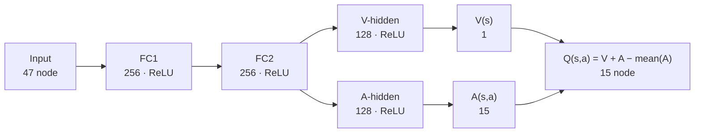

> [!warning] Dibersihkan 2026-11-07 (aturan ver-1-6)
> Bagian "Status implementasi" (riwayat latih dan hasil evaluasi lama) dihapus. Yang tersisa adalah rancangan awal (2026-09-30) dan masih memuat keputusan lama: satu model, aksi SAMBUNG, demonstrator w = 1,3. Aturan yang berlaku sekarang (branch `ver-1-6`):
> - **Hybrid A\* + RS (`astar`):** w = 2,0, h = max(h_RS, h_D), tembakan RS dicoba setiap ekspansi ke-4.
> - **DQfD:** hanya model jauh, dilatih dari demo Hybrid A\* dengan w = 2,0, dan pencarian DQfD juga w = 2,0. Tembakan RS dicoba bila < 60 cm dari tujuan dan tidak ada halangan. Tidak ada model dekat.
> - **Pelatihan:** gradien dengan PyTorch, forward dengan NumPy, 32 sinar dengan Numba.

Tujuan: menggantikan fungsi **Hybrid A\*** (`forklift_planner.HybridAStarPlanner`) saat operasional dengan **DQfD** (*Deep Q-learning from Demonstrations*, Hester dkk. 2018), yang belajar dari Hybrid A\* sebagai demonstrator. Satu DQN per robot, karena batas kemudi ID 01 dan ID 02 berbeda.

- DQfD **hanya** menggantikan perencana jalur. Pelacak tetap **pure pursuit** (`jejak.py`), tidak berubah.

> [!note] Istilah
> Di seluruh catatan ini dan di keluaran program, **"A\*" adalah singkatan untuk Hybrid A\*** (`HybridAStarPlanner`, expert/demonstrator): "A\* (cadangan)", "A\* 2 s", "rasio biaya DQfD/A\*", "setuju dengan A\*". A\* biasa (grid, tanpa heading) tidak dipakai sebagai expert. Ia hanya muncul sebagai **heuristik Dijkstra holonomik** di dalam Hybrid A\*, yang juga menjadi input jaringan 42–44 dan panel "heuristik Dijkstra" di dasbor.
- Simulasi dijalankan untuk robot ID 01 dan ID 02, dan proses belajar neuronnya harus bisa dilihat.

---

## Usulan Claude (2026-09-30)

> Hasil membaca `forklift_planner.py`, `rencana.py`, `jejak.py`, `konfig.py`, `pose.SumberSimulasi`, dan `navigasi.py`. `forklift_planner.py` tidak diubah (README: "salinan v1, jangan diubah"). Hybrid A\* tetap dipakai sebagai demonstrator, cadangan, dan pembanding.

### 1. Posisi di dalam sistem

```
                         ┌─ sekarang: HybridAStarPlanner.plan()   (pencarian, s.d. 1,3 s di Rumah)
Perencana._sekali() ─────┤
  (rencana.py)           └─ baru:     DQfDPlanner.plan()          (rollout jaringan, ±puluhan ms)
                                  │
                                  ▼  daftar (gx, gy, yaw, arah) dalam SEL — format SAMA
                         jejak.buat("pursuit") → PathTracker       (tidak berubah)
                                  │
                         wasit.py, pemantau zona, robot.py         (tidak berubah)
```

Satu-satunya titik sambung adalah `rencana.buat_perencana()`. `DQfDPlanner` meniru antarmuka `HybridAStarPlanner`:

| Anggota | Dipakai oleh |
|---|---|
| `plan(omap, start, goal)` → list `(x, y, yaw, arah)` atau `None` | `Perencana._sekali()` |
| `last_stats` (`expansions`, `time`, `reason`) | `Perencana.rencanakan()` |
| `time_limit` | percobaan heading bebas di `_sekali()` (diperkecil ke 0,4 s) |
| `.v` (VehicleModel) | pemeriksaan pose |

Dengan antarmuka ini, semua pemakai `Perencana` tetap bekerja apa adanya: margin cadangan (8 lalu 6 cm), heading tujuan bebas, robot lain sebagai rintangan (`peta_dengan`), pencarian minggir di `navigasi.py`, dan bayangan wasit (`sisa_jalur()` dari pelacak).

Model dipilih dari `profil.id`: `model_dqn/id01.pt` atau `model_dqn/id02.pt`.

### 2. Satu DQN per robot

| | ID 01 | ID 02 |
|---|---|---|
| `max_steer_deg` | 35,0° | **22,0°** sejak perbaikan mekanisme 2026-09-30 (semula 23,5°) |
| R minimum | 32,1 cm | **55,7 cm** (semula 51,7) |
| Kemudi rencana (× `PLAN_STEER_RATIO` 0,75) | 26,3° | 16,5° (semula 17,6°) |
| R rencana | 45,6 cm | **76,0 cm** (semula 70,8) |

Di `Rumah`, titik terlapang hanya 34 cm. ID 02 akan lebih sering butuh manuver maju-mundur, dan sebagian tujuan tidak tercapai sama sekali. Jadi kebijakan ID 01 tidak bisa dipakai begitu saja untuk ID 02. Bobot ID 01 boleh dijadikan titik awal pelatihan ID 02 (*transfer learning*), tapi itu diuji sebagai eksperimen, bukan anggapan.

### 3. MDP: kinematik dan deterministik

Ruang keadaannya sama dengan ruang pencarian Hybrid A\*. Jeda kemudi, ramp gas, dan latensi kamera **tidak** masuk ke pelatihan karena itu urusan pelacak. Hasilnya lingkungan yang murah, cukup numpy, dan bisa menjalankan jutaan langkah.

#### Aksi: 14 primitif Hybrid A\* + SAMBUNG

| Aksi | Isi | Setara di `forklift_planner.py` |
|---|---|---|
| 0–13 | κ ∈ 7 tingkat × {maju, mundur}, panjang 7,3 cm (4 sub-titik) | `self.kappas` × `self.dirs`, `step`, `n_sub` |
| 14 | **SAMBUNG**: tembakan Reeds-Shepp bebas-tabrakan ke tujuan, lalu episode selesai | `_analytic()` / `_best_free_rs()` |

SAMBUNG dipelajari, bukan aturan tetap, karena dua alasan:

- Primitif diskret hampir tidak pernah mendarat tepat di toleransi tujuan (3,2 cm, 12°).
- Hybrid A\* menerima RS hanya ketika simpulnya memang terbaik. Aturan "terima RS bebas pertama" menghasilkan busur panjang yang jelek.

**Masking** (Q = −∞ sebelum argmax):
- primitif yang badannya menyentuh zona di salah satu sub-titiknya (`pose_margin ≤ 0`, sama dengan ekspansi A\*),
- primitif yang menuju sel yang sudah dikunjungi (`_key`, setara *closed set*), supaya rollout tidak berputar-putar,
- SAMBUNG bila tidak ada RS yang bebas.

#### Reward: minus biaya Hybrid A\*, persis

```
r(primitif) = −[ step·(1 atau reverse_cost)
               + steer_cost·step·|κ|/κmax
               + steer_change_cost·|κ − κ_sebelum|/κmax
               + switch_cost·[ganti arah]
               + clearance_penalty(margin_min) ]
r(SAMBUNG)  = −_rs_cost(...) − penalti clearance sepanjang RS        (terminal)
buntu (semua aksi ter-mask) / > 300 primitif = −B                     (terminal)
γ = 0,995
```

Karena reward sama persis dengan biaya A\*, **Q(s,a) = −biaya-sisa ke tujuan**. Akibatnya:
1. Loss TD dan loss imitasi mengejar hal yang sama, jadi tidak saling tarik.
2. Kualitas jalur DQfD bisa dibandingkan langsung dengan A\* sebagai **rasio biaya**. Demonstrator memakai `h_weight = 1,3` dan batas waktu, jadi jalurnya belum tentu optimal. DQfD bisa **melampaui** gurunya, dan itu terukur.

#### Observasi

Rinciannya di bagian 7 (47 input). Garis besarnya: tujuan dalam kerangka robot, primitif sebelumnya, 32 sinar virtual ke `omap.dist`, heuristik holonomik (Dijkstra), dan margin.

Sinar dipakai, bukan peta yang dihafal, karena robot lain dan rintangan sementara hanya muncul di `omap`, dan sinar bisa melihatnya.

### 4. Demonstrasi dari Hybrid A\*

Karena dinamikanya deterministik, aksi demonstrator **bisa direkonstruksi tepat** dari jalur A\*:
- setiap 4 sub-titik = satu primitif; κ = Δyaw/Δs dibulatkan ke tingkat terdekat, arah dari kolom `arah`;
- ekor RS di ujung jalur = satu aksi SAMBUNG.

**Uji penerimaan:**
- aksi hasil ekstraksi yang diputar ulang menghasilkan jalur yang sama dalam < 0,01 sel;
- jumlah reward = g-cost A\* sampai 1e-6.

**Skenario:** `Kalibrasi`, `Rumah2`, `Rumah`, ditambah peta prosedural acak dan badan robot acak sebagai rintangan. Start/tujuan disaring dengan `Perencana.margin_untuk_pose`, dan ±30% tujuan diberi heading bebas. Targetnya ±5.000 episode per robot, dibuat paralel memakai 16 inti CPU.

Skenario yang gagal diselesaikan A\* (lebih sering di ID 02) disimpan sebagai **set uji negatif**: DQfD harus ikut mengembalikan `None` dengan cepat, bukan memaksakan jalur. Terukur di tahap 1–2, kegagalan A\* di `Rumah` seluruhnya "tidak ada jalur" (ruang pencarian habis), bukan batas waktu. Lihat bagian Status.

### 5. Algoritma DQfD

- Dueling Double DQN (susunan di bagian 7).
- Loss: `J = J_DQ(1-langkah) + λ₁·J_n(n=10) + λ₂·J_E + λ₃·L2`
  - `J_E = max_a[Q(s,a) + l(a_E,a)] − Q(s,a_E)`, margin `l = 0,8`, **hanya** pada sampel demo.
- *Prioritized replay*. Data demo disimpan permanen dan mendapat bonus prioritas ε_d.
- **Fase A, pra-latih:** hanya data demo, ±50–100 ribu langkah gradien.
- **Fase B, latihan sendiri:** ε kecil (0,01–0,1), data demo tetap dicampur. Kurikulumnya `Kalibrasi` → `Rumah2` → `Rumah`, rute pendek → panjang.

#### 5.1 Arti ketiga komponen loss

**Q(s, a)** adalah perkiraan jaringan tentang **biaya-sisa ke tujuan** (÷100, bertanda negatif) bila dari keadaan s ia memilih aksi a lalu melanjutkan dengan baik. Biayanya sama dengan biaya Hybrid A\*: panjang, mundur, ganti arah, belokan, dan kedekatan ke zona.

| Komponen | Rumus | Yang dijaga | Keterangan |
|---|---|---|---|
| **J_DQ** (TD 1 langkah, Double DQN) | galat `Q(s,a) − [r + γ·Q_target(s', a*)]`, dengan `a*` = argmax jaringan online di s' | **Konsistensi** perkiraan dari langkah ke langkah: biaya dari sini = biaya satu primitif + biaya-sisa dari tempat berikutnya | Sumber peta nilai di dasbor |
| **J_n** (TD 10 langkah) | galat `Q(s,a) − [r₁ + γr₂ + … + γ⁹r₁₀ + γ¹⁰·Q_target(s₁₀, a*)]` | Sama, tetapi biaya 10 langkah **nyata** dijumlahkan dulu | Informasi "rute ini mahal" merambat 10× lebih cepat. Penting di Rumah (20–100 langkah per rute). **Bias** pada data eksplorasi, karena 10 aksi itu termasuk aksi acak ε |
| **J_E** (large-margin, hanya data demo) | `max_a[Q(s,a) + l(a_E,a)] − Q(s,a_E)`, `l = 0,8` bila a ≠ aksi A\*, 0 bila sama | **Meniru A\***: Q aksi A\* harus lebih baik minimal 0,8 (setara biaya 80) dari semua aksi sah lain | J_DQ dan J_n hanya memeriksa konsistensi, J_E yang memberi tahu jalan mana yang benar. Tidak bisa nol karena A\* sering punya beberapa aksi setara; itu juga sebab % setuju berhenti di ±70% |

**Membaca grafik loss di dasbor** (biru J_DQ, hijau J_n, oranye J_E):

- J_E turun cepat lalu melandai: jaringan makin meniru A\*, dan melandai karena ada aksi setara.
- J_E turun lagi di fase latihan sendiri: porsi data demo per batch mengecil, bukan berarti peniruannya makin baik.
- J_DQ kecil dan datar: perkiraan biayanya konsisten.
- **J_n naik terus di fase latihan sendiri** (putaran 1): target 10 langkah dari data eksplorasi bias, sehingga jaringan mengejar target yang bergeser. Karena itu di putaran 2 bobot J_n fase B diturunkan (1 → 0,5) dan learning rate diperkecil (1e-4 → 5e-5).

Analogi belajar menyetir: J_E = instruktur yang bilang "belok di sini"; J_DQ = memeriksa perkiraan "tinggal 5 menit lagi" masuk akal dari detik ke detik; J_n = melihat 10 tikungan ke depan untuk menilai apakah jalan ini memang lebih jauh.

**Saat operasional** (`DQfDPlanner.plan`, sebagaimana dibuat di tahap 9):
1. Hitung heuristik Dijkstra sekali (`reset()` lingkungan).
2. Rollout greedy dengan masking sampai SAMBUNG atau tiba.
3. **Pencarian terbaik-dulu** berpandu Q (f = g + c + 2·h, anggaran 1.200 langkah; lihat bagian "Pencarian terbaik-dulu"). Sebelumnya: *mundur* (DFS, kembali ke aksi Q terbaik berikutnya saat buntu), yang menggantikan rencana awal *beam search*. Mundur masih ada di kode sebagai pembanding.
4. **Gerbang mutu** (mode `dqfd`): jalur ditolak bila biayanya > 1,3 × perkiraan jaringan sendiri −V(s₀).
5. Gagal atau ditolak: jatuh ke Hybrid A\* (mode `dqfd`), atau kembalikan `None` (mode `dqfd-murni`). Tercatat di `last_stats["perencana"]`.

### 6. Visualisasi neuron (tingkat perencanaan)

```
┌───────────────────────────────┬──────────────────────────────┐
│ Arena: rollout langkah demi   │ Q 15 aksi (bar): dipilih,    │
│ langkah, kipas 14 primitif    │ pilihan A*, ter-mask (abu)   │
│ diwarnai Q; jalur A* sbg hantu│                              │
├───────────────────────────────┼──────────────────────────────┤
│ Aktivasi FC1 (16×16)          │ Aktivasi FC2 (16×16)         │
│                               │ + V(s) dan A(s,a)            │
├───────────────────────────────┼──────────────────────────────┤
│ Biaya-sisa HASIL BELAJAR      │ Kurva: J_DQ, J_E, % tiba,    │
│  −V(x,y | θ, tujuan)          │ rasio biaya DQfD/A*,         │
│ di samping heuristik Dijkstra │ % setuju dgn A*, neuron mati │
└───────────────────────────────┴──────────────────────────────┘
```

- **Peta biaya-sisa** adalah panel yang paling bermakna. Heuristik Dijkstra tidak tahu kendala kemudi. Peta hasil belajar seharusnya menunjukkan bahwa tujuan di **belakang** robot itu mahal (butuh manuver maju-mundur), dan bahwa peta ID 02 lebih mahal di tikungan dibanding ID 01.
- **Saliensi** (∂Q/∂input) memperlihatkan sinar mana yang diperhatikan jaringan.
- **Heatmap bobot FC1** memperlihatkan input mana yang dibaca oleh tiap neuron.
- Semua checkpoint disimpan supaya perkembangan neuron bisa diputar ulang dari awal pra-latih sampai akhir.

---

### 7. Susunan neuron

Arsitekturnya sama untuk ID 01 dan ID 02, bobotnya terpisah.

**Ringkasan: 47 node input → 4 lapis tersembunyi (2 bersama + 1 per cabang dueling), 768 neuron → 15 node output. Parameter: 145.936 per robot.**



```
             INPUT                LAPIS BERSAMA                 CABANG DUELING              OUTPUT
                                                          ┌─► V-hidden 128 ─► V(s)  1 ─┐
  47 node ─► FC1 256 (ReLU) ─► FC2 256 (ReLU) ─┤                                         ├─► Q(s,a) 15
                                                          └─► A-hidden 128 ─► A(s,a) 15┘
                                                               Q = V + A − rata-rata(A)
```

#### 7.1 Lapis input: 47 node

Semua nilai dinormalisasi ke kira-kira [−1, 1] atau [0, 1].

| Indeks | Jml | Kelompok | Isi | Skala |
|---|---|---|---|---|
| 0–1 | 2 | Tujuan | dx, dy tujuan dalam kerangka robot | ÷ 300 cm |
| 2 | 1 | | jarak lurus ke tujuan | ÷ 300 cm |
| 3–4 | 2 | | cos, sin (heading tujuan − heading robot) | — |
| 5 | 1 | | penanda heading bebas (1 = bebas) | 0/1 |
| 6–7 | 2 | | pendekatan lurus maju / mundur layak (`_feasible_approach_dirs`) | 0/1 |
| 8 | 1 | Primitif sebelumnya | arah d (−1 mundur, 0 awal, +1 maju) | — |
| 9 | 1 | | κ sebelumnya / κmax | −1…+1 |
| 10–41 | **32** | Sinar virtual | jarak bebas dari tepi badan, tiap 11,25° mengelilingi robot | ÷ 100 cm |
| 42 | 1 | Heuristik Dijkstra | biaya holonomik ke tujuan (`_holonomic_heuristic`) | ÷ 300 cm |
| 43–44 | 2 | | cos, sin arah gradien heuristik (kerangka robot) | — |
| 45 | 1 | Margin | margin yang sedang dipakai (8 atau 6 cm) | ÷ 8 cm |
| 46 | 1 | | jarak bebas badan saat ini (`pose_margin`) | ÷ 20 cm |

- **Input 8–9** diperlukan karena `steer_change_cost` dan `switch_cost` bergantung pada primitif sebelumnya. Tanpa keduanya keadaannya tidak Markov.
- **Input 42–44** memberi tahu jaringan arah keluar dari labirin. Sinar sepanjang 100 cm tidak bisa melihat pintu koridor di balik tembok.

#### 7.2 Lapis tersembunyi: 768 neuron

| Lapis | Neuron | Aktivasi | Parameter (bobot + bias) |
|---|---|---|---|
| FC1 (bersama) | 256 | ReLU | 47×256 + 256 = **12.288** |
| FC2 (bersama) | 256 | ReLU | 256×256 + 256 = **65.792** |
| V-hidden (cabang nilai) | 128 | ReLU | 256×128 + 128 = **32.896** |
| A-hidden (cabang keuntungan) | 128 | ReLU | 256×128 + 128 = **32.896** |

- **Dueling.** Di koridor lapang hampir semua aksi sama baiknya, dan yang penting hanya "seberapa jauh lagi", yaitu V(s). A(s,a) baru berperan di celah sempit dan titik ganti arah. Memisahkan keduanya membuat pembelajaran lebih stabil.
- **256 neuron** cukup untuk memetakan 47 input ke fungsi biaya A\* (tembok, ganti arah, clearance). Selain itu 256 = 16×16, jadi mudah ditampilkan sebagai kotak di dasbor. Varian 128–128 bisa dicoba kalau jaringan yang lebih kecil sudah cukup.
- **Tanpa BatchNorm**, karena statistik batch di RL terus bergeser dan merusak target TD.

#### 7.3 Lapis output: 15 node

V (1 node, 129 parameter) dan A (15 node, 1.935 parameter) digabung menjadi **15 nilai Q**, dalam satuan **minus biaya-sisa ke tujuan** (sama dengan g-cost Hybrid A\*).

| Node | Arah | κ / κmax | ID 01: δ / R | ID 02: δ / R |
|---|---|---|---|---|
| 0 | maju | −1 | −26,3° / 45,6 cm | −17,6° / 70,8 cm |
| 1 | maju | −⅔ | −18,2° / 68,4 cm | −12,0° / 106,2 cm |
| 2 | maju | −⅓ | −9,3° / 136,9 cm | −6,1° / 212,5 cm |
| 3 | maju | 0 | lurus | lurus |
| 4–6 | maju | +⅓, +⅔, +1 | cermin dari 2, 1, 0 | cermin dari 2, 1, 0 |
| 7–13 | mundur | −1 … +1 | sama seperti 0–6, arah mundur | sama seperti 0–6, arah mundur |
| 14 | **SAMBUNG** | — | tembakan Reeds-Shepp ke tujuan | tembakan Reeds-Shepp ke tujuan |

Panjang tiap primitif 7,3 cm. κ tersebar linear, `κ_i = κmax·(2i/6 − 1)`, dengan `κmax = tan(max_steer × 0,75) / L` milik robot masing-masing. Karena itu **node 0 pada ID 02 berarti belokan 1,55× lebih lebar** daripada node 0 pada ID 01. Indeksnya sama, tapi maknanya berbeda secara fisik, dan itulah sebabnya bobotnya terpisah.

#### 7.4 Ukuran total

| | Nilai |
|---|---|
| Neuron tersembunyi | 256 + 256 + 128 + 128 = **768** |
| Neuron output berparameter | 1 + 15 = 16 |
| Parameter per jaringan | **145.936** (±0,6 MB float32) |
| Per robot | jaringan online + jaringan target (salinan) |
| Operasi per keputusan | ±146 ribu perkalian, sekitar puluhan µs di CPU |

Satu forward pass menghasilkan Q untuk ke-15 aksi sekaligus. Satu jalur di `Rumah` (±100 primitif) hanya butuh beberapa milidetik waktu jaringan. Sisa waktu `plan()` dipakai untuk pemeriksaan tabrakan, sama dengan Hybrid A\*.

#### 7.5 Kenapa output diskret, bukan derajat steering

> [!note] Keputusan 2026-09-30
> Tetap **7 tingkat kemudi** (14 primitif + SAMBUNG = 15 output), sama dengan `n_steer = 7` Hybrid A\*.

**1. Output DQN adalah nilai, bukan perintah.** Setiap node berisi Q(s,a), yaitu "seberapa baik aksi ini", bukan "berapa derajat". Aksi dipilih lewat `argmax` atas 15 node. Untuk sudut kontinu, `argmax` harus dicari di tak hingga banyak kemungkinan, dan DQN tidak punya cara untuk itu. Output sudut langsung berarti berganti ke keluarga *actor-critic* (DDPG, TD3, SAC; versi demonstrasinya DDPGfD). Akibatnya:
- itu bukan DQfD lagi, karena loss *large-margin* `J_E`, yang membuat imitasi dari A\* efektif, hanya terdefinisi untuk aksi diskret;
- masking tabrakan jadi sulit: sekarang cukup Q = −∞ untuk primitif yang menabrak, sedangkan pada aksi kontinu rentang sudut yang aman harus dicari dulu;
- pelatihannya kurang stabil, karena ada dua jaringan yang saling mengejar.

**2. Tiap node sudah mewakili satu sudut.** Lihat tabel 7.3. Di dalam jaringan nilainya ditulis sebagai κ/κmax (−1 … +1) supaya arsitektur kedua robot sama. Konversi ke derajat, `δ = atan(κ·L)`, dilakukan di luar jaringan memakai `konfig.profil(id)`, dan hasilnya dipakai sebagai label node di dasbor. Tingkatnya rata dalam κ, bukan dalam derajat: 9,3° / 18,2° / 26,3° pada ID 01.

**3. Derajat ini bukan perintah ke servo.** Sudut di output DQfD adalah kelengkungan **jalur rencana**. Sudut yang dikirim ke servo tetap dihitung **pure pursuit** di 20 Hz, dan hasilnya kontinu. Karena itu pula `PLAN_STEER_RATIO = 0,75`: perencana hanya memakai 75% kemudi, dan 25% sisanya disediakan untuk koreksi pelacak. Pembagiannya sama dengan Hybrid A\* sekarang: perencana diskret, pelacak kontinu.

**Pilihan yang dipertimbangkan:**

| Pilihan | Untung | Rugi |
|---|---|---|
| **Tetap 7 tingkat** (dipilih) | Label demo tepat 1:1 dengan A\*, uji "biaya = g-cost" bisa dipakai | Resolusi ±9° (ID 01), ±6° (ID 02) |
| Tambah tingkat, mis. 11 atau 15 (output 23 atau 31) | Jalur lebih halus, masih DQfD | A\* hanya memakai 7 tingkat, jadi tingkat baru tidak punya label demo dan hanya bisa dipelajari lewat latihan sendiri. Demonstrator juga harus dijalankan ulang dengan `n_steer` baru supaya sebanding |
| Aksi hibrida (P-DQN): arah diskret + sudut kontinu | Sudut bebas | Algoritma lain, masking dan imitasi jadi rumit |
| Actor-critic (TD3/SAC + demo) | Kontinu penuh | Bukan DQfD, kurang stabil, masking sulit |

Kalau evaluasi tahap 8 menunjukkan jalurnya terlalu kasar, langkah berikutnya yang paling murah adalah menaikkan `n_steer` (demonstrator dan DQfD sama-sama).

---

### 8. Tahapan pengerjaan

| #   | Tahap                                                                                                              | Kriteria lulus                                                          | Status (2026-09-30) |
| --- | ------------------------------------------------------------------------------------------------------------------ | ----------------------------------------------------------------------- | --- |
| 0   | Pasang PyTorch (Python 3.14, CUDA 12.8+ untuk RTX 5050; CPU pun cukup)                                             | `import torch` berhasil                                                 | ✅ 2.11.0+cu128 |
| 1   | **Adaptor demonstrator**: jalur A\* diubah jadi (s, a)                                                             | Putar ulang < 0,01 sel, biaya = g-cost A\*                              | ✅ selisih 0,00 |
| 2   | **Lingkungan perencanaan** vektor (primitif, masking, SAMBUNG, reward)                                             | Uji tahap 1 lolos di dalam env                                          | ✅ (belum divektorkan, paralel lewat proses) |
| 3   | Pembangkit skenario + dataset demo ID 01 dan ID 02                                                                 | ±5.000 episode per robot, set uji terpisah                              | ✅ deterministik |
| 4   | Jaringan + DQfD + hook aktivasi                                                                                    | Overfit pada 1 episode                                                  | ✅ |
| 5   | Pra-latih per robot                                                                                                | Setuju dengan A\* ≥ 85%, tiba ≥ 70% di set uji                          | ⚠️ tiba ✓, setuju 66–73% (kriteria perlu ditinjau) |
| 6   | Dasbor neuron (dibangun bersama tahap 4–7)                                                                         | —                                                                       | ✅ |
| 7   | Latihan sendiri + kurikulum                                                                                        | Tiba ≥ 95%, rasio biaya ≤ 1,1× A\*                                      | ✅ tiba 97–98% (uji); rasio median 1,00, p90 1,14–1,16 dengan pencarian terbaik-dulu |
| 8   | **Evaluasi tingkat rencana** vs A\*                                                                                | % tiba, rasio biaya, jumlah ganti arah, jarak ke zona, **waktu hitung** | ✅ putaran 1, 2, dan terbaik-dulu |
| 9   | Integrasi ke `rencana.py` (`--perencana dqfd`) + **simulasi ID 01 dan 02** dengan pure pursuit, jeda, derau 1,2 cm | Lima skenario dua-robot di README lolos, tanpa masuk zona               | ✅ terintegrasi; ⚠️ mutu jalur (lihat Tahap 9) |
| 10  | Robot nyata di `Kalibrasi`, laju rendah                                                                            | Tidak ada estop zona                                                    | ⬜ |

**Berkas** (paket baru `Forklift Robot Program/drl/`):

| Berkas | Tugas |
|---|---|
| `adaptor_demo.py` | Jalur Hybrid A\* → transisi (s, a, r, s'); `--uji` |
| `lingkungan.py` | MDP perencanaan: primitif, masking, SAMBUNG, reward, observasi, simpan/pulihkan keadaan |
| `skenario.py` | Pembangkit start/tujuan + peta sintetis + dataset; `--periksa`, `--pratinjau` |
| `jaringan.py` | Dueling MLP + hook aktivasi |
| `dqfd.py` | Buffer PER, loss J_DQ + J_n + J_E, agen |
| `rollout.py` | Skenario, PabrikEnv, rollout serempak |
| `latih.py` | `python -m drl.latih --id 1,2 --tampil` |
| `perencana_dqfd.py` | `rencanakan()` (greedy + mundur), `DQfDPlanner` (antarmuka `HybridAStarPlanner`, gerbang mutu) |
| `visual_neuron.py` | Dasbor langsung + `--putar` checkpoint |
| `evaluasi.py` | DQfD vs Hybrid A\* pada seluruh rute uji |
| `uji_navigasi.py` | Robot BERJALAN di simulasi (`navigasi.py` tanpa jendela), A\* vs DQfD |

Checkpoint dan log disimpan di `model_dqn/id01/` dan `model_dqn/id02/`. File lama yang disentuh: `rencana.py` dan `navigasi.py` (pemilih perencana, tahap 9), serta `wasit.py` dan `README.md` (perbaikan wasit, di kedua repo).

### 9. Keputusan

- [x] **Output tetap 7 tingkat kemudi** (bagian 7.5).
- [x] **Cadangan Hybrid A\***: ya. `--perencana dqfd` = DQfD + gerbang mutu + A\* cadangan; `dqfd-murni` = tanpa cadangan, untuk menilai DQfD sendirian.
- [x] **Tempat dasbor**: jendela OpenCV (`drl/visual_neuron.py`), sama seperti `navigasi.py`. TensorBoard belum dibuat.
- [x] **Urutan setelah uji jalan tertutup**: perbaikan wasit dulu (juga di repo `Forklift Control`), lalu putaran latih B.
- [x] **Kemudi ID 02 yang asimetris** (kiri 29°, kanan 23,6°): terselesaikan oleh perbaikan mekanisme. Kemudi kini simetris, jenuh di 22,2–22,5°, dan dipakai 22,0° (lihat "Perbaikan mekanisme ID 02").
- [ ] **Kriteria "setuju ≥ 85%"** (tahap 5): usul diganti rasio biaya, karena A\* sering punya beberapa aksi setara.
