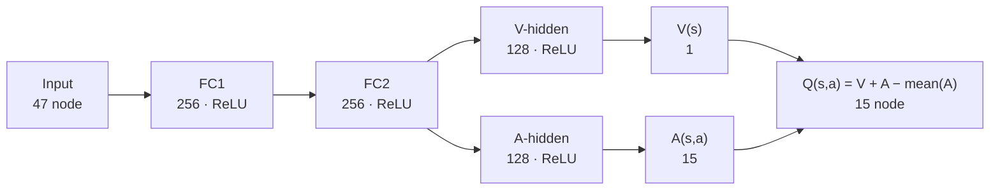

Tujuan: menggantikan fungsi **Hybrid A\*** (`forklift_planner.HybridAStarPlanner`) saat operasional dengan **DQfD** (*Deep Q-learning from Demonstrations*, Hester dkk. 2018), yang belajar dari Hybrid A\* sebagai demonstrator. Satu DQN per robot, karena batas kemudi ID 01 dan ID 02 berbeda.

- DQfD **hanya** menggantikan perencana jalur. Pelacak tetap **pure pursuit** (`jejak.py`), tidak berubah.

> [!note] Istilah
> Di seluruh catatan ini dan di keluaran program, **"A\*" adalah singkatan untuk Hybrid A\*** (`HybridAStarPlanner`, expert/demonstrator): "A\* (cadangan)", "A\* 2 s", "rasio biaya DQfD/A\*", "setuju dengan A\*". A\* biasa (grid, tanpa heading) tidak dipakai sebagai expert. Ia hanya muncul sebagai **heuristik Dijkstra holonomik** di dalam Hybrid A\*, yang juga menjadi input jaringan 42–44 dan panel "heuristik Dijkstra" di dasbor.
- Simulasi dijalankan untuk robot ID 01 dan ID 02, dan proses belajar neuronnya harus bisa dilihat.

---

## Usulan Claude (2026-09-30)

> Hasil membaca `forklift_planner.py`, `rencana.py`, `jejak.py`, `konfig.py`, `pose.SumberSimulasi`, dan `navigasi.py`. `forklift_planner.py` tidak diubah (README: "salinan v1, jangan diubah"). Hybrid A\* tetap dipakai sebagai demonstrator, cadangan, dan pembanding.

### 1. Posisi di dalam sistem

```
                         ┌─ sekarang: HybridAStarPlanner.plan()   (pencarian, s.d. 1,3 s di Rumah)
Perencana._sekali() ─────┤
  (rencana.py)           └─ baru:     DQfDPlanner.plan()          (rollout jaringan, ±puluhan ms)
                                  │
                                  ▼  daftar (gx, gy, yaw, arah) dalam SEL — format SAMA
                         jejak.buat("pursuit") → PathTracker       (tidak berubah)
                                  │
                         wasit.py, pemantau zona, robot.py         (tidak berubah)
```

Satu-satunya titik sambung adalah `rencana.buat_perencana()`. `DQfDPlanner` meniru antarmuka `HybridAStarPlanner`:

| Anggota | Dipakai oleh |
|---|---|
| `plan(omap, start, goal)` → list `(x, y, yaw, arah)` atau `None` | `Perencana._sekali()` |
| `last_stats` (`expansions`, `time`, `reason`) | `Perencana.rencanakan()` |
| `time_limit` | percobaan heading bebas di `_sekali()` (diperkecil ke 0,4 s) |
| `.v` (VehicleModel) | pemeriksaan pose |

Dengan antarmuka ini, semua pemakai `Perencana` tetap bekerja apa adanya: margin cadangan (8 lalu 6 cm), heading tujuan bebas, robot lain sebagai rintangan (`peta_dengan`), pencarian minggir di `navigasi.py`, dan bayangan wasit (`sisa_jalur()` dari pelacak).

Model dipilih dari `profil.id`: `model_dqn/id01.pt` atau `model_dqn/id02.pt`.

### 2. Satu DQN per robot

| | ID 01 | ID 02 |
|---|---|---|
| `max_steer_deg` | 35,0° | 23,5° (sisi kiri sebenarnya 29°, kanan 23,6°) |
| R minimum | 32,1 cm | **51,7 cm** |
| Kemudi rencana (× `PLAN_STEER_RATIO` 0,75) | 26,3° | 17,6° |
| R rencana | 45,6 cm | **70,8 cm** |

Di `Rumah`, titik terlapang hanya 34 cm. ID 02 akan lebih sering butuh manuver maju-mundur, dan sebagian tujuan tidak tercapai sama sekali. Jadi kebijakan ID 01 tidak bisa dipakai begitu saja untuk ID 02. Bobot ID 01 boleh dijadikan titik awal pelatihan ID 02 (*transfer learning*), tapi itu diuji sebagai eksperimen, bukan anggapan.

### 3. MDP: kinematik dan deterministik

Ruang keadaannya sama dengan ruang pencarian Hybrid A\*. Jeda kemudi, ramp gas, dan latensi kamera **tidak** masuk ke pelatihan karena itu urusan pelacak. Hasilnya lingkungan yang murah, cukup numpy, dan bisa menjalankan jutaan langkah.

#### Aksi: 14 primitif Hybrid A\* + SAMBUNG

| Aksi | Isi | Setara di `forklift_planner.py` |
|---|---|---|
| 0–13 | κ ∈ 7 tingkat × {maju, mundur}, panjang 7,3 cm (4 sub-titik) | `self.kappas` × `self.dirs`, `step`, `n_sub` |
| 14 | **SAMBUNG**: tembakan Reeds-Shepp bebas-tabrakan ke tujuan, lalu episode selesai | `_analytic()` / `_best_free_rs()` |

SAMBUNG dipelajari, bukan aturan tetap, karena dua alasan:

- Primitif diskret hampir tidak pernah mendarat tepat di toleransi tujuan (3,2 cm, 12°).
- Hybrid A\* menerima RS hanya ketika simpulnya memang terbaik. Aturan "terima RS bebas pertama" menghasilkan busur panjang yang jelek.

**Masking** (Q = −∞ sebelum argmax):
- primitif yang badannya menyentuh zona di salah satu sub-titiknya (`pose_margin ≤ 0`, sama dengan ekspansi A\*),
- primitif yang menuju sel yang sudah dikunjungi (`_key`, setara *closed set*), supaya rollout tidak berputar-putar,
- SAMBUNG bila tidak ada RS yang bebas.

#### Reward: minus biaya Hybrid A\*, persis

```
r(primitif) = −[ step·(1 atau reverse_cost)
               + steer_cost·step·|κ|/κmax
               + steer_change_cost·|κ − κ_sebelum|/κmax
               + switch_cost·[ganti arah]
               + clearance_penalty(margin_min) ]
r(SAMBUNG)  = −_rs_cost(...) − penalti clearance sepanjang RS        (terminal)
buntu (semua aksi ter-mask) / > 300 primitif = −B                     (terminal)
γ = 0,995
```

Karena reward sama persis dengan biaya A\*, **Q(s,a) = −biaya-sisa ke tujuan**. Akibatnya:
1. Loss TD dan loss imitasi mengejar hal yang sama, jadi tidak saling tarik.
2. Kualitas jalur DQfD bisa dibandingkan langsung dengan A\* sebagai **rasio biaya**. Demonstrator memakai `h_weight = 1,3` dan batas waktu, jadi jalurnya belum tentu optimal. DQfD bisa **melampaui** gurunya, dan itu terukur.

#### Observasi

Rinciannya di bagian 7 (47 input). Garis besarnya: tujuan dalam kerangka robot, primitif sebelumnya, 32 sinar virtual ke `omap.dist`, heuristik holonomik (Dijkstra), dan margin.

Sinar dipakai, bukan peta yang dihafal, karena robot lain dan rintangan sementara hanya muncul di `omap`, dan sinar bisa melihatnya.

### 4. Demonstrasi dari Hybrid A\*

Karena dinamikanya deterministik, aksi demonstrator **bisa direkonstruksi tepat** dari jalur A\*:
- setiap 4 sub-titik = satu primitif; κ = Δyaw/Δs dibulatkan ke tingkat terdekat, arah dari kolom `arah`;
- ekor RS di ujung jalur = satu aksi SAMBUNG.

**Uji penerimaan:**
- aksi hasil ekstraksi yang diputar ulang menghasilkan jalur yang sama dalam < 0,01 sel;
- jumlah reward = g-cost A\* sampai 1e-6.

**Skenario:** `Kalibrasi`, `Rumah2`, `Rumah`, ditambah peta prosedural acak dan badan robot acak sebagai rintangan. Start/tujuan disaring dengan `Perencana.margin_untuk_pose`, dan ±30% tujuan diberi heading bebas. Targetnya ±5.000 episode per robot, dibuat paralel memakai 16 inti CPU.

Skenario yang gagal diselesaikan A\* (lebih sering di ID 02) disimpan sebagai **set uji negatif**: DQfD harus ikut mengembalikan `None` dengan cepat, bukan memaksakan jalur. Terukur di tahap 1–2, kegagalan A\* di `Rumah` seluruhnya "tidak ada jalur" (ruang pencarian habis), bukan batas waktu. Lihat bagian Status.

### 5. Algoritma DQfD

- Dueling Double DQN (susunan di bagian 7).
- Loss: `J = J_DQ(1-langkah) + λ₁·J_n(n=10) + λ₂·J_E + λ₃·L2`
  - `J_E = max_a[Q(s,a) + l(a_E,a)] − Q(s,a_E)`, margin `l = 0,8`, **hanya** pada sampel demo.
- *Prioritized replay*. Data demo disimpan permanen dan mendapat bonus prioritas ε_d.
- **Fase A, pra-latih:** hanya data demo, ±50–100 ribu langkah gradien.
- **Fase B, latihan sendiri:** ε kecil (0,01–0,1), data demo tetap dicampur. Kurikulumnya `Kalibrasi` → `Rumah2` → `Rumah`, rute pendek → panjang.

#### 5.1 Arti ketiga komponen loss

**Q(s, a)** adalah perkiraan jaringan tentang **biaya-sisa ke tujuan** (÷100, bertanda negatif) bila dari keadaan s ia memilih aksi a lalu melanjutkan dengan baik. Biayanya sama dengan biaya Hybrid A\*: panjang, mundur, ganti arah, belokan, dan kedekatan ke zona.

| Komponen | Rumus | Yang dijaga | Keterangan |
|---|---|---|---|
| **J_DQ** (TD 1 langkah, Double DQN) | galat `Q(s,a) − [r + γ·Q_target(s', a*)]`, dengan `a*` = argmax jaringan online di s' | **Konsistensi** perkiraan dari langkah ke langkah: biaya dari sini = biaya satu primitif + biaya-sisa dari tempat berikutnya | Sumber peta nilai di dasbor |
| **J_n** (TD 10 langkah) | galat `Q(s,a) − [r₁ + γr₂ + … + γ⁹r₁₀ + γ¹⁰·Q_target(s₁₀, a*)]` | Sama, tetapi biaya 10 langkah **nyata** dijumlahkan dulu | Informasi "rute ini mahal" merambat 10× lebih cepat. Penting di Rumah (20–100 langkah per rute). **Bias** pada data eksplorasi, karena 10 aksi itu termasuk aksi acak ε |
| **J_E** (large-margin, hanya data demo) | `max_a[Q(s,a) + l(a_E,a)] − Q(s,a_E)`, `l = 0,8` bila a ≠ aksi A\*, 0 bila sama | **Meniru A\***: Q aksi A\* harus lebih baik minimal 0,8 (setara biaya 80) dari semua aksi sah lain | J_DQ dan J_n hanya memeriksa konsistensi, J_E yang memberi tahu jalan mana yang benar. Tidak bisa nol karena A\* sering punya beberapa aksi setara; itu juga sebab % setuju berhenti di ±70% |

**Membaca grafik loss di dasbor** (biru J_DQ, hijau J_n, oranye J_E):

- J_E turun cepat lalu melandai: jaringan makin meniru A\*, dan melandai karena ada aksi setara.
- J_E turun lagi di fase latihan sendiri: porsi data demo per batch mengecil, bukan berarti peniruannya makin baik.
- J_DQ kecil dan datar: perkiraan biayanya konsisten.
- **J_n naik terus di fase latihan sendiri** (putaran 1): target 10 langkah dari data eksplorasi bias, sehingga jaringan mengejar target yang bergeser. Karena itu di putaran 2 bobot J_n fase B diturunkan (1 → 0,5) dan learning rate diperkecil (1e-4 → 5e-5).

Analogi belajar menyetir: J_E = instruktur yang bilang "belok di sini"; J_DQ = memeriksa perkiraan "tinggal 5 menit lagi" masuk akal dari detik ke detik; J_n = melihat 10 tikungan ke depan untuk menilai apakah jalan ini memang lebih jauh.

**Saat operasional** (`DQfDPlanner.plan`, sebagaimana dibuat di tahap 9):
1. Hitung heuristik Dijkstra sekali (`reset()` lingkungan).
2. Rollout greedy dengan masking sampai SAMBUNG atau tiba.
3. **Pencarian terbaik-dulu** berpandu Q (f = g + c + 2·h, anggaran 1.200 langkah; lihat bagian "Pencarian terbaik-dulu"). Sebelumnya: *mundur* (DFS, kembali ke aksi Q terbaik berikutnya saat buntu), yang menggantikan rencana awal *beam search*. Mundur masih ada di kode sebagai pembanding.
4. **Gerbang mutu** (mode `dqfd`): jalur ditolak bila biayanya > 1,3 × perkiraan jaringan sendiri −V(s₀).
5. Gagal atau ditolak: jatuh ke Hybrid A\* (mode `dqfd`), atau kembalikan `None` (mode `dqfd-murni`). Tercatat di `last_stats["perencana"]`.

### 6. Visualisasi neuron (tingkat perencanaan)

```
┌───────────────────────────────┬──────────────────────────────┐
│ Arena: rollout langkah demi   │ Q 15 aksi (bar): dipilih,    │
│ langkah, kipas 14 primitif    │ pilihan A*, ter-mask (abu)   │
│ diwarnai Q; jalur A* sbg hantu│                              │
├───────────────────────────────┼──────────────────────────────┤
│ Aktivasi FC1 (16×16)          │ Aktivasi FC2 (16×16)         │
│                               │ + V(s) dan A(s,a)            │
├───────────────────────────────┼──────────────────────────────┤
│ Biaya-sisa HASIL BELAJAR      │ Kurva: J_DQ, J_E, % tiba,    │
│  −V(x,y | θ, tujuan)          │ rasio biaya DQfD/A*,         │
│ di samping heuristik Dijkstra │ % setuju dgn A*, neuron mati │
└───────────────────────────────┴──────────────────────────────┘
```

- **Peta biaya-sisa** adalah panel yang paling bermakna. Heuristik Dijkstra tidak tahu kendala kemudi. Peta hasil belajar seharusnya menunjukkan bahwa tujuan di **belakang** robot itu mahal (butuh manuver maju-mundur), dan bahwa peta ID 02 lebih mahal di tikungan dibanding ID 01.
- **Saliensi** (∂Q/∂input) memperlihatkan sinar mana yang diperhatikan jaringan.
- **Heatmap bobot FC1** memperlihatkan input mana yang dibaca oleh tiap neuron.
- Semua checkpoint disimpan supaya perkembangan neuron bisa diputar ulang dari awal pra-latih sampai akhir.

---

### 7. Susunan neuron

Arsitekturnya sama untuk ID 01 dan ID 02, bobotnya terpisah.

**Ringkasan: 47 node input → 4 lapis tersembunyi (2 bersama + 1 per cabang dueling), 768 neuron → 15 node output. Parameter: 145.936 per robot.**



```
             INPUT                LAPIS BERSAMA                 CABANG DUELING              OUTPUT
                                                          ┌─► V-hidden 128 ─► V(s)  1 ─┐
  47 node ─► FC1 256 (ReLU) ─► FC2 256 (ReLU) ─┤                                         ├─► Q(s,a) 15
                                                          └─► A-hidden 128 ─► A(s,a) 15┘
                                                               Q = V + A − rata-rata(A)
```

#### 7.1 Lapis input: 47 node

Semua nilai dinormalisasi ke kira-kira [−1, 1] atau [0, 1].

| Indeks | Jml | Kelompok | Isi | Skala |
|---|---|---|---|---|
| 0–1 | 2 | Tujuan | dx, dy tujuan dalam kerangka robot | ÷ 300 cm |
| 2 | 1 | | jarak lurus ke tujuan | ÷ 300 cm |
| 3–4 | 2 | | cos, sin (heading tujuan − heading robot) | — |
| 5 | 1 | | penanda heading bebas (1 = bebas) | 0/1 |
| 6–7 | 2 | | pendekatan lurus maju / mundur layak (`_feasible_approach_dirs`) | 0/1 |
| 8 | 1 | Primitif sebelumnya | arah d (−1 mundur, 0 awal, +1 maju) | — |
| 9 | 1 | | κ sebelumnya / κmax | −1…+1 |
| 10–41 | **32** | Sinar virtual | jarak bebas dari tepi badan, tiap 11,25° mengelilingi robot | ÷ 100 cm |
| 42 | 1 | Heuristik Dijkstra | biaya holonomik ke tujuan (`_holonomic_heuristic`) | ÷ 300 cm |
| 43–44 | 2 | | cos, sin arah gradien heuristik (kerangka robot) | — |
| 45 | 1 | Margin | margin yang sedang dipakai (8 atau 6 cm) | ÷ 8 cm |
| 46 | 1 | | jarak bebas badan saat ini (`pose_margin`) | ÷ 20 cm |

- **Input 8–9** diperlukan karena `steer_change_cost` dan `switch_cost` bergantung pada primitif sebelumnya. Tanpa keduanya keadaannya tidak Markov.
- **Input 42–44** memberi tahu jaringan arah keluar dari labirin. Sinar sepanjang 100 cm tidak bisa melihat pintu koridor di balik tembok.

#### 7.2 Lapis tersembunyi: 768 neuron

| Lapis | Neuron | Aktivasi | Parameter (bobot + bias) |
|---|---|---|---|
| FC1 (bersama) | 256 | ReLU | 47×256 + 256 = **12.288** |
| FC2 (bersama) | 256 | ReLU | 256×256 + 256 = **65.792** |
| V-hidden (cabang nilai) | 128 | ReLU | 256×128 + 128 = **32.896** |
| A-hidden (cabang keuntungan) | 128 | ReLU | 256×128 + 128 = **32.896** |

- **Dueling.** Di koridor lapang hampir semua aksi sama baiknya, dan yang penting hanya "seberapa jauh lagi", yaitu V(s). A(s,a) baru berperan di celah sempit dan titik ganti arah. Memisahkan keduanya membuat pembelajaran lebih stabil.
- **256 neuron** cukup untuk memetakan 47 input ke fungsi biaya A\* (tembok, ganti arah, clearance). Selain itu 256 = 16×16, jadi mudah ditampilkan sebagai kotak di dasbor. Varian 128–128 bisa dicoba kalau jaringan yang lebih kecil sudah cukup.
- **Tanpa BatchNorm**, karena statistik batch di RL terus bergeser dan merusak target TD.

#### 7.3 Lapis output: 15 node

V (1 node, 129 parameter) dan A (15 node, 1.935 parameter) digabung menjadi **15 nilai Q**, dalam satuan **minus biaya-sisa ke tujuan** (sama dengan g-cost Hybrid A\*).

| Node | Arah | κ / κmax | ID 01: δ / R | ID 02: δ / R |
|---|---|---|---|---|
| 0 | maju | −1 | −26,3° / 45,6 cm | −17,6° / 70,8 cm |
| 1 | maju | −⅔ | −18,2° / 68,4 cm | −12,0° / 106,2 cm |
| 2 | maju | −⅓ | −9,3° / 136,9 cm | −6,1° / 212,5 cm |
| 3 | maju | 0 | lurus | lurus |
| 4–6 | maju | +⅓, +⅔, +1 | cermin dari 2, 1, 0 | cermin dari 2, 1, 0 |
| 7–13 | mundur | −1 … +1 | sama seperti 0–6, arah mundur | sama seperti 0–6, arah mundur |
| 14 | **SAMBUNG** | — | tembakan Reeds-Shepp ke tujuan | tembakan Reeds-Shepp ke tujuan |

Panjang tiap primitif 7,3 cm. κ tersebar linear, `κ_i = κmax·(2i/6 − 1)`, dengan `κmax = tan(max_steer × 0,75) / L` milik robot masing-masing. Karena itu **node 0 pada ID 02 berarti belokan 1,55× lebih lebar** daripada node 0 pada ID 01. Indeksnya sama, tapi maknanya berbeda secara fisik, dan itulah sebabnya bobotnya terpisah.

#### 7.4 Ukuran total

| | Nilai |
|---|---|
| Neuron tersembunyi | 256 + 256 + 128 + 128 = **768** |
| Neuron output berparameter | 1 + 15 = 16 |
| Parameter per jaringan | **145.936** (±0,6 MB float32) |
| Per robot | jaringan online + jaringan target (salinan) |
| Operasi per keputusan | ±146 ribu perkalian, sekitar puluhan µs di CPU |

Satu forward pass menghasilkan Q untuk ke-15 aksi sekaligus. Satu jalur di `Rumah` (±100 primitif) hanya butuh beberapa milidetik waktu jaringan. Sisa waktu `plan()` dipakai untuk pemeriksaan tabrakan, sama dengan Hybrid A\*.

#### 7.5 Kenapa output diskret, bukan derajat steering

> [!note] Keputusan 2026-09-30
> Tetap **7 tingkat kemudi** (14 primitif + SAMBUNG = 15 output), sama dengan `n_steer = 7` Hybrid A\*.

**1. Output DQN adalah nilai, bukan perintah.** Setiap node berisi Q(s,a), yaitu "seberapa baik aksi ini", bukan "berapa derajat". Aksi dipilih lewat `argmax` atas 15 node. Untuk sudut kontinu, `argmax` harus dicari di tak hingga banyak kemungkinan, dan DQN tidak punya cara untuk itu. Output sudut langsung berarti berganti ke keluarga *actor-critic* (DDPG, TD3, SAC; versi demonstrasinya DDPGfD). Akibatnya:
- itu bukan DQfD lagi, karena loss *large-margin* `J_E`, yang membuat imitasi dari A\* efektif, hanya terdefinisi untuk aksi diskret;
- masking tabrakan jadi sulit: sekarang cukup Q = −∞ untuk primitif yang menabrak, sedangkan pada aksi kontinu rentang sudut yang aman harus dicari dulu;
- pelatihannya kurang stabil, karena ada dua jaringan yang saling mengejar.

**2. Tiap node sudah mewakili satu sudut.** Lihat tabel 7.3. Di dalam jaringan nilainya ditulis sebagai κ/κmax (−1 … +1) supaya arsitektur kedua robot sama. Konversi ke derajat, `δ = atan(κ·L)`, dilakukan di luar jaringan memakai `konfig.profil(id)`, dan hasilnya dipakai sebagai label node di dasbor. Tingkatnya rata dalam κ, bukan dalam derajat: 9,3° / 18,2° / 26,3° pada ID 01.

**3. Derajat ini bukan perintah ke servo.** Sudut di output DQfD adalah kelengkungan **jalur rencana**. Sudut yang dikirim ke servo tetap dihitung **pure pursuit** di 20 Hz, dan hasilnya kontinu. Karena itu pula `PLAN_STEER_RATIO = 0,75`: perencana hanya memakai 75% kemudi, dan 25% sisanya disediakan untuk koreksi pelacak. Pembagiannya sama dengan Hybrid A\* sekarang: perencana diskret, pelacak kontinu.

**Pilihan yang dipertimbangkan:**

| Pilihan | Untung | Rugi |
|---|---|---|
| **Tetap 7 tingkat** (dipilih) | Label demo tepat 1:1 dengan A\*, uji "biaya = g-cost" bisa dipakai | Resolusi ±9° (ID 01), ±6° (ID 02) |
| Tambah tingkat, mis. 11 atau 15 (output 23 atau 31) | Jalur lebih halus, masih DQfD | A\* hanya memakai 7 tingkat, jadi tingkat baru tidak punya label demo dan hanya bisa dipelajari lewat latihan sendiri. Demonstrator juga harus dijalankan ulang dengan `n_steer` baru supaya sebanding |
| Aksi hibrida (P-DQN): arah diskret + sudut kontinu | Sudut bebas | Algoritma lain, masking dan imitasi jadi rumit |
| Actor-critic (TD3/SAC + demo) | Kontinu penuh | Bukan DQfD, kurang stabil, masking sulit |

Kalau evaluasi tahap 8 menunjukkan jalurnya terlalu kasar, langkah berikutnya yang paling murah adalah menaikkan `n_steer` (demonstrator dan DQfD sama-sama).

---

### 8. Tahapan pengerjaan

| #   | Tahap                                                                                                              | Kriteria lulus                                                          | Status (2026-09-30) |
| --- | ------------------------------------------------------------------------------------------------------------------ | ----------------------------------------------------------------------- | --- |
| 0   | Pasang PyTorch (Python 3.14, CUDA 12.8+ untuk RTX 5050; CPU pun cukup)                                             | `import torch` berhasil                                                 | ✅ 2.11.0+cu128 |
| 1   | **Adaptor demonstrator**: jalur A\* diubah jadi (s, a)                                                             | Putar ulang < 0,01 sel, biaya = g-cost A\*                              | ✅ selisih 0,00 |
| 2   | **Lingkungan perencanaan** vektor (primitif, masking, SAMBUNG, reward)                                             | Uji tahap 1 lolos di dalam env                                          | ✅ (belum divektorkan, paralel lewat proses) |
| 3   | Pembangkit skenario + dataset demo ID 01 dan ID 02                                                                 | ±5.000 episode per robot, set uji terpisah                              | ✅ deterministik |
| 4   | Jaringan + DQfD + hook aktivasi                                                                                    | Overfit pada 1 episode                                                  | ✅ |
| 5   | Pra-latih per robot                                                                                                | Setuju dengan A\* ≥ 85%, tiba ≥ 70% di set uji                          | ⚠️ tiba ✓, setuju 66–73% (kriteria perlu ditinjau) |
| 6   | Dasbor neuron (dibangun bersama tahap 4–7)                                                                         | —                                                                       | ✅ |
| 7   | Latihan sendiri + kurikulum                                                                                        | Tiba ≥ 95%, rasio biaya ≤ 1,1× A\*                                      | ✅ tiba 97–98% (uji); rasio median 1,00, p90 1,14–1,16 dengan pencarian terbaik-dulu |
| 8   | **Evaluasi tingkat rencana** vs A\*                                                                                | % tiba, rasio biaya, jumlah ganti arah, jarak ke zona, **waktu hitung** | ✅ putaran 1, 2, dan terbaik-dulu |
| 9   | Integrasi ke `rencana.py` (`--perencana dqfd`) + **simulasi ID 01 dan 02** dengan pure pursuit, jeda, derau 1,2 cm | Lima skenario dua-robot di README lolos, tanpa masuk zona               | ✅ terintegrasi; ⚠️ mutu jalur (lihat Tahap 9) |
| 10  | Robot nyata di `Kalibrasi`, laju rendah                                                                            | Tidak ada estop zona                                                    | ⬜ |

**Berkas** (paket baru `Forklift Robot Program/drl/`):

| Berkas | Tugas |
|---|---|
| `adaptor_demo.py` | Jalur Hybrid A\* → transisi (s, a, r, s'); `--uji` |
| `lingkungan.py` | MDP perencanaan: primitif, masking, SAMBUNG, reward, observasi, simpan/pulihkan keadaan |
| `skenario.py` | Pembangkit start/tujuan + peta sintetis + dataset; `--periksa`, `--pratinjau` |
| `jaringan.py` | Dueling MLP + hook aktivasi |
| `dqfd.py` | Buffer PER, loss J_DQ + J_n + J_E, agen |
| `rollout.py` | Skenario, PabrikEnv, rollout serempak |
| `latih.py` | `python -m drl.latih --id 1,2 --tampil` |
| `perencana_dqfd.py` | `rencanakan()` (greedy + mundur), `DQfDPlanner` (antarmuka `HybridAStarPlanner`, gerbang mutu) |
| `visual_neuron.py` | Dasbor langsung + `--putar` checkpoint |
| `evaluasi.py` | DQfD vs Hybrid A\* pada seluruh rute uji |
| `uji_navigasi.py` | Robot BERJALAN di simulasi (`navigasi.py` tanpa jendela), A\* vs DQfD |

Checkpoint dan log disimpan di `model_dqn/id01/` dan `model_dqn/id02/`. File lama yang disentuh: `rencana.py` dan `navigasi.py` (pemilih perencana, tahap 9), serta `wasit.py` dan `README.md` (perbaikan wasit, di kedua repo).

### 9. Keputusan

- [x] **Output tetap 7 tingkat kemudi** (bagian 7.5).
- [x] **Cadangan Hybrid A\***: ya. `--perencana dqfd` = DQfD + gerbang mutu + A\* cadangan; `dqfd-murni` = tanpa cadangan, untuk menilai DQfD sendirian.
- [x] **Tempat dasbor**: jendela OpenCV (`drl/visual_neuron.py`), sama seperti `navigasi.py`. TensorBoard belum dibuat.
- [x] **Urutan setelah uji jalan tertutup**: perbaikan wasit dulu (juga di repo `Forklift Control`), lalu putaran latih B.
- [ ] **Kemudi ID 02 yang asimetris** (kiri 29°, kanan 23,6°): masih dianggap simetris 23,5°, sama dengan demonstrator.
- [ ] **Kriteria "setuju ≥ 85%"** (tahap 5): usul diganti rasio biaya, karena A\* sering punya beberapa aksi setara.

---

## Status implementasi (2026-09-30)

Tahap 1–2 **selesai dan lulus uji penerimaan**. PyTorch belum dibutuhkan.

```
python -m drl.adaptor_demo --uji                     # dari folder "Forklift Robot Program"
python -m drl.adaptor_demo --uji --n 50 --seed 11
```

| Berkas | Isi |
|---|---|
| `drl/lingkungan.py` | `LingkunganRencana`: 15 aksi, masking, SAMBUNG, biaya = biaya A\*, observasi 47 |
| `drl/adaptor_demo.py` | Rekam g-cost A\*, urai jalur → aksi, putar ulang, uji penerimaan |

**Cara kerja.** Lingkungan memakai objek `HybridAStarPlanner` sendiri sebagai pustaka gerak (kappas, bobot biaya, heuristik, `_analytic`, `_at_goal`, `_key`). Hanya ekspansi satu primitif yang disalin, karena di `forklift_planner.py` bagian itu ada di dalam loop `plan()`. `plan()` tidak mengembalikan g-cost, jadi adaptor merekamnya dari luar dengan membungkus `_h`/`_analytic` di level objek dan menukar sementara `heapq` modul. `forklift_planner.py` tidak diubah.

**Hasil uji** (seed 7, n = 15 dan seed 11, n = 50; ID 01 & 02; tiga peta): **semua jalur yang ditemukan A\* lulus kelima syarat**, total 363 jalur.

| | Hasil |
|---|---|
| Aksi demo lolos mask, episode berakhir tepat di aksi terakhir | semua |
| Selisih jalur putar-ulang vs A\* | **0,00** sel (identik sampai bit, bukan hanya < 0,01) |
| Selisih biaya lingkungan vs g-cost A\* | **0,00** (bukan hanya < 1e-6) |
| Perintah pure pursuit pada kedua jalur | identik |
| Observasi 47 angka, berhingga | semua langkah |

Seed 11, n = 50:

| Robot | Peta | A\* menemukan | Aksi rata / maks | A\* rata | Putar ulang rata |
|---|---|---|---|---|---|
| ID 01 | Kalibrasi | 50/50 | 1,9 / 4 | 3 ms | 4 ms |
| ID 01 | Rumah2 | 48/50 | 5,8 / 24 | 37 ms | 8 ms |
| ID 01 | Rumah | 33/50 | 19,5 / 54 | 472 ms | 21 ms |
| ID 02 | Kalibrasi | 50/50 | 1,9 / 9 | 5 ms | 4 ms |
| ID 02 | Rumah2 | 47/50 | 8,8 / 37 | 83 ms | 12 ms |
| ID 02 | Rumah | **12/50** | 26,7 / 61 | 313 ms | 29 ms |

"Putar ulang" menghitung mask ke-15 aksi di setiap langkah, jadi angkanya mendekati ongkos rollout DQfD tanpa jaringan: **1–3 ms per langkah**, ±20–30 ms per jalur di `Rumah`, dibanding 313–472 ms untuk A\*.

**Temuan yang mengubah rencana:**

- **SAMBUNG tidak dibatasi jarak.** Rencana awal hanya mengizinkannya di bawah `analytic_dist` (101 cm). Uji pertama gagal karena A\* juga mencoba Reeds-Shepp pada setiap ekspansi ke-4 berapa pun jaraknya, sehingga ada demo yang tersambung dari > 101 cm. Biaya SAMBUNG terukur 0,3 ms rata-rata (maks 0,7 ms) di jarak mana pun, jadi pembatasan dihapus.
- **Kegagalan A\* di `Rumah` bukan batas waktu.** Seluruh 17 (ID 01) dan 38 (ID 02) kegagalan beralasan "tidak ada jalur", dan dengan batas 30 s / 400 ribu ekspansi tetap 0 yang ketemu. Pasangan itu memang tak terjangkau dengan primitif dan margin 8 cm. Akibatnya untuk tahap 3:
  - pasangan acak di `Rumah` untuk ID 02 76% mustahil, jadi pembangkit skenario harus menyaring kelayakan dulu (atau memakai pose dari daerah yang tersambung), kalau tidak sebagian besar waktu habis untuk A\* yang gagal;
  - pasangan mustahil dipakai sebagai **set uji negatif**: DQfD harus buntu dengan cepat, bukan memaksakan jalur.

**Belum dikerjakan di tahap ini:**

- Lingkungan belum divektorkan. Ekspansi primitif memang per-keadaan di Python, sama seperti A\*. Paralelismenya lewat proses: di tahap 3, 15 pekerja.

**Diuji tambahan:** margin 8 dan 6 cm, masing-masing dengan badan robot lain parkir di pose acak sebagai rintangan (`Perencana.peta_dengan`), di `Rumah2` dan `Rumah`, ID 01 & 02: **63/63 identik** (selisih jalur 0, biaya < 1e-6).

### Tahap 3: dataset demo (selesai)

```
python -m drl.skenario --id 1,2 --n 5000     # ±8,5 menit, 15 pekerja
python -m drl.skenario --periksa             # integritas + rekonstruksi
python -m drl.skenario --pratinjau           # gambar peta sintetis + jalur demo
```

Berkas: `drl/skenario.py`. Keluaran di `drl/data/` (masuk `.gitignore`, karena bisa dibangkitkan ulang): `demo_id0N.npz`, `negatif_id0N.npz`, `ringkasan_id0N.json`.

**Variasi skenario:** peta `Kalibrasi` 15%, `Rumah2` 25%, `Rumah` 30%, dan **peta sintetis** 30% (dinding tepi sedikit miring, blok 12–60 cm, blok sudut, kadang dinding sekat). Margin cadangan 6 cm 20%, robot lain parkir sebagai rintangan 30%, heading bebas 30%, jarak dekat (15–60 cm) 15%.

| | ID 01 | ID 02 |
|---|---|---|
| Episode (uji) | 5000 (463 uji, 9,3%) | 5000 (474 uji, 9,5%) |
| Transisi | 41.841 | 54.137 |
| Peta sintetis berbeda | 84 | 89 |
| A\* ketemu: Kalibrasi / Rumah2 / Rumah / sintetis | 100 / 98 / **69** / 90% | 100 / 91 / **34** / 85% |
| Langkah rata/maks di Rumah | 16,9 / 92 | 19,4 / 126 |
| Negatif (A\* gagal) | 873 | 3364 |
| Aksi: maju / mundur / SAMBUNG | 44 / 44 / 12% | 44 / 47 / 9% |
| Galat putar-ulang | 0 | 0 |

**Pemeriksaan** (`--periksa`): aksi selalu lolos mask, `obs_next` bersambung, `selesai` hanya di langkah terakhir, dan 200 episode per robot diputar ulang **hanya dari metadata tersimpan** (peta, margin, rintangan, awal, tujuan). Hasilnya identik. Dataset berdiri sendiri, tanpa perlu A\* lagi.

**Keputusan di tahap ini:**

- **Batas waktu A\* dilepas saat membangkitkan demo**, yang membatasi hanya `max_expansions` (30.000). Dengan 15 pekerja berebut CPU, batas 2 s ikut memotong pencarian yang di robot sebenarnya selesai, dan dataset tidak bisa diulang persis.
- **Pemilihan episode deterministik:** kuota diambil menurut nomor tugas, bukan urutan tugas selesai. Dibangkitkan dua kali, hasilnya **identik** kecuali kolom waktu jam dinding.
- **Set uji per tugas** (setiap tugas ke-10). Untuk peta sintetis artinya petanya sendiri belum pernah dilihat saat latihan.
- `BIAYA_BUNTU_CM` dinaikkan 2000 → **5000**. Biaya episode demo terbesar ternyata 2592 (ID 01) dan 2922 (ID 02). Dengan 2000, agen yang menghadapi rute mahal bisa "memilih" buntu karena lebih murah.

**Catatan untuk tahap 4:**

- Reward per langkah median −17, tetapi SAMBUNG bisa sampai −956 (Reeds-Shepp panjang). Rentangnya lebar, jadi reward perlu diskalakan (mis. ÷100) sebelum masuk loss TD.
- Maju dan mundur hampir seimbang (44/44%). Itu memang watak A\* di peta rapat dengan `reverse_cost = 2`, bukan galat.
- Episode di peta lapang sangat pendek (±2 langkah): A\* langsung menyambung Reeds-Shepp. Keputusan terpenting DQfD di sana adalah **kapan SAMBUNG**, sedangkan di Rumah adalah urutan manuvernya.

### Tahap 4 + 6: jaringan, DQfD, dasbor (siap dijalankan)

PyTorch 2.11.0+cu128 terpasang. RTX 5050 (sm_120) terdeteksi, dengan langkah latih 1,1 ms di GPU dan forward satu keadaan 0,03 ms di CPU. Karena itu pelatihan berjalan di GPU, sedangkan rollout memakai salinan jaringan di CPU.

```
python -m drl.latih --id 1,2 --tampil               # ID 01 lalu ID 02, dengan dasbor
python -m drl.visual_neuron --putar model_dqn/id01  # putar ulang checkpoint
```

| Berkas | Isi |
|---|---|
| `drl/jaringan.py` | Dueling MLP 47 → 256 → 256 → V128/A128 → 15, **145.936 parameter** (terverifikasi) |
| `drl/dqfd.py` | Buffer PER (demo permanen + agen melingkar), J_DQ + J_n (n = 10) + J_E (margin 0,8) + L2, Double DQN |
| `drl/rollout.py` | Skenario, PabrikEnv, KumpulanRollout (banyak episode serempak, satu forward per langkah) |
| `drl/latih.py` | Fase A pra-latih (30.000 langkah gradien), fase B latihan sendiri (100.000 langkah lingkungan), evaluasi, checkpoint |
| `drl/visual_neuron.py` | Dasbor OpenCV + putar ulang checkpoint |

Keluaran ada di `model_dqn/` (masuk `.gitignore`): `id0N/ckpt_*.pt`, `id0N/riwayat.json`, `id0N.pt`.

**Uji tahap 4:**

- **Overfit satu episode** (23 langkah, Rumah): setuju 100%, Q(s0) = −6,117 vs return diskon demo −6,118, dan rollout tertutup mengulang urutan aksi A\* **persis** (biaya 660,0 = 660,0).
- **Latih singkat** (1.000 pra + 1.000 lingkungan, 43 s): setuju naik 12% → 54%. Dasbor tergambar benar di dua probe.

**Perbaikan yang ditemukan saat uji:**

- **`reset()` kini menolak pose awal yang buntu** (tidak ada aksi sah) dengan alasan "buntu". Sebagian skenario negatif memang begitu, dan itu adalah jawaban "tidak ada jalur" yang sah, bukan galat.
- **Dataset dimuat sekali ke memori** (`rollout.muat_npz`). `np.load` terkompresi mendekompres ulang setiap `d["obs"]` diakses (±0,02 s), sehingga pemuatan per episode memakan 3 menit.
- **Peta nilai = biaya termurah dari 8 arah hadap.** Dengan satu arah saja, badan + margin 8 cm hanya muat di sedikit titik di Rumah.
- **Latar arena disimpan per probe:** 94 → 14 ms per frame. Dasbor pada 6 fps menambah ±8% waktu latih.

**Dasbor:** simulasi (rollout langkah demi langkah, kipas calon diwarnai Q, 32 sinar, jalur A\* sebagai pembanding), jaringan (input 47, aktivasi FC1/FC2/V/A, Q 15 aksi, perkiraan vs biaya-sisa nyata), peta nilai −V di samping heuristik Dijkstra, dan progres (loss, % setuju, % tiba, rasio biaya). Tombol: `q` hentikan robot ini, `ESC` hentikan semua, `n` rute berikutnya, `p` jeda.

### Pelatihan pertama + evaluasi penuh

Pelatihan dengan setelan bawaan (30.000 langkah pra-latih + 100.000 langkah lingkungan latihan sendiri) memakan ±15 menit per robot. Evaluasi selama latihan hanya memakai 80 rute (1 rute = 5% per jenis peta), jadi naik-turunnya di grafik sebagian besar derau. Angka di bawah berasal dari **evaluasi penuh**: seluruh rute uji, satu per satu, dengan A\* diukur ulang secara adil (satu proses, batas 2 s seperti operasional).

```
python -u -m drl.evaluasi --id 1,2      # ±8 menit; keluaran model_dqn/evaluasi_id0N.json
```

Berkas baru: `drl/perencana_dqfd.py` (rencana greedy + **mundur saat buntu**: kembali ke keadaan sebelumnya dan coba aksi Q terbaik berikutnya; sel yang pernah dicoba tetap tertutup; anggaran 600 langkah) dan `drl/evaluasi.py`. `LingkunganRencana` mendapat `simpan_keadaan()` / `pulihkan_keadaan()`.

**Tiba (%)**, greedy / mundur / A\* 2 s:

| Peta | ID 01 (n) | ID 01 | ID 02 (n) | ID 02 |
|---|---|---|---|---|
| **Semua** | 463 | 88,3 / **96,8** / 99,4 | 474 | 83,3 / **97,3** / 98,7 |
| Kalibrasi | 60 | 100 / 100 / 100 | 59 | 100 / 100 / 100 |
| Rumah2 | 115 | 96,5 / 99,1 / 99,1 | 106 | 95,3 / 100 / 100 |
| **Rumah** | 142 | 71,8 / **90,8** / 99,3 | 157 | 61,1 / **96,8** / 100 |
| sintetis | 146 | 93,2 / 99,3 / 99,3 | 152 | 91,4 / 94,7 / 96,1 |

**Rasio biaya** (DQfD mundur / A\*), median / p90: ID 01 semua 1,00 / 2,12, Rumah **1,23 / 3,29**. ID 02 semua 1,00 / 2,24, Rumah **1,11 / 3,65**.

**Waktu rencana** (ms, median / p90), DQfD mundur vs A\*:

| | ID 01 | ID 02 |
|---|---|---|
| Semua | 7 / 114 vs 6 / 265 | 8 / 199 vs 6 / 398 |
| Rumah | 41 / 549 vs 50 / 765 | 43 / 364 vs 59 / 678 |

> [!warning] Koreksi klaim kecepatan
> Angka "47 ms vs A\* 596 ms" (±13× lebih cepat) di dasbor dan laporan sebelumnya **keliru**. Waktu A\* di sana diambil dari dataset, yang dibangkitkan saat 15 proses berebut CPU. Diukur adil, A\* **hampir sama cepat** pada rute biasa (median 6 vs 7 ms). DQfD hanya unggul pada rute sulit: p90 sekitar 2× lebih cepat.

**Skenario negatif** (150 per robot, A\* "tidak ada jalur" tanpa batas waktu):

| | ID 01 | ID 02 |
|---|---|---|
| DQfD buntu | 82% | 69% |
| **DQfD menemukan jalur** | **27 (18%)** | **47 (31%)** |
| Jalur itu sah menurut pemeriksaan independen | 27/27 | 47/47 |
| Waktu sampai menyerah (median) | 405 ms | 809 ms |

Pemeriksaan independen: setiap pose bebas zona dengan margin skenario, pose berurutan tersambung, dan pose akhir dalam toleransi tujuan. Contohnya ada di `model_dqn/negatif_ditemukan_id0N.png`; sebagian berkelok-kelok, tetapi semuanya sah. Penjelasan paling mungkin: A\* menutup sel (4,9 cm × 10°) begitu dikunjungi pertama kali, sehingga jalur lewat pose lain di sel yang sama tidak pernah dicoba. Hybrid A\* hanya lengkap sebatas resolusi gridnya.

**Terhadap kriteria:**

| Kriteria | ID 01 | ID 02 |
|---|---|---|
| Tahap 5: setuju ≥ 85% | ✗ 66% | ✗ 72% |
| Tahap 7: tiba ≥ 95% (mundur) | ✓ 96,8% (Rumah ✗ 90,8%) | ✓ 97,3% (sintetis ✗ 94,7%) |
| Tahap 7: rasio ≤ 1,1 | ✓ median 1,00; ✗ Rumah 1,23, p90 2,1 | ✓ median 1,00; ✗ Rumah 1,11, p90 2,2 |

Kriteria "setuju ≥ 85%" perlu ditinjau: A\* sering punya beberapa aksi yang sama baiknya, jadi rasio biaya adalah ukuran yang lebih tepat.

**Kesimpulan sementara:** dengan mundur, DQfD hampir seandal A\* (97% vs 99%) dan menemukan jalur yang dilewatkan A\*. Kelemahannya adalah **mutu jalur di Rumah** (sebagian berkelok, p90 > 3× biaya A\*) dan keunggulan kecepatannya lebih kecil dari yang semula diklaim.

### Tahap 9: integrasi + robot berjalan di simulasi

```
python navigasi.py --simulasi --id 1,2 --perencana dqfd        # interaktif
python -u -m drl.uji_navigasi --perencana astar,dqfd --n 5     # otomatis, ±8 menit
```

- `rencana.Perencana(..., jenis="astar" | "dqfd" | "dqfd-murni")`. `dqfd` = DQfD dengan A\* sebagai cadangan bila DQfD gagal. PyTorch hanya diimpor bila DQfD dipilih.
- `drl/perencana_dqfd.DQfDPlanner`: antarmuka sama dengan `HybridAStarPlanner` (`plan`, `last_stats`, `time_limit`, `v`), jalur berformat sama. Pelacak, wasit, dan pencarian minggir tidak diubah. `last_stats["perencana"]` mencatat siapa yang menghasilkan jalur, dan navigasi mencetaknya ("jalur 172 cm ... 9 ms oleh dqfd").
- `navigasi.py --perencana`, dan baris status menampilkan perencana yang dipakai.
- `drl/uji_navigasi.py`: `navigasi.Navigasi` dijalankan tanpa jendela dalam waktu nyata, dengan pure pursuit, jeda kemudi/kamera, derau pose 1,2 cm, dan wasit. Semua diukur dari pose **sebenarnya** simulator.

**Hasil** (30 rute satu robot = 5 per peta × 3 peta × 2 robot, dan 6 pasangan ID 01 + ID 02 yang jalur A\*-nya berpotongan):

| | A\* | DQfD (A\* cadangan) |
|---|---|---|
| Satu robot: tiba | **30/30** | **25/30** |
| Badan sebenarnya masuk zona | 0 | 0 |
| Jarak terdekat ke zona (pose sebenarnya) | 3,58 cm | **0,55 cm** |
| Galat akhir rata / maks | 4,1 / 6,4 cm | 4,5 / 7,3 cm |
| Waktu tempuh median | 25,5 s | 28,5 s |
| Pasangan: robot tiba | 10/12 | 7/12 |
| Jarak badan antar-robot terdekat | 9,6 cm | **1,4 cm (KONTAK)** |

**Kegagalan DQfD, dari log:**

1. **Estop zona (3×)**: pose *terukur* berderau menyentuh zona. Badan sebenarnya tidak masuk, tetapi hanya 0,55–2,4 cm dari zona. Jalur DQfD panjang dengan banyak titik ganti arah (hingga 544 cm), sehingga galat pelacakan menumpuk di dekat zona.
2. **Tidak selesai dalam 120 s (3×)**: jalur sangat berkelok, sampai 885 cm dengan 477 titik, padahal rutenya jauh lebih pendek. Robot masih berjalan saat batas waktu habis.
3. **KONTAK antar-robot (1×, Kalibrasi #656/#1762)**: ID 01 menunggu ("memberi jalan ke robot 02"), lalu ID 02 bergerak ke badan ID 01. Wasit memicu estop kontak di 1,4 cm. Dengan A\*, pasangan yang sama aman (9,6 cm). *Diselidiki lebih lanjut di bawah: ternyata bukan akibat DQfD.*
4. Dua pasangan di Rumah (#691/#1800, #691/#4070) gagal pada **kedua** perencana: ID 01 tidak punya jalur selama ID 02 berdiri di posisi awalnya. Ini masalah pemilihan skenario, bukan perencana.

**Kesimpulan:** "tiba di perencanaan" (97%) belum berarti "jalurnya layak dikendarai". Mode mundur menyelamatkan rute dengan jalur yang berkelok, dan jalur berkelok memperbesar galat pelacakan dan estop zona. Masalah utamanya tetap **mutu jalur**.

#### Penyelidikan kontak antar-robot: celah WASIT, bukan DQfD

1. **Tidak terulang dengan derau acak:** 16 putar ulang (sebagian dengan 6 salinan serempak) memberi jarak terdekat 6,4–9,3 cm, tanpa kontak. Periode loop tetap 50–52 ms walau CPU dibebani, jadi dugaan "loop terlambat" **salah**.
2. **Penyebab sebenarnya: jalur VARIAN.** Saat kontak, jalur ID 02 panjangnya 138 cm / 64 titik, sedangkan di semua putar ulang 125–128 cm. Menggeser pose awal ID 02 dalam rentang derau (±2 cm, ±2°) menghasilkan jalur 122–148 cm untuk DQfD dan **118–141 cm untuk A\***. A\* sama pekanya terhadap derau pose awal, dan bisa menghasilkan varian 138 cm / 64 titik yang sama.
3. **Direproduksi tanpa derau** dari pose tergeser (−2, −2, −2°): **A\* dan DQfD sama-sama** membawa kedua robot ke 1,7–1,8 cm. Jadi ini celah wasit, dan bisa terjadi dengan perencana apa pun.
4. **Urutan kejadiannya** (rekaman A\*): wasit menyuruh ID 01 menunggu ("memberi jalan"), ID 01 berhenti di t = 3,2 s, lalu ID 02 (pemenang) melaju penuh 17,4 cm/s **menyerempet** ID 01 yang diam sampai 1,7 cm tanpa pernah disuruh berhenti. Aturan `wasit._pasangan` hanya menghentikan robot yang bayangannya **mendekat** > 0,5 cm dari jarak sekarang (`batas = min(MULTI_JARAK_AMAN_CM, d_kini − 0,5)`). Saat berpapasan menyamping jaraknya turun pelan (9,4 → 1,7 cm dalam 1,6 s), dan titik terdekatnya ±24 cm di depan, di luar panjang bayangan (±13,6 cm pada 17,4 cm/s).

> [!warning] Koreksi
> Pernyataan sebelumnya bahwa kontak ini "celah wasit yang terungkap oleh bentuk jalur DQfD" dan bahwa "DQfD dua robot belum aman" **keliru**. Celahnya ada di wasit dan berlaku juga untuk A\*. Uji dua robot di README (0 kontak dari 15 jalan) hanya kebetulan tidak memuat jalur yang menyerempet robot yang sedang menunggu.

5. **Akar masalahnya:** diukur dari rekaman, ID 02 berjalan **±3,5 cm di samping jalurnya** ke arah ID 01, dengan selisih heading hanya ±1°. Bayangan dihitung dari pose **jalur**, jadi wasit melihat 5,7–8,9 cm, sementara badan sebenarnya lewat 1,6 cm. Wasit menganggap robot selalu tepat di jalurnya.

**Perbaikan (dikerjakan 2026-09-30, di KEDUA repo):** `wasit.ikut_badan()` memindahkan bayangan (geser + putar) dengan selisih pose badan sekarang terhadap titik jalur terdekat, sebelum dibandingkan. Aturan "mendekat" tidak diubah, jadi robot yang berjalan sejajar tetap boleh jalan. Usulan awal (batas jarak mutlak) tidak dipakai, karena tidak menyentuh akar masalahnya.

| Uji | Hasil |
|---|---|
| `python wasit.py` | 11/11. Kasus baru "menyerempet" **gagal tanpa perbaikan**, lulus dengan perbaikan; kasus penjaga "menyimpang tapi sejajar" tetap jalan |
| Skenario reproduksi (jalur varian, tanpa derau) | jarak terdekat 1,7 → **5,4–6,2 cm**, A\* dan DQfD; kebuntuan diurai oleh rencana ulang yang sudah ada |
| 6 pasangan × 3 ulang × {A\*, DQfD} = 36 jalan berderau | **0 kontak**, terdekat 7,4 cm (A\*) / 7,6 cm (DQfD) |

Kegagalan yang tersisa di uji pasangan bukan dari wasit. ID 01 di pasangan Rumah #691 tidak pernah punya jalur (skenario tak terjangkau). ID 02 di #691/#4070 kadang gagal merencanakan **di detik pertama**, sebelum wasit memutuskan apa pun, karena derau pose awal di koridor sempit.

Berkas yang berubah: `wasit.py` dan catatan di `README.md` (bagian "Dua robot"), di repo ini dan di `Forklift Control` (akhir baris LF dipertahankan). `drl/uji_navigasi.py` mendapat `--hanya-pasangan` dan `--ulang`.

#### Gerbang mutu di mode `dqfd`

`DQfDPlanner` menolak jalur DQfD, lalu memakai A\*, bila **biaya > 1,3 × perkiraan jaringan sendiri** (−V(s₀) × skala). Hanya di mode `dqfd`; `dqfd-murni` tanpa gerbang. Kalibrasi pada rute uji: log(biaya/perkiraan) berkorelasi **0,79–0,80** dengan log(biaya/A\*). Jalur diterima 83% (ID 01) / 77% (ID 02), p90 rasio jalur diterima 2,12 → 1,37 / 2,24 → 1,21. Ambangnya dipilih dari data uji sendiri, karena belum ada set validasi.

Uji jalan tertutup diulang dengan skenario yang sama:

| | A\* | DQfD tanpa gerbang | **DQfD + gerbang** |
|---|---|---|---|
| Satu robot: tiba | 30/30 | 25/30 | **29/30** |
| Jarak zona terdekat | 3,58 cm | 0,55 cm | 1,16 cm |
| Galat akhir rata / maks | 4,1 / 6,4 cm | 4,5 / 7,3 cm | 4,8 / 13,4 cm |
| Pasangan: robot tiba | 10/12 | 7/12 | **10/12** |
| Jarak antar-robot terdekat | 9,6 cm | 1,4 cm | 8,1 cm |
| Jalur oleh DQfD / A\* cadangan | – | 30 / 0 | 24 / 6 |

Dua pasangan yang gagal (Rumah #691/…) gagal di semua perencana, karena skenarionya memang tak terjangkau selama robot lain berdiri di pose awalnya.

**Sisa masalah, dan keduanya tidak ditangkap gerbang biaya:**

- **Rumah2 #662**: estop zona. Jalur DQfD sah dan biayanya wajar, tetapi menyusuri tepi margin dekat Z9, sehingga pelacak memotong tikungan (sisa jarak 1,16 cm). A\* di rute sama menjaga 7,9 cm.
- **Rumah #3764**: tiba dengan galat 13,4 cm (A\* 4,4 cm). Manuver akhirnya diduga tidak memberi pelacak ruang untuk meluruskan diri.

Keduanya soal **kelayakan dikendarai** (jarak bebas di sepanjang jalur, pendekatan akhir), bukan biaya. Ini sasaran putaran latih B.

---

### Putaran latih 2 (berjalan, 2026-09-30)

```
python -u -m drl.latih --id 1,2 --tampil      # ±28 menit per robot; log: model_dqn/latih_putaran2.log
```

Model putaran 1 disimpan di `model_dqn/putaran1/` (id0N.pt, checkpoint, evaluasi, gambar negatif).

**Perubahan terhadap putaran 1:**

| Perubahan | Alasan (dari hasil putaran 1) |
|---|---|
| **Set validasi**: setiap episode latih ke-10 (±454 episode); dievaluasi 160 rute (Rumah 60, sintetis 40, Rumah2 40, Kalibrasi 20) | Pemilihan model dan ambang gerbang tidak boleh memakai set uji |
| **Evaluasi dengan perencana operasional** (mundur saat buntu) | Putaran 1 hanya greedy, padahal yang dipakai operasional adalah mundur |
| **Skor** = tiba_mundur − 10 × (rasio_p90 − 1); `id0N.pt` = checkpoint skor terbaik, `id0N_akhir.pt` = terakhir | Putaran 1 menyimpan model terakhir, padahal ID 01 lebih baik di tengah latihan; skor ikut menghukum jalur berkelok |
| Fase B: lr 1e-4 → **5e-5**, bobot J_n 1 → **0,5** | J_n naik terus sejak fase B (lihat 5.1) |
| Fase B: **50% skenario Rumah** (`--porsi-rumah`) | Mutu jalur terburuk ada di Rumah |
| Pra-latih 30k → **20k**, latihan sendiri 100k → **150k** langkah lingkungan | Pra-latih putaran 1 mentok di ±5k |

Dasbor kini menampilkan tiba greedy / mundur, rasio p90, dan skor. Grafik "tiba" memakai tiba mundur.

**ID 01: selesai (27,9 menit).** Angka **validasi**, bukan uji:

| Langkah | Fase | Setuju | Tiba greedy / mundur | Rasio p90 | Skor |
|---|---|---|---|---|---|
| 0 | awal | 14,4% | 33,8 / 80,0% | 19,78 | −107,8 |
| 5.000 | pra | 66,5% | 74,4 / 95,6% | 5,85 | 47,2 |
| 20.000 | pra (akhir) | 68,5% | 75,6 / 93,8% | 4,68 | 57,0 |
| 25.000 | mandiri | 68,9% | 83,8 / 96,9% | 3,53 | 71,6 |
| **50.000** | **mandiri (terbaik)** | 68,1% | **89,4 / 97,5%** | **2,24** | **85,1** |
| 95.000 | akhir | 67,9% | 86,9 / 95,6% | 2,89 | 76,8 |

Pengamatan:

- **Latihan sendiri memperbaiki mutu jalur**: p90 validasi turun 4,68 (akhir pra-latih) → 2,2–3,2. Tetapi skornya **naik-turun** di fase B (75–85), dan titik terbaik lagi-lagi di tengah (50k), seperti putaran 1. Pemilihan model terbaik memang dibutuhkan.
- **J_n tetap melonjak di awal fase B** (0,34 → ±1,0), lalu **tidak lagi naik terus** dan sedikit turun menjelang akhir (0,82–0,86). Penurunan lr dan bobot J_n meredam, tetapi tidak menghilangkannya.
- Set validasi berat ke Rumah, jadi p90-nya **tidak bisa dibandingkan langsung** dengan evaluasi uji putaran 1 (p90 2,12 untuk semua peta). Pembandingan yang sah menunggu `drl.evaluasi` pada set uji.

**ID 02: selesai (31,5 menit).** Model terbaik di langkah **95.000, di akhir latihan dan masih membaik** (tiba mundur 95,6%, p90 validasi 2,27, skor 82,9). J_n fase B naik ke 1,1–1,3 lalu turun ke 0,95 menjelang akhir.

**Gerbang mutu dikalibrasi ulang pada set validasi** (model putaran 2). Korelasi log(biaya/perkiraan) vs log(rasio) = 0,82 (ID 01) / 0,70 (ID 02). Ambang 1,3 tetap dipilih: diterima 76,5% / 84,5%, p90 rasio jalur diterima 2,17 → 1,29 / 2,13 → 1,31, jalur baik ikut ditolak 15/322 dan 7/339.

#### Hasil putaran 2 pada set UJI (sama persis dengan evaluasi putaran 1)

Tiba (mode mundur) dan rasio biaya DQfD / Hybrid A\*, **putaran 1 → putaran 2**:

| Peta | ID 01 tiba | ID 01 rasio p90 | ID 02 tiba | ID 02 rasio p90 |
|---|---|---|---|---|
| **Semua** | 96,8 → 95,9% | 2,12 → **2,67** | 97,3 → 97,7% | 2,24 → 2,18 |
| Kalibrasi | 100 → 100% | 1,01 → 1,06 | 100 → 100% | 1,18 → 1,06 |
| Rumah2 | 99,1 → 99,1% | 1,63 → 1,68 | 100 → 99,1% | 1,89 → 1,80 |
| **Rumah** | 90,8 → 89,4% | 3,29 → **4,56** | 96,8 → 97,5% | 3,65 → 3,37 |
| sintetis | 99,3 → 97,9% | 1,79 → 1,95 | 94,7 → 96,1% | 1,36 → 1,46 |

Greedy di Rumah: ID 01 71,8 → **63,4%**, ID 02 61,1 → 64,3%. Negatif yang dipecahkan DQfD (sah semua): ID 01 27 → 31, ID 02 47 → 47. Waktu median mundur 6–7 ms vs Hybrid A\* 5 ms; p90 156–163 ms vs 249–401 ms.

**Kesimpulan putaran 2: tidak memperbaiki mutu jalur.** ID 02 sedikit lebih baik (dalam rentang derau). **ID 01 lebih buruk di Rumah** (p90 3,29 → 4,56, greedy −8 poin), padahal model terbaiknya dipilih dari validasi. Set validasi berisi 60 rute Rumah, jadi skornya naik-turun ±5 antar-evaluasi, dan pemilihan "terbaik" di sana ikut terpengaruh derau. Penggantian bobot J_n, lr, dan porsi Rumah tidak menyentuh masalah pokoknya.

#### Uji jalan tertutup, model putaran 2 + wasit baru

| | Hybrid A\* | DQfD + gerbang (putaran 2) |
|---|---|---|
| Satu robot tiba | 28/30 | 28/30 |
| Badan masuk zona | 0 | 0 |
| Jarak zona terdekat | **0,89 cm** | 2,08 cm |
| Galat akhir rata / maks | 4,4 / 7,2 cm | 4,4 / 6,4 cm |
| Pasangan: robot tiba | 9/12 | 10/12 |
| Jarak antar-robot terdekat | 8,4 cm | 8,8 cm |
| Jalur oleh DQfD / cadangan | – | 26 / 4 (satu robot) |

- Kegagalan Hybrid A\*: estop zona ID 01 Rumah #2100 dan gagal rencana ID 02 Rumah2 #575. Kegagalan DQfD: estop zona ID 01 Rumah #4133 dan ID 02 Rumah #4815. Di putaran sebelumnya Hybrid A\* 30/30 pada skenario yang sama, jadi **satu kali jalan per skenario punya ragam ±2 rute** karena derau. Perbedaan 28 vs 28 atau 29 bukan perbedaan nyata.
- Wasit baru terkonfirmasi lagi: tidak ada kontak, jarak antar-robot terdekat 8,4–8,8 cm.
- **Secara operasional**, mode `dqfd` (DQfD + gerbang + Hybrid A\* cadangan) kini **setara** Hybrid A\* di uji jalan tertutup. Mode `dqfd-murni` belum.

#### Arah berikutnya (usulan)

Setelah dua putaran, persetujuan dengan Hybrid A\* mentok di 66–73%. Kalau jaringan salah di Rumah, pencarian mundur memang menemukan jalur, tetapi jalurnya berkelok. Memperbaiki kebijakan dengan setelan latih saja tidak menggeser angka ini. Pilihan:

1. **DQfD sebagai heuristik di dalam Hybrid A\*** (Hybrid A\* berpandu jaringan): −V(s) dari jaringan menggantikan atau melengkapi heuristik Dijkstra. Mutu jalurnya dijamin pencarian A\*, jaringan hanya mempercepat ekspansi. Ini paling menjanjikan untuk mutu, tapi DQfD tidak lagi "menggantikan" Hybrid A\*, melainkan mempercepatnya.
2. **Pencarian terbaik-dulu dengan biaya g + perkiraan V** menggantikan mundur (DFS). DQfD tetap perencana utama, tetapi memilih cabang secara global, bukan hanya dari keadaan terakhir.
3. **Perbaiki representasi**: patch peta egosentris + CNN sebagai pengganti 32 sinar, supaya jaringan melihat bentuk koridor Rumah, bukan hanya jarak.
4. **Latihan lebih panjang untuk ID 02** (masih membaik di akhir putaran 2).

Model yang dipakai sekarang: ID 01 dan ID 02 putaran 2 di `model_dqn/`, putaran 1 di `model_dqn/putaran1/`. Untuk ID 01, putaran 1 lebih baik di set uji. Tetapi memilih model dari set uji berarti mengintip jawaban, jadi keputusannya perlu dicatat terang.

**Keputusan (2026-09-30): pilihan 2 dikerjakan lebih dulu.**

---

### Pencarian terbaik-dulu (pilihan 2)

`perencana_dqfd.rencanakan_terbaik()` menggantikan mundur (DFS) sebagai metode operasional `DQfDPlanner`. Model tidak dilatih ulang: model putaran 2 yang sama, hanya cara merencanakannya yang berubah.

- Tiap calon langkah diberi **f = g + c(a) + w · h**. g = biaya yang sudah ditempuh; c(a) = biaya primitif (tepat, dari lingkungan); h = max(0, −Q(s,a) × skala − c(a)), yaitu perkiraan jaringan biaya-sisa setelah langkah itu. Satu forward di s memberi h untuk ke-14 calon sekaligus.
- Yang dibuka selalu calon dengan **f terkecil di seluruh pohon**, bukan hanya dari keadaan terakhir seperti mundur. Jaringan benar: jalannya sama dengan greedy. Jaringan salah: pindah ke cabang yang secara keseluruhan lebih murah.
- **SAMBUNG memakai biaya Reeds-Shepp sebenarnya** (terminal), jadi jalur baru ditutup bila sambungan itu memang bersaing, seperti cara Hybrid A\* menerima ekspansi analitiknya.
- Sel yang sudah dimasuki cabang mana pun tertutup (closed set). Jalur tiap simpul disimpan sebagai rantai induk, karena simpul berikutnya bisa berasal dari cabang mana saja.

**Pemilihan bobot w dan anggaran pada set VALIDASI** (160 rute, 60 Rumah, model putaran 2), ID 01 / ID 02:

| Metode | Tiba | Rumah tiba | Rasio p90 | Rumah p90 | ms p90 |
|---|---|---|---|---|---|
| mundur (600) | 97,5 / 95,6 | 96,7 / 95,0 | 2,24 / 2,27 | 3,26 / 3,80 | 104 / 176 |
| terbaik w 1,0, a 600 | 94,4 / 95,6 | 91,7 / 93,3 | 1,03 / 1,11 | 1,06 / 1,13 | 773 / 552 |
| terbaik w 1,5, a 600 | 95,0 / 96,9 | 91,7 / 96,7 | 1,19 / 1,15 | 1,26 / 1,20 | 576 / 413 |
| terbaik w 1,5, a 1200 | 97,5 / 98,8 | 98,3 / 100 | 1,20 / 1,16 | 1,31 / 1,23 | 600 / 437 |
| **terbaik w 2,0, a 1200** (dipakai) | **97,5 / 98,8** | **98,3 / 100** | **1,20 / 1,17** | **1,24 / 1,24** | 427 / 337 |

Semua jalur diperiksa ulang secara independen: tidak satu pun tidak sah.

**Gerbang mutu dengan metode baru** (set validasi): jalur buruk (rasio > 1,3) tinggal 24/439 (ID 01) dan 21/447 (ID 02). Gerbang 1,3 menahan 8 dan 2 di antaranya, dengan harga 15 dan 2 jalur baik dialihkan ke Hybrid A\*. Itu hanya menambah waktu, bukan menurunkan mutu, jadi gerbang tetap dipasang sebagai jaring pengaman.

#### Hasil pada set UJI (penilaian jujur: w dan anggaran dipilih dari validasi)

| Peta | ID 01 tiba: greedy / mundur / **terbaik** / Hybrid A\* | ID 01 rasio p90: mundur → **terbaik** | ID 02 tiba: greedy / mundur / **terbaik** / Hybrid A\* | ID 02 rasio p90: mundur → **terbaik** |
|---|---|---|---|---|
| **Semua** | 87,5 / 95,9 / **97,2** / 99,4 | 2,67 → **1,14** | 85,2 / 97,7 / **98,3** / 98,3 | 2,18 → **1,16** |
| Kalibrasi | 100 / 100 / **100** / 100 | 1,06 → 1,00 | 100 / 100 / **100** / 100 | 1,06 → 1,00 |
| Rumah2 | 98,3 / 99,1 / **99,1** / 99,1 | 1,68 → 1,04 | 97,2 / 99,1 / **100** / 100 | 1,80 → 1,15 |
| **Rumah** | 63,4 / 89,4 / **93,0** / 99,3 | 4,56 → **1,23** | 64,3 / 97,5 / **97,5** / 99,4 | 3,37 → **1,32** |
| sintetis | 97,3 / 97,9 / **98,6** / 99,3 | 1,95 → 1,09 | 92,8 / 96,1 / **97,4** / 95,4 | 1,46 → 1,02 |

Rasio median tetap 1,000 di semua peta.

| | ID 01 | ID 02 |
|---|---|---|
| Waktu median / p90: terbaik vs Hybrid A\* | 5 / 356 ms vs 5 / 245 ms | 6 / 403 ms vs 6 / 401 ms |
| Waktu p90 di Rumah: terbaik vs Hybrid A\* | **1942** vs 738 ms | 662 vs 716 ms |
| Gagal (terbaik) | anggaran habis 13 | anggaran habis 7, buntu 1 |
| Negatif dipecahkan DQfD (semua sah) | 29/150 | **54/150** |

Kesimpulan tingkat rencana:

- **Mutu jalur teratasi.** p90 rasio biaya turun dari 2,2–2,7 ke **1,14–1,16**, dan di Rumah dari 3,4–4,6 ke **1,23–1,32**. Median tetap 1,00 (sama dengan Hybrid A\*).
- **ID 02 menyamai Hybrid A\*** dalam % tiba (98,3 vs 98,3), dan di peta sintetis bahkan lebih baik (97,4 vs 95,4), dengan waktu yang setara.
- **ID 01 masih di bawah Hybrid A\* di Rumah** (93,0 vs 99,3), dan kasus tersulitnya lambat (p90 1,9 s, dekat batas 2 s). Kegagalannya semua "anggaran habis": jaringan ID 01 di Rumah kurang akurat, sehingga pencarian menjelajah terlalu lebar. (Model ID 01 putaran 1 lebih baik di Rumah; lihat catatan pemilihan model di atas.)

#### Uji jalan tertutup (metode terbaik-dulu, wasit baru)

| | Hybrid A\* | `dqfd` (terbaik + gerbang + cadangan) | `dqfd-murni` (terbaik, tanpa cadangan) |
|---|---|---|---|
| Satu robot tiba | 29/30 | 26/30 | 28/30 |
| Badan masuk zona | 0 | 0 | 0 |
| Jarak zona terdekat | 0,83 cm | 0,65 cm | 1,68 cm |
| Galat akhir rata / maks | 4,2 / 5,5 cm | 4,3 / 6,4 cm | 4,5 / 8,3 cm |
| Pasangan: robot tiba | 10/12 | 10/12 | 10/12 |
| Jarak antar-robot terdekat | 7,4 cm | 9,7 cm | 10,4 cm |
| Jalur oleh DQfD / cadangan | – | 30 / 0 (satu robot) | 30 / – |

- Semua kegagalan satu robot adalah **estop zona dari pose terukur di Rumah**; badan sebenarnya tidak pernah masuk zona. Rumah #2100 gagal juga pada Hybrid A\*, dan #4133 / #4815 pada `dqfd` maupun `dqfd-murni`.
- `dqfd` (26) lebih rendah dari `dqfd-murni` (28) padahal jalurnya sama (gerbang tidak pernah menolak). Itu menunjukkan ragam antar-jalan (±2 rute per jalan tunggal). Selisih 26–29 **bukan perbedaan nyata**.
- **Tidak ada kontak antar-robot** di satu pun jalan.
- Sisa masalah jalan tertutup (estop zona di Rumah, juga pada Hybrid A\*) tampaknya soal **pelacakan di koridor sempit dengan derau pose**, bukan soal perencana. Kalau mau dikejar, perlu dijalankan beberapa kali per skenario supaya ragamnya terukur.

Catatan teknis: evaluasi ID 02 pada jalan pertama berhenti diam-diam di rute 450/474 (kode 1, tanpa traceback), bertepatan dengan saat user menghentikan perintah lain. Dijalankan ulang tanpa galat. Angka ID 02 di atas dari jalan ulang itu. Hasil mode mundur putaran 2 diarsipkan di `model_dqn/putaran2_mundur/`.

#### Performa komputasi: Hybrid A\* vs DQfD (Rumah2)

```
python -u -m drl.banding_komputasi --peta Rumah2 --ulang 3     # ±5 menit; model_dqn/banding_komputasi_Rumah2.{json,png}
```

Dibuat khusus untuk membandingkan komputasi secara adil:

- **Rute sama persis** untuk ketiga perencana: semua rute uji Rumah2, lengkap dengan margin dan badan robot lain sebagai rintangan bila ada.
- **Lewat `Perencana.rencanakan()`**, jalur kode yang sama dengan `navigasi.py`, termasuk margin cadangan.
- **Tiap rute 3×, dilaporkan median**, setelah pemanasan. Ongkos membangun perencana dan memuat model dilaporkan terpisah.

| Rumah2 | ID 01: Hybrid A\* | ID 01: `dqfd` | ID 01: `dqfd-murni` | ID 02: Hybrid A\* | ID 02: `dqfd` | ID 02: `dqfd-murni` |
|---|---|---|---|---|---|---|
| Rute | 115 | 115 | 115 | 106 | 106 | 106 |
| Tiba | 99,1% | 99,1% | 98,3% | 100% | 100% | 100% |
| **Waktu median** | **5,6 ms** | 10,0 ms | 7,9 ms | **14,8 ms** | 22,9 ms | 22,5 ms |
| Waktu rata-rata | 86 ms | 192 ms | 157 ms | 158 ms | 173 ms | 142 ms |
| Waktu p90 | **63 ms** | 152 ms | 151 ms | 431 ms | 369 ms | **361 ms** |
| Waktu maks | 4,0 s | 8,0 s | 4,0 s | 2,5 s | 3,4 s | 2,3 s |
| Kerja median | 9 ekspansi | 3 langkah, 4 forward | 3 langkah | 22 ekspansi | 9 langkah, 10 forward | 9 langkah |
| DQfD lebih cepat di | – | 16% rute | 15% rute | – | 21% rute | 21% rute |
| Total waktu semua rute | 9,9 s | 22,1 s | 18,1 s | 16,8 s | 18,3 s | 15,1 s |

Temuan:

- **Di Rumah2, Hybrid A\* lebih cepat.** Median ±1,6–1,8× lebih cepat, dan DQfD hanya unggul di 15–21% rute. Hybrid A\* di peta lapang ini hanya butuh 9–22 ekspansi, karena heuristiknya sudah sangat tepat, jadi tidak banyak yang bisa dihemat.
- **Jaringan saraf hanya ±5% dari waktu DQfD.** Sisanya pekerjaan geometri yang sejenis dengan Hybrid A\*: memeriksa tabrakan 14 calon, mencoba Reeds-Shepp, dan menghitung 32 sinar. Satu langkah DQfD lebih mahal daripada satu ekspansi Hybrid A\*, sehingga DQfD baru untung bila Hybrid A\* butuh jauh lebih banyak ekspansi. Itu terjadi di rute sulit: ID 02 p90 361–369 ms vs 431 ms. Di grafik, rute dengan Hybrid A\* > 300 ms sering berada di bawah garis.
- `dqfd` lebih lambat dari `dqfd-murni` karena rute yang ditolak gerbang atau gagal ikut membayar Hybrid A\* cadangan. Waktu maks 8,0 s = DQfD 2 s + Hybrid A\* 2 s pada kedua margin.
- Memuat model DQfD hanya 4–6 ms. "Rencana pertama" 474 / 2244 ms pada ID 01 adalah rute pertama yang kebetulan sulit, bukan ongkos memuat.
- Untuk operasi robot, keduanya jauh di bawah batas: perencanaan berjalan di thread terpisah dari loop 20 Hz, dan median 5–23 ms praktis tak terasa. Perbedaannya hanya bermakna di kasus sulit (p90 / maks).

> [!warning] Koreksi waktu di `drl.evaluasi`
> Sampai 2026-09-30, `evaluasi.py` mengukur waktu DQfD **tanpa** `env.reset()`. Padahal reset menghitung heuristik Dijkstra (±3 ms, diukur median 3,0 ms di Rumah2), sedangkan Hybrid A\* menghitung Dijkstra-nya di dalam waktu yang diukur. Median waktu DQfD di tabel-tabel evaluasi di atas karena itu **±3 ms terlalu kecil**; p90 dan maks hampir tidak terpengaruh. Kode sudah diperbaiki. Untuk perbandingan komputasi, pakai `drl.banding_komputasi`.

#### Ketiga peta: ukuran sama, rintangan berbeda

Diukur dari peta constraint (grid 300 × 270 cm untuk ketiganya):

| | Kalibrasi | Rumah2 | Rumah |
|---|---|---|---|
| Zona / luas terisi | 4 / 19,8% | 10 / 13,6% | 12 / 31,8% |
| Dinding tepi | 14–20 cm | 7–10 cm | 14–20 cm |
| Blok di dalam | – | 6: 4 × ±16 cm, 2 × 31 cm | 8: 4 × 30 cm, 4 × ±48 × 31 cm |
| Jarak bebas terlebar | 105 cm | 50 cm | 34 cm |
| Lantai tempat badan + margin 8 cm muat (salah satu dari 8 arah) | 54% | 38% | 21% |
| Hybrid A\* menemukan jalur, pasangan acak (ID 01 / ID 02) | 100 / 100% | 98 / 91% | 69 / 34% |

Ini menjelaskan pola hasil. Di **Rumah2** (blok kecil dan sedikit, koridor sampai 50 cm) DQfD terbaik-dulu **setara** Hybrid A\*: tiba 99,1 / 100%, p90 1,04 / 1,15. Di **Rumah** hanya 21% lantai yang muat dan koridor terlebar 34 cm, lebih sempit dari lingkaran putar mana pun, sehingga hampir setiap rute butuh manuver maju-mundur. Paling berat untuk ID 02 (radius rencana 70,8 cm). Di sanalah DQfD masih tertinggal.

Urutan uji robot nyata yang wajar (tahap 10): **Kalibrasi → Rumah2 → Rumah**.

**Berikutnya (usulan):**

1. **ID 01 di Rumah**: latih ulang dengan porsi Rumah lebih besar atau lebih lama, atau pakai model putaran 1 (lebih baik di Rumah, tapi pemilihannya dari set uji harus dicatat).
2. **Latihan lebih panjang untuk ID 02** (masih membaik di akhir putaran 2).
3. **Uji jalan tertutup berulang** (`--ulang 3`) untuk mengukur ragam, dan menyelidiki estop zona di Rumah yang juga dialami Hybrid A\*.
4. Tahap 10: robot nyata di `Kalibrasi`, laju rendah.

Terkait: [[Model Robot ID 01]], [[Model Robot ID 02]], [[Multi Robot Navigation and Control]].
