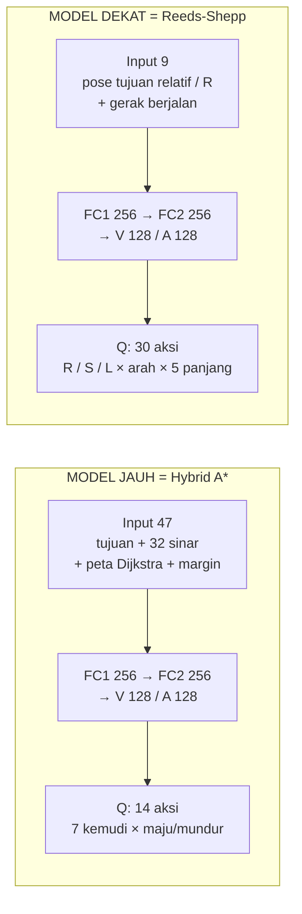
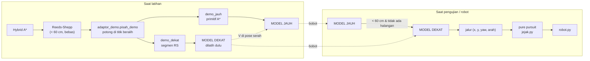

Struktur **full DQfD, dua model per robot** (versi aksi 4), branch `ver-1-2`, 2026-10-20. Konsep dasar DQfD dan sejarahnya ada di [[Deep Reinforcement Learning]].

> [!note] Inti
> - **Hybrid A\* dan Reeds-Shepp hanya menjadi demonstrator saat latihan.** Saat pengujian dan di robot, seluruh jalur dipilih dua jaringan DQfD, tanpa pemanggilan Reeds-Shepp maupun Hybrid A\* (diverifikasi: 0 panggilan selama `dqfd-murni` merencanakan).
> - **Model jauh meniru masukan & keluaran Hybrid A\*.**
> - **Model dekat meniru masukan & keluaran Reeds-Shepp.**
> - **Model jauh berhenti di dalam 60 cm bila tidak ada halangan.** Bila masih ada halangan, model jauh **berjalan lanjut** sampai tidak ada halangan, lalu model dekat melanjutkan.

```
awal ──[MODEL JAUH = Hybrid A*]──> berhenti: < 60 cm DAN tidak ada halangan ──[MODEL DEKAT = Reeds-Shepp]──> tujuan
                                   (masih ada halangan -> model jauh lanjut)
```

---

## 1. Model jauh vs model dekat

### 1.1 Peran

| | **MODEL JAUH** (`id0N_jauh.pt`) | **MODEL DEKAT** (`id0N_dekat.pt`) |
|---|---|---|
| Meniru | **Hybrid A\*** | **Reeds-Shepp** |
| Bekerja | posisi awal → titik serah | titik serah → tujuan |
| Tugas | navigasi memutari rintangan | pendaratan presisi |
| Melihat rintangan? | **ya** (32 sinar + peta Dijkstra) | **tidak**, sama dengan RS. Tabrakan dicegah mask lingkungan |
| Selesai sukses bila | di dalam 60 cm **dan** tidak ada halangan (bagian 3) | tiba ≤ **1,0 cm & 2°** |
| Masukan | **47** angka | **9** angka |
| Keluaran | **14** aksi | **30** aksi |
| Parameter | 145.807 | 138.143 |
| Data latih | `demo_jauh_id0N.npz` | `demo_dekat_id0N.npz` + `demo_dekat_tambahan_id0N.npz` |
| Urutan latih | kedua (biaya mendarat dari V model dekat) | pertama |

### 1.2 Masukan (INPUT)

| Isi | Model JAUH (47), seperti masukan Hybrid A\* | Model DEKAT (9), seperti masukan Reeds-Shepp |
|---|---|---|
| Posisi tujuan relatif (maju, samping) | indeks 0–1, ÷ 300 cm | indeks 0–1, **÷ R** (radius belok 25,7 cm, seperti `reeds_shepp_paths`) |
| Jarak lurus ke tujuan | indeks 2, ÷ 300 cm | – (sudah tersirat di 0–1) |
| Selisih arah hadap tujuan (cos, sin) | indeks 3–4 | indeks 2–3 |
| Penanda arah tujuan bebas | indeks 5 | indeks 4 |
| Pendekatan lurus 32,4 cm muat depan / belakang | indeks 6–7 | indeks 5–6 (target tembakan RS, `_approach_dirs`) |
| Arah gerak & kelengkungan berjalan | indeks 8–9 | indeks 7–8 (biaya RS bergantung padanya, `_rs_cost`) |
| **32 sinar jarak ke rintangan** | **indeks 10–41** | **tidak ada** |
| **Peta Dijkstra** (biaya memutari rintangan + arah turunnya) | **indeks 42–44** | **tidak ada** |
| Margin keselamatan, jarak bebas badan | indeks 45–46 | **tidak ada** |

### 1.3 Keluaran (OUTPUT)

| | Model JAUH (14), seperti keluaran Hybrid A\* | Model DEKAT (30), seperti keluaran Reeds-Shepp |
|---|---|---|
| Bentuk | **primitif**: 7 tingkat kemudi × maju/mundur | **segmen RS**: 3 jenis × maju/mundur × 5 panjang |
| Kemudi | −41,3 / −30,3 / −16,3 / 0 / +16,3 / +30,3 / +41,3° | **R** (kanan penuh −41,3°) / **S** (lurus) / **L** (kiri penuh +41,3°) |
| Panjang | 7,3 cm | 7,3 / 3,65 / 1,83 / 0,91 / 0,46 cm (1, ½, ¼, ⅛, 1/16 langkah) |
| Indeks | 0–6 maju, 7–13 mundur | `panjang × 6 + kemudi × 2 + arah` (kemudi R, S, L; arah maju, mundur) |



## 2. Posisi di dalam sistem



- DQfD **hanya** menggantikan perencana jalur. Pelacak (pure pursuit), wasit, dan `robot.py` tidak berubah.
- ID 01 dan ID 02 memakai susunan yang sama, dengan bobot terpisah yang dilatih dari demo masing-masing.

## 3. Aturan berhenti model jauh

Model jauh berhenti, lalu model dekat mengambil alih, bila **kedua** syarat terpenuhi:

1. **Titik acuan di dalam 60 cm** dari tujuan (`analytic_dist`). Ini batas **terjauh**, sama dengan jarak demonstrator mulai mencoba Reeds-Shepp.
2. **Tidak ada halangan untuk mendarat.** Diperiksa dua tahap:

| Tahap | Saat latihan (demonstrator) | Saat pengujian (robot) |
|---|---|---|
| Saringan cepat | Peta Dijkstra tidak memaksa memutar (biaya Dijkstra = jarak oktil grid), atau sudah < 25 cm (`RADIUS_SERAH_PAKSA_CM`) | sama |
| Jalur pendaratan bebas | **Tembakan Reeds-Shepp dari pose itu bebas tabrakan**, syarat yang sama persis dengan saat Hybrid A\* beralih ke RS | **Model dekat mencoba mendarat dari pose itu** dan berhasil tanpa tabrakan |

Bila masih ada halangan, **model jauh berjalan lanjut** dan memperkecil jarak, lalu dicek lagi di pose berikutnya. Saat pengujian, paling banyak **12** percobaan pendaratan per rute (`MAKS_SERAH`, semula 6; lihat bagian 12.1), masing-masing ≤ 0,6 s (`BATAS_DEKAT_S`).

Akibatnya:
- Saat latihan, model jauh berhenti **tepat** di titik demonstrator beralih ke Reeds-Shepp, jadi demo jauh = primitif Hybrid A\* dan demo dekat = **100% segmen Reeds-Shepp**.
- Saat pengujian, tidak ada Reeds-Shepp sama sekali. Yang memutuskan "tidak ada halangan" adalah model dekat sendiri.

Demonstrator memakai parameter `konfig.PARAM_RENCANA`: Reeds-Shepp hanya dicoba < 60 cm dari tujuan (percobaan berkala `analytic_every` dimatikan), dan Hybrid A\* selalu mengambil RS begitu tembakannya bebas (79/79 terukur).

## 4. Demo: pemotongan dan uji penerimaan

```
jalur demo = [awal] + (4 pose per primitif A*) x N + (pose ekor Reeds-Shepp)
aksi jauh  = primitif A*, diurai PERSIS (1 kelompok 4 pose = 1 primitif)
aksi dekat = ekor RS -> per segmen: aksi panjang penuh + aksi pendek untuk sisanya
             (dibulatkan ke 1/16 langkah, ditulis biner ½ + ¼ + ⅛ + 1/16)
```

Busur Reeds-Shepp memakai kelengkungan yang **sama persis** dengan kemudi penuh (radius = 1/κ_max). Pada 200 ekor RS, pecahan sampai 1/16 membuat semuanya mendarat ≤ 1,0 cm & 1,2°.

Demo yang tidak bisa dipakai dibuang dengan kode alasan (`adaptor_demo.TOLAK`):

| Kode | Arti |
|---|---|
| `belum_bebas` | RS demonstrator mulai saat peta Dijkstra masih menunjukkan halangan (RS memutari rintangan) |
| `tanpa_rs` | Hybrid A\* tiba tanpa ekor RS, sehingga tidak ada bagian model dekat |
| `jauh_margin` | Bagian A\* menyentuh margin (peta dengan robot lain sebagai rintangan) |
| `dekat_margin` | Ekor RS hasil urai menyimpang sekitar 1 cm dan menyentuh margin |
| `dekat_presisi` | Ekor RS hasil urai tidak mendarat ≤ 1 cm & 2° |

Uji penerimaan (`python -m drl.adaptor_demo --uji`, 30 rute per robot per peta):

| | Kalibrasi | Rumah | Rumah2 |
|---|---|---|---|
| Lulus ID 01 / ID 02 | 28/30, 29/30 | 24/30, 25/28 | 30/30, 30/30 |
| Ditolak ID 01 | dekat_presisi 2 | belum_bebas 2, dekat_margin 4 | – |
| Ditolak ID 02 | dekat_margin 1 | dekat_margin 2, tanpa_rs 1 | – |
| Selisih bagian jauh dari A\* | 0 | 0 | 0 |
| Galat akhir dekat, rata (maks) | 0,6 cm / 0,5° (0,97 cm / 1,04°) | 0,4 cm / 0,4° (0,92 cm / 1,43°) | 0,6 cm / 0,4° (0,93 cm / 1,01°) |
| Simpang dari A\* + RS, maks | 0,96 cm | 0,86 cm | 0,89 cm |
| Biaya vs A\* + RS | −0,9 s.d. −0,4% | +0,2 s.d. +0,3% | −0,8 s.d. −0,7% |

## 5. MDP (`lingkungan.py`)

Satu episode = satu perencanaan satu model. Tidak ada dinamika (jeda kemudi, ramp gas, kamera); itu urusan pelacak.

| | Model JAUH | Model DEKAT |
|---|---|---|
| Mulai dari | pose awal, diam | pose serah, dengan arah & kelengkungan berjalan (`d0`, `k0`) |
| Selesai sukses | berhenti (bagian 3) | tiba ≤ 1,0 cm & 2° (arah bebas: posisi saja) |
| Reset ditolak bila | sudah boleh berhenti di pose awal ("sudah di radius dekat") | sudah di tujuan |
| Imbalan akhir | − **nilai serah**: biaya mendarat menurut model dekat | – |

**Mask** (aksi terlarang, Q = −10⁹):
1. Badan menyentuh zona di salah satu sub-titik (aturan Hybrid A\*, termasuk kelonggaran "lepas diri" bila awalnya menempel).
2. Aksi panjang **penuh** yang mendarat di sel yang sudah dikunjungi **dengan arah yang sama** (sel `_key` Hybrid A\*: 4,9 cm, 10°). Arah ikut dihitung karena manuver maju-mundur RS memang melewati sel yang sama dua kali.
3. Aksi **pendek** (hanya model dekat) yang mendarat di **sel halus** yang sudah dikunjungi dengan arah sama: 1/16 sel A\* (0,3 cm, 0,625°), lebih kecil dari gerak terpendek (0,46 cm > 0,3 × √2).
4. Aksi pendek setelah 32 dipakai dalam satu episode (`MAKS_PENDEK`).

**Reward** = −biaya langkah, dengan rumus ekspansi Hybrid A\* untuk panjang aksi itu (`p` = panjang):

```
biaya = p · (1 atau reverse_cost 2,0)
      + steer_cost 0,3 · p · |κ|/κmax
      + steer_change_cost 6,0 · |κ − κ_sebelum|/κmax
      + switch_cost 32,4 · [ganti arah]
      + clearance_penalty(margin_min, p)
```

| Akhir | Syarat | Catatan |
|---|---|---|
| Berhenti (jauh) | bagian 3 | sukses; reward − nilai serah |
| Tiba (dekat) | ≤ 1 cm & 2° | sukses |
| Buntu | semua aksi ter-mask | reward −5000 cm tambahan |
| Terpotong | 300 langkah | bukan keadaan terminal untuk DQN |

**Nilai serah** = −max_a Q_dekat(pose serah) × 100, dipotong ≥ 0 (biaya buntu bila model dekat tidak punya aksi sah). Karena model dekat buta rintangan, V-nya berperan seperti **biaya Reeds-Shepp tanpa rintangan**, yaitu heuristik non-holonomik di Hybrid A\* standar. Dengan nilai ini model jauh belajar tiba di batas 60 cm dengan arah yang enak didaratkan.

## 6. Masukan model jauh: 47 angka

Kerangka robot (x maju, y samping).

| Indeks | Jml | Isi | Skala |
|---|---|---|---|
| 0–1 | 2 | Posisi tujuan relatif: maju, samping | ÷ 300 cm |
| 2 | 1 | Jarak lurus ke tujuan | ÷ 300 cm |
| 3–4 | 2 | Selisih arah hadap tujuan (cos, sin) | (1, 0) bila arah bebas |
| 5 | 1 | Penanda arah tujuan bebas | 0/1 |
| 6–7 | 2 | Pendekatan lurus 32,4 cm muat dari depan / dari belakang | 0/1 |
| 8 | 1 | Arah gerak terakhir | +1 / −1 / 0 |
| 9 | 1 | Kelengkungan kemudi terakhir | κ/κmax |
| 10–41 | 32 | **Sinar**: jarak tepi badan ke zona, setiap 11,25°, dari pusat badan | 0 = menempel, 1 = ≥ 100 cm |
| 42 | 1 | **Heuristik Dijkstra**: biaya tempuh ke tujuan memutari rintangan | ÷ 300 cm |
| 43–44 | 2 | Arah turun heuristik (cos, sin) | kerangka robot |
| 45 | 1 | Margin keselamatan yang dipakai | 8 cm = 1,0 |
| 46 | 1 | Jarak bebas badan sekarang | ÷ 20 cm, dipotong −1…1 |

Sinar dan peta Dijkstra adalah padanan **peta rintangan** yang dibaca Hybrid A\*. Peta Dijkstra yang sama juga dipakai saringan berhenti (bagian 3).

## 7. Masukan model dekat: 9 angka

Persis besaran yang dipakai Hybrid A\* untuk menyusun dan menilai tembakan Reeds-Shepp: `reeds_shepp_paths((x, y, yaw), target, radius)`, target dari `_approach_dirs`, dan `_rs_cost(segmen, d, k)`.

| Indeks | Isi | Skala |
|---|---|---|
| 0–1 | Posisi tujuan relatif: maju, samping | ÷ R = 25,7 cm (radius belok rencana, 1/κ_max) |
| 2–3 | Selisih arah hadap tujuan (cos, sin) | (1, 0) bila arah bebas |
| 4 | Penanda arah tujuan bebas | 0/1 |
| 5–6 | Pendekatan lurus 32,4 cm muat dari depan / dari belakang | 0/1 |
| 7 | Arah gerak yang sedang berjalan | +1 / −1 / 0 |
| 8 | Kelengkungan yang sedang berjalan | κ/κmax |

**Tidak ada sinar, peta, maupun margin.** Model dekat buta rintangan, sama dengan Reeds-Shepp. Tabrakan dicegah mask lingkungan, dan pencarian mencoba aksi berikutnya menurut Q, seperti `_best_free_rs` mencoba kandidat RS dari yang termurah.

## 8. Keluaran

### 8.1 Model jauh: 14 primitif Hybrid A\*

| Aksi | Gerak | Panjang | Kemudi |
|---|---|---|---|
| 0–6 | maju | 7,3 cm (4 sub-titik) | −41,3 / −30,3 / −16,3 / 0 / +16,3 / +30,3 / +41,3° |
| 7–13 | mundur | 7,3 cm | sama |

### 8.2 Model dekat: 30 segmen Reeds-Shepp

Indeks = `panjang × 6 + kemudi × 2 + arah`:

| Panjang | R+ | R− | S+ | S− | L+ | L− |
|---|---|---|---|---|---|---|
| 1 langkah (7,3 cm) | 0 | 1 | 2 | 3 | 4 | 5 |
| ½ (3,65 cm) | 6 | 7 | 8 | 9 | 10 | 11 |
| ¼ (1,83 cm) | 12 | 13 | 14 | 15 | 16 | 17 |
| ⅛ (0,91 cm) | 18 | 19 | 20 | 21 | 22 | 23 |
| 1/16 (0,46 cm) | 24 | 25 | 26 | 27 | 28 | 29 |

R = kanan penuh (κ = −κ_max), S = lurus, L = kiri penuh (κ = +κ_max), mengikuti penamaan segmen Reeds-Shepp; "+" maju, "−" mundur. Uji kecil (150 demo ID 01): R+ 18,1%, R− 12,3%, S+ 23,0%, S− 14,9%, L+ 20,2%, L− 11,4%; aksi pendek 39,9%.

## 9. Susunan neuron: Dueling DQN

Lapis tersembunyi sama untuk kedua model. Yang membuatnya meniru Hybrid A\* atau Reeds-Shepp adalah **masukan dan keluarannya**.

| Lapis | Model JAUH | Parameter | Model DEKAT | Parameter |
|---|---|---|---|---|
| FC1 · ReLU | 47 → 256 | 12.288 | 9 → 256 | 2.560 |
| FC2 · ReLU | 256 → 256 | 65.792 | 256 → 256 | 65.792 |
| V-hidden · ReLU | 256 → 128 | 32.896 | 256 → 128 | 32.896 |
| V(s) | 128 → 1 | 129 | 128 → 1 | 129 |
| A-hidden · ReLU | 256 → 128 | 32.896 | 256 → 128 | 32.896 |
| A(s,a) | 128 → 14 | 1.806 | 128 → 30 | 3.870 |
| **Total** | | **145.807** | | **138.143** |

- **Q(s,a) = V(s) + A(s,a) − rata-rata(A)** = −(biaya sisa) / 100 (`SKALA_REWARD`).
- V model jauh termasuk biaya mendarat dari pose serah. V model dekat adalah biaya mendarat itu sendiri.

### Diagram neuron

Cara membaca: lingkaran = neuron, ⋮ = neuron yang tidak digambar (FC1/FC2 berisi 256, V/A-hidden 128), garis abu-abu = bobot yang dilatih. Garis hijau dari A ke Q dan garis putus-putus dari V ke Q **tidak punya bobot**: itu rumus Q = V + A − rata(A).

**Model jauh** (meniru Hybrid A\*): 47 masukan dikelompokkan per indeks, 14 keluaran primitif.

![[Gambar/DQfD neuron model jauh.svg]]

**Model dekat** (meniru Reeds-Shepp): 9 masukan tanpa sinar/peta, 30 keluaran segmen R/S/L dikelompokkan per panjang.

![[Gambar/DQfD neuron model dekat.svg]]

## 10. Algoritma belajar (`dqfd.py`, `latih.py`)

### 10.1 Loss

```
J = J_DQ + λn · J_n + λe · J_E + L2
```

| Komponen | Isi | Nilai |
|---|---|---|
| J_DQ | TD 1 langkah, Double DQN (argmax jaringan online, nilai jaringan target) | γ = 0,995 |
| J_n | TD n langkah | n = 10, λn = 1,0 (fase A), 0,5 (fase B) |
| J_E | Large-margin, **hanya sampel demo**: max_a[Q(s,a) + l(a_E,a)] − Q(s,a_E) | margin l = 0,8, λe = 1,0 |
| L2 | weight decay Adam | 1e-5 |

Semua max/argmax hanya atas aksi sah (mask). Buffer: prioritized replay proporsional (α = 0,4). Data demo di depan dan permanen, dengan bonus prioritas ε_demo = 1,0. Data agen melingkar di belakangnya (300.000 transisi).

### 10.2 Urutan dan fase

1. **Model dekat dilatih dulu**, dari `demo_dekat` + `demo_dekat_tambahan` (digabung otomatis).
2. **Model jauh** sesudahnya. Imbalan akhir demonya dihitung dari `ep_obs_serah` / `ep_mask_serah` dengan model dekat; dataset menyimpan reward tanpa nilai itu. Saat latihan sendiri, lingkungan memanggil model dekat di setiap pose berhenti (`nilai_serah`), dan aturan berhenti memakai cek demonstrator (tembakan RS bebas).

| | Fase A: pra-latih | Fase B: latihan sendiri |
|---|---|---|
| Data | Hanya demo (episode bukan uji) | Demo + hasil rollout jaringan sendiri |
| Panjang | 20.000 langkah gradien | 150.000 langkah lingkungan, 0,5 langkah gradien per langkah lingkungan |
| Learning rate | 1e-4 | 5e-5 |
| Eksplorasi | – | ε 0,1 → 0,01 di antara aksi sah, 16 rollout paralel |
| Skenario | – | 70% dari demo latih, 30% acak baru (dekat: start 15–60 cm dari tujuan); 50% dari peta tersulit |

Lain-lain:
- batch 256, sinkron jaringan target setiap 2.000 langkah, evaluasi setiap 5.000 langkah;
- GPU `--perangkat cuda` (NVIDIA GeForce RTX 5050 Laptop, CUDA 12.8);
- peta tersulit = jenis peta asli dengan waktu Hybrid A\* rata-rata terbesar (Rumah).

### 10.3 Validasi dan pemilihan model

- Set validasi: setiap episode latih ke-10 (bukan set uji). 40 rute per jenis peta, 60 untuk peta tersulit. Perencana **mundur**.
- **Skor** = % tiba − 10 × (p90 rasio biaya − 1). Model terbaik disimpan sebagai `id0N_<jenis>.pt`, yang terakhir sebagai `id0N_<jenis>_akhir.pt`.

| Model | Yang dinilai | Metrik di baris evaluasi |
|---|---|---|
| Dekat | pendaratan dari pose awal episode dekat | tiba, rasio biaya vs demo, **galat akhir cm / deg**, `balik` (titik balik) vs demo |
| Jauh | **rute gabungan** jauh + dekat | `TIBA gabungan`, `gagal jauh/dekat`, rasio vs demo A\* + RS, `balik`, galat akhir |

- `gagal_jauh`: tidak pernah mencapai pose yang lolos saringan berhenti, artinya masalah **navigasi**.
- `gagal_dekat`: ada pose seperti itu, tetapi semua gagal didaratkan, artinya masalah **presisi**.

## 11. Dataset (`skenario.py`)

| Berkas (`drl/data/`) | Isi |
|---|---|
| `demo_jauh_id0N.npz` | Episode model jauh (primitif A\*), plus `ep_obs_serah` (9 angka) / `ep_mask_serah` (30) model dekat di pose serah |
| `demo_dekat_id0N.npz` | Episode model dekat (segmen RS) dari potongan demo utama; `ep_awal` = pose serah, `ep_d0` / `ep_k0` |
| `demo_dekat_tambahan_id0N.npz` | `--hanya-dekat`: skenario yang start-nya 15–60 cm dari tujuan |
| `negatif_id0N.npz` | Skenario yang gagal di Hybrid A\*: DQfD harus ikut buntu |
| `ringkasan_id0N.json` | Jumlah per peta, demo ditolak per kode, histogram aksi, komposisi |

| | Nilai |
|---|---|
| Demo A\* per robot | 5.000 (`--n`) |
| Peta | Semua di `Camera/peta_constraint/` dibagi rata + sintetis 30%: Kalibrasi, Rumah, Rumah2 masing-masing 23,3%, sintetis 30% |
| Satu tugas | Satu peta, 20 skenario. Setiap tugas ke-10 masuk set uji |
| Variasi | margin cadangan 6 cm 20%, badan robot lain sebagai rintangan 30%, arah tujuan bebas 30%, jarak dekat 15–60 cm 15% (sisanya 40–300 cm) |

Uji kecil (150 demo ID 01): 112 episode jauh dan 142 episode dekat, dan semuanya bisa diputar ulang persis dari metadata (`--periksa`).

## 12. Saat pengujian (`perencana_dqfd.py`)

`rencanakan_dua()`:
1. Model jauh mencari jalur.
2. Di setiap pose yang lolos saringan (di dalam 60 cm, peta Dijkstra bebas), **model dekat mencoba mendarat**. Kalau berhasil tanpa tabrakan, model jauh berhenti di situ.
3. Kalau gagal, model jauh **berjalan lanjut** dari pose itu dan memperkecil jarak (maksimal 12 percobaan pendaratan, masing-masing ≤ 0,6 s).
4. Start yang sudah memenuhi syarat langsung ke model dekat.
5. Jalur akhir = jalur jauh + jalur dekat, dengan format yang sama dengan Hybrid A\*.

Metode pencarian (dipakai untuk kedua model):
- **Mundur**: greedy menurut Q; saat buntu kembali dan coba aksi terbaik berikutnya (anggaran 600).
- **Terbaik-dulu**: f = g + c(a) + 2,0 × h, h = max(0, −Q × 100 − c(a)), anggaran 1.200. Untuk model dekat, langkah yang langsung tiba diberi h = 0.
- **Gabungan** (bawaan): terbaik-dulu dengan 75% batas waktu, lalu mundur bila gagal.

| Mode `--perencana` | Isi |
|---|---|
| `dqfd-murni` | **Hanya dua jaringan.** Gagal = tidak berangkat. Dipakai untuk pengujian |
| `dqfd` | Dua jaringan, dengan Hybrid A\* + Reeds-Shepp sebagai cadangan dan gerbang mutu 1,3 |
| `astar` | Hybrid A\* + Reeds-Shepp, tanpa DQfD |

Di layar `navigasi.py`, bagian model jauh berwarna hijau/oranye, bagian model dekat biru muda/ungu, dan titik pergantiannya ditandai **"serah"**.

### 12.1 Jumlah percobaan pendaratan (`MAKS_SERAH`)

Evaluasi pertama (model ID 01: jauh langkah 55.000, dekat langkah 95.000) tiba 91,1%. Kegagalannya hampir semua **gagal dekat** (8,7%), terkumpul di Rumah. Uji pada rute yang sama, tanpa latih ulang:

| Pengaturan | 30 rute yang gagal | 80 rute acak | Waktu median (acak) |
|---|---|---|---|
| Maks 6, pose serah pertama dulu (semula) | 0/30 | 73/80 | 205 ms |
| **Maks 12, pose serah pertama dulu** (dipakai) | **20/30** | **76/80** | 151 ms |
| Anggaran ×3 + 2 s per pendaratan, maks 12 | 22/30 | – | – |
| ≤ 12 kandidat diurutkan biaya jauh + V model dekat, coba maks 6 | 10/30 | 73/80 | 263 ms |
| ≤ 6 kandidat diurutkan biaya jauh + V model dekat, coba maks 6 | 0/30 | 73/80 | 150 ms |

- Yang menentukan adalah **banyaknya pose serah yang dicoba**, bukan anggaran per pencarian.
- **Urutan berdasarkan V model dekat tidak membantu.** Model dekat buta rintangan, jadi V-nya terlalu optimis di tempat sempit dan tidak bisa membedakan pose serah yang mudah dari yang sulit.
- Rute normal tidak melambat, karena biasanya berhasil di percobaan pertama atau kedua (rata-rata 2,2). Perkiraan tiba ID 01 naik ke sekitar 97%; evaluasi ulang penuh belum dijalankan.

**Kompatibilitas model.** Checkpoint mencatat `max_steer_deg`, `r_plan_cm`, `versi_aksi` (= 4), `jenis`, `n_aksi`, dan `n_obs`. Model dengan profil kemudi, ruang aksi, atau jenis lain ditolak dengan pesan yang menyuruh latih ulang. Model dan data versi sebelumnya diarsipkan di `model_dqn/arsip_*` dan `drl/data/arsip_*`.

## 13. Keputusan terbuka

> [!warning] Disetel setelah pelatihan penuh
> - **Metode pencarian** (mundur / terbaik-dulu / gabungan): pilih dari `drl.evaluasi` di set uji.
> - **`BATAS_DEKAT_S`** (0,6 s). `MAKS_SERAH` sudah ditetapkan 12 (bagian 12.1).
> - **Latih ulang supaya model jauh menyerahkan di pose yang benar-benar bisa didaratkan**: model dekat dilatih dari pose serah yang dicapai model jauh (DAgger), dan nilai akhir model jauh diambil dari hasil pendaratan sungguhan.
> - **`RADIUS_SERAH_PAKSA_CM`** (25 cm): tetap, atau `None` supaya saringan Dijkstra berlaku mutlak.

- **Bobot per peta**: ketiga peta asli dibagi rata. Opsi `--bobot` belum dibuat.
- **Nama model**: "jauh/dekat" bisa diganti menjadi `hybrid` / `rs`.

## 14. Perintah

Dari folder `Forklift Robot Program`:

```powershell
python -m drl.adaptor_demo --uji                           # demonstrator & pemotongan lulus di semua peta?
python -m drl.skenario --id 1,2 --n 5000                   # demo jauh + dekat + negatif
python -m drl.skenario --id 1,2 --n 5000 --hanya-dekat     # demo dekat tambahan
python -m drl.skenario --id 1,2 --periksa                  # integritas semua dataset
python -m drl.latih --id 1,2 --perangkat cuda              # dekat lalu jauh; --model dekat / jauh, --tampil
python -m drl.evaluasi --id 1,2                            # nilai di set uji
python navigasi.py --simulasi --id 1 --perencana dqfd-murni
```

Opsi peta untuk `drl.skenario`: `--peta Kalibrasi,Rumah` (hanya peta tertentu), `--porsi-sintetis 0.2`.
