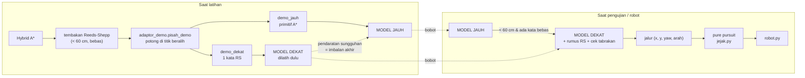

Struktur **DQfD dua model per robot**, versi aksi 6, branch `ver-1-4`, 2026-10-23. Konsep dasar DQfD ada di [[Deep Reinforcement Learning]].

> [!note] Inti
> - **Hybrid A\* + Reeds-Shepp adalah demonstrator saat latihan.**
> - **Model jauh meniru Hybrid A\*:** 47 masukan (tujuan + peta rintangan) → Q untuk 14 primitif gerak. Saat dipakai tidak ada pencarian A\*.
> - **Model dekat memilih kata Reeds-Shepp:** 9 masukan (masukan rumus RS) → Q untuk 88 kata RS. Panjang segmen kata dihitung **rumus RS**, lalu kata dicoba berurutan menurut Q sampai ada yang bebas tabrakan. Hasilnya tiba **tepat** di tujuan.
> - **Model jauh berhenti di dalam 60 cm bila ada kata RS yang bebas.** Bila belum ada, model jauh **berjalan lanjut** dan mencoba lagi dari pose berikutnya.

```
awal ──[MODEL JAUH: 14 primitif]──> < 60 cm, ada kata RS bebas? ──ya──[MODEL DEKAT: 1 kata RS]──> tujuan (eksak)
                                            │ tidak
                                            └── model jauh lanjut satu primitif, coba lagi
```

---

## 1. Dua model

### 1.1 Peran

| | **MODEL JAUH** (`id0N_jauh.pt`) | **MODEL DEKAT** (`id0N_dekat.pt`) |
|---|---|---|
| Meniru | Hybrid A\* | pilihan kurva Reeds-Shepp |
| Bekerja | posisi awal → titik serah | titik serah → tujuan |
| Tugas | navigasi memutari rintangan | pendaratan presisi |
| Melihat rintangan? | ya: 32 sinar + peta Dijkstra | tidak; tabrakan dicek setelah kata dipilih |
| Masukan | **47** angka | **9** angka |
| Keluaran | **14** primitif | **88** kata RS |
| Satu episode | banyak langkah, sampai serah | **satu** aksi |
| Selesai sukses bila | di dalam 60 cm dan ada kata RS bebas (bagian 3) | kata RS bebas tabrakan → tiba eksak |
| Parameter | 145.807 | 145.625 |
| Data latih | `demo_jauh_id0N.npz` | `demo_dekat_id0N.npz` + `_tambahan` + `_dagger` |
| Urutan latih | kedua | pertama |

### 1.2 Masukan

| Isi | Model JAUH (47) | Model DEKAT (9) |
|---|---|---|
| Posisi tujuan relatif (maju, samping) | indeks 0–1, ÷ 300 cm | indeks 0–1, **÷ R** (radius belok 25,7 cm) |
| Jarak lurus ke tujuan | indeks 2 | – |
| Selisih arah hadap tujuan (cos, sin) | indeks 3–4 | indeks 2–3 |
| Penanda arah tujuan bebas | indeks 5 | indeks 4 |
| Pendekatan lurus muat depan / belakang | indeks 6–7 | indeks 5–6 |
| Arah gerak & kelengkungan berjalan | indeks 8–9 | indeks 7–8 |
| 32 sinar jarak ke rintangan | indeks 10–41 | – |
| Peta Dijkstra (biaya + arah turun) | indeks 42–44 | – |
| Margin, jarak bebas badan | indeks 45–46 | – |

### 1.3 Keluaran

| | Model JAUH (14) | Model DEKAT (88) |
|---|---|---|
| Bentuk | primitif: 7 tingkat kemudi × maju/mundur | **kata RS utuh**: 44 jenis kata × 2 titik sambung |
| Panjang | 7,3 cm tetap | dari **rumus RS** (kontinu, eksak) |
| Kemudi | −41,3 … +41,3° (7 tingkat) | R (kanan penuh −41,3°), S (lurus), L (kiri penuh +41,3°) |
| Indeks | 0–6 maju, 7–13 mundur | `slot × 44 + keluarga × 4 + varian` (bagian 4) |

## 2. Posisi di dalam sistem



- DQfD hanya menggantikan perencana jalur. Pelacak (pure pursuit), wasit, dan `robot.py` tidak berubah.
- ID 01 dan ID 02 memakai susunan yang sama, dengan bobot terpisah yang dilatih dari demo masing-masing.

## 3. Aturan berhenti model jauh

Model jauh berhenti, lalu model dekat mengambil alih, bila **kedua** syarat terpenuhi:

1. **Titik acuan di dalam 60 cm** dari tujuan (`analytic_dist`), jarak yang sama dengan saat demonstrator mulai mencoba Reeds-Shepp.
2. **Ada kata RS yang bebas tabrakan dari pose itu.**

| Tahap | Membuat dataset | Latihan sendiri model jauh (fase B) | Saat pengujian |
|---|---|---|---|
| Saringan cepat | peta Dijkstra tidak memaksa memutar (biaya Dijkstra = jarak oktil grid), atau sudah < 25 cm (`RADIUS_SERAH_PAKSA_CM`) | sama | sama |
| Ada kata bebas? | tembakan RS demonstrator bebas (syarat yang sama dengan saat Hybrid A\* beralih ke RS) | model dekat mencoba mendarat (`buat_cek_pendaratan`) | model dekat mencoba mendarat |

Bila belum ada kata yang bebas, model jauh **berjalan lanjut** satu primitif lalu mencoba lagi, paling banyak **1000** percobaan per rute (`MAKS_SERAH`). Satu percobaan kurang dari 1 ms, jadi yang membatasi sebenarnya batas waktu perencanaan (2 s). Ini setara dengan Hybrid A\* yang mencoba RS di setiap simpul di dalam 60 cm. Model jauh saat ini mencoba rata-rata 5,8 / 7,7 kali per rute (ID 01 / ID 02).

Di dataset, model jauh berhenti **tepat** di titik demonstrator beralih ke Reeds-Shepp. Jadi demo jauh = primitif Hybrid A\*, dan demo dekat = satu kata, yaitu ekor RS Hybrid A\*.

## 4. Kata Reeds-Shepp: keluaran model dekat

Rumus Reeds-Shepp di perencana (`forklift_planner._rs_words`) menghitung kurva dari **11 keluarga**, masing-masing dalam **4 varian**. `lingkungan.kata_rs_semua` memakai urutan yang sama, dengan indeks tetap:

| Keluarga | Kata dasar | Jenis |
|---|---|---|
| 0 | L S L | CSC |
| 1 | L S R | CSC |
| 2 | L R L | CCC |
| 3 | L R L (dibalik) | CCC |
| 4 | L R L R (a) | CCCC |
| 5 | L R L R (b) | CCCC |
| 6 | L R S L | CCSC |
| 7 | L R S R | CCSC |
| 8 | L S R L | CSCC |
| 9 | R S R L | CSCC |
| 10 | L R S L R | CCSCC |

| Varian | Arti |
|---|---|
| 0 asli | seperti kata dasar |
| 1 balik waktu (`~`) | semua gerak dibalik: maju ↔ mundur |
| 2 cermin | kiri ↔ kanan (L ↔ R) |
| 3 keduanya | balik waktu + cermin |

**Titik sambung (slot).** Robot harus masuk lurus 32,4 cm ke tujuan, jadi kurva RS disambung ke titik di depan atau di belakang tujuan, lalu ditutup segmen lurus. Rumusnya sama dengan `_analytic` Hybrid A\*:

| Slot | Tujuan berarah, pendekatan lurus muat | Pendekatan lurus tidak muat | Tujuan tanpa arah |
|---|---|---|---|
| 0 (aksi 0–43) | masuk **maju** | langsung ke tujuan | menghadap tujuan |
| 1 (aksi 44–87) | masuk **mundur** | – (di-mask) | membelakangi tujuan |

**Indeks aksi** = `slot × 44 + keluarga × 4 + varian`. Contoh: aksi 4 = L S R asli, masuk maju; aksi 87 = R L S R L balik waktu + cermin, masuk mundur.

**Mask.** Kata yang tidak punya solusi geometri untuk pose itu. Tabrakan **tidak** masuk mask, karena dicek saat kata dijalankan.

**Memilih kata (saat dipakai):**
1. Jaringan memberi Q untuk 88 kata. Kata yang di-mask diberi Q = −10⁹.
2. Kata diurutkan menurut Q (tertinggi dulu).
3. Untuk kata pertama: panjang segmen dari rumus RS, kurva disampel tiap 2,4 cm, dan badan + margin dicek di setiap sampel.
4. Bebas → dipakai, robot tiba tepat di tujuan. Menabrak → kata berikutnya.
5. Semua menabrak → pendaratan dari pose ini gagal, dan model jauh berjalan lanjut (bagian 3).

**Demonstrator** (`aksi_demonstrator`) = persis `_best_free_rs` Hybrid A\*: kandidat diurutkan menurut biaya rumus, paling banyak 6 dicek tabrakan, berhenti begitu kandidat berikutnya tidak lebih murah dari yang sudah bebas, lalu ambil yang bebas termurah. Model dekat mencoba **semua** kata sah, jadi kadang menemukan kurva bebas di pose yang ditolak demonstrator.

Contoh langkah demi langkah, dibandingkan dengan rumus Reeds-Shepp: artifact "Pendaratan Kata demi Kata".

## 5. Demo dan uji penerimaan

```
jalur demo = [awal] + (4 pose per primitif A*) × N + (pose ekor Reeds-Shepp)
aksi jauh  = primitif A*, diurai PERSIS (1 kelompok 4 pose = 1 primitif)
aksi dekat = SATU kata RS = pilihan demonstrator di titik serah = ekor RS A*
```

Demo yang tidak bisa dipakai dibuang dengan kode alasan (`adaptor_demo.TOLAK`):

| Kode | Arti |
|---|---|
| `belum_bebas` | RS demonstrator mulai saat peta Dijkstra masih menunjukkan halangan |
| `tanpa_rs` | Hybrid A\* tiba tanpa ekor RS, sehingga tidak ada bagian model dekat |
| `jauh_margin` | bagian A\* menyentuh margin (peta dengan robot lain sebagai rintangan) |

Uji penerimaan (`python -m drl.adaptor_demo --uji`, 15 rute per robot per peta):

| | Kalibrasi | Rumah | Rumah2 |
|---|---|---|---|
| Lulus ID 01 / ID 02 | 15/15, 15/15 | 14/15, 13/14 | 15/15, 15/15 |
| Ditolak | – | `belum_bebas` / `tanpa_rs` | – |
| Selisih bagian jauh dari A\* | 0 | 0 | 0 |
| Kata dekat vs ekor RS A\* | identik | identik | identik |
| Galat akhir, simpangan, selisih biaya | 0 / 0 / +0,0% | 0 / 0 / +0,0% | 0 / 0 / +0,0% |
| Segmen per kata, rata-rata | 4,1 / 3,8 | 3,7 / 3,8 | 3,8 / 4,1 |

Pemeriksaan lain: 44 kata berindeks tetap identik dengan `reeds_shepp_paths` (3.000/3.000 pose acak); demonstrator identik dengan `_analytic` Hybrid A\* (437/437 rute uji, kurva dan biaya).

## 6. MDP (`lingkungan.py`)

| | Model JAUH | Model DEKAT |
|---|---|---|
| Mulai dari | pose awal, diam | pose serah, dengan arah & kelengkungan berjalan (`d0`, `k0`) |
| Satu aksi | primitif 7,3 cm | satu kata RS utuh |
| Selesai sukses | berhenti (bagian 3) | kata bebas tabrakan → tiba eksak |
| Selesai gagal | buntu (semua aksi ter-mask) | kata menabrak |
| Reset ditolak bila | sudah boleh berhenti di pose awal | sudah di tujuan |
| Imbalan | −biaya per primitif; di serah − biaya pendaratan model dekat | −biaya kurva, atau −5000 bila menabrak |

**Mask model jauh** (Q = −10⁹):
1. Badan menyentuh zona di salah satu sub-titik (aturan Hybrid A\*, termasuk kelonggaran "lepas diri" bila awalnya menempel).
2. Primitif yang mendarat di sel yang sudah dikunjungi **dengan arah yang sama** (sel `_key` Hybrid A\*: 4,9 cm, 10°).

**Biaya** memakai rumus Hybrid A\*, sehingga satuannya sama dengan g-cost A\*:

```
primitif (panjang p):  p · (1 atau reverse_cost 2,0) + steer_cost 0,3 · p · |κ|/κmax
                       + steer_change_cost 6,0 · |κ − κ_sebelum|/κmax
                       + switch_cost 32,4 · [ganti arah] + clearance_penalty
kata RS:               _rs_cost(segmen, d, k) (rumus yang sama, per segmen)
                       + clearance_penalty di tiap sampel 2,4 cm
```

| Akhir | Syarat | Catatan |
|---|---|---|
| Serah (jauh) | bagian 3 | sukses; imbalan − biaya pendaratan |
| Tiba (dekat) | kata bebas | sukses, galat 0 |
| Tabrakan (dekat) | kata menabrak | imbalan −5000 |
| Buntu (jauh) | semua aksi ter-mask | imbalan −5000 |
| Serah habis (jauh) | jatah percobaan pendaratan habis | imbalan −5000 |
| Terpotong (jauh) | 300 langkah | bukan keadaan terminal untuk DQN |

## 7. Masukan model jauh: 47 angka

Kerangka robot (x maju, y samping).

| Indeks | Jml | Isi | Skala |
|---|---|---|---|
| 0–1 | 2 | Posisi tujuan relatif: maju, samping | ÷ 300 cm |
| 2 | 1 | Jarak lurus ke tujuan | ÷ 300 cm |
| 3–4 | 2 | Selisih arah hadap tujuan (cos, sin) | (1, 0) bila arah bebas |
| 5 | 1 | Penanda arah tujuan bebas | 0/1 |
| 6–7 | 2 | Pendekatan lurus 32,4 cm muat dari depan / dari belakang | 0/1 |
| 8 | 1 | Arah gerak terakhir | +1 / −1 / 0 |
| 9 | 1 | Kelengkungan kemudi terakhir | κ/κmax |
| 10–41 | 32 | **Sinar**: jarak tepi badan ke zona, setiap 11,25°, dari pusat badan | 0 = menempel, 1 = ≥ 100 cm |
| 42 | 1 | **Heuristik Dijkstra**: biaya tempuh ke tujuan memutari rintangan | ÷ 300 cm |
| 43–44 | 2 | Arah turun heuristik (cos, sin) | kerangka robot |
| 45 | 1 | Margin keselamatan yang dipakai | 8 cm = 1,0 |
| 46 | 1 | Jarak bebas badan sekarang | ÷ 20 cm, dipotong −1…1 |

## 8. Masukan model dekat: 9 angka

Persis besaran yang dipakai rumus Reeds-Shepp: `reeds_shepp_paths((x, y, yaw), target, radius)`, target dari `_approach_dirs`, biaya `_rs_cost(segmen, d, k)`.

| Indeks | Isi | Skala |
|---|---|---|
| 0–1 | Posisi tujuan relatif: maju, samping | ÷ R = 25,7 cm (radius belok rencana, 1/κmax) |
| 2–3 | Selisih arah hadap tujuan (cos, sin) | (1, 0) bila arah bebas |
| 4 | Penanda arah tujuan bebas | 0/1 |
| 5–6 | Pendekatan lurus 32,4 cm muat dari depan / dari belakang (slot 0 / 1 tersedia) | 0/1 |
| 7 | Arah gerak yang sedang berjalan | +1 / −1 / 0 |
| 8 | Kelengkungan yang sedang berjalan | κ/κmax |

Model dekat tidak melihat rintangan, sama dengan rumus RS. Yang dipelajari jaringan adalah **urutan** kata: kata mana yang murah dan biasanya bebas.

## 9. Susunan neuron: Dueling DQN

Lapis tersembunyi sama untuk kedua model.

| Lapis | Model JAUH | Parameter | Model DEKAT | Parameter |
|---|---|---|---|---|
| FC1 · ReLU | 47 → 256 | 12.288 | 9 → 256 | 2.560 |
| FC2 · ReLU | 256 → 256 | 65.792 | 256 → 256 | 65.792 |
| V-hidden · ReLU | 256 → 128 | 32.896 | 256 → 128 | 32.896 |
| V(s) | 128 → 1 | 129 | 128 → 1 | 129 |
| A-hidden · ReLU | 256 → 128 | 32.896 | 256 → 128 | 32.896 |
| A(s,a) | 128 → 14 | 1.806 | 128 → 88 | 11.352 |
| **Total** | | **145.807** | | **145.625** |

- **Q(s,a) = V(s) + A(s,a) − rata-rata(A)** = −(biaya sisa) / 100 (`SKALA_REWARD`).
- Q model jauh mencakup biaya sampai tujuan, termasuk pendaratan. Q model dekat adalah biaya kata itu (atau −50 bila diperkirakan menabrak).

### Diagram neuron

Lingkaran = neuron, ⋮ = neuron yang tidak digambar, garis abu-abu = bobot yang dilatih. Garis hijau dari A ke Q dan garis putus-putus dari V ke Q **tidak punya bobot**: itu rumus Q = V + A − rata(A).

**Model jauh**: 47 masukan dikelompokkan per indeks, 14 keluaran primitif.

![[Gambar/DQfD neuron model jauh.svg]]

**Model dekat**: 9 masukan rumus RS, 88 keluaran kata RS dikelompokkan per titik sambung.

![[Gambar/DQfD neuron model dekat.svg]]

## 10. Algoritma belajar (`dqfd.py`, `latih.py`)

### 10.1 Loss

```
J = J_DQ + λn · J_n + λe · J_E + L2
```

| Komponen | Isi | Nilai |
|---|---|---|
| J_DQ | TD 1 langkah, Double DQN (argmax jaringan online, nilai jaringan target) | γ = 0,995 |
| J_n | TD n langkah | n = 10, λn = 1,0 (fase A), 0,5 (fase B) |
| J_E | Large-margin, **hanya sampel demo**: max_a[Q(s,a) + l(a_E,a)] − Q(s,a_E) | margin l = 0,8, λe = 1,0 |
| L2 | weight decay Adam | 1e-5 |

Semua max/argmax hanya atas aksi sah (mask). Buffer: prioritized replay proporsional (α = 0,4). Data demo di depan dan permanen, dengan bonus prioritas ε_demo = 1,0. Data agen melingkar di belakangnya (300.000 transisi).

Episode model dekat hanya satu aksi, jadi TD 1 langkah dan n langkah sama: Q dekat langsung belajar biaya kata yang dipilih (atau −50 bila menabrak). J_E mendorong kata demonstrator ke urutan pertama.

### 10.2 Urutan dan fase

1. **Model dekat dilatih dulu**, dari `demo_dekat` + `demo_dekat_tambahan` + `demo_dekat_dagger` (digabung otomatis).
2. **Model jauh** sesudahnya. Imbalan di pose serah = **pendaratan sungguhan** model dekat (`--nilai-akhir pendaratan`, bawaan): biaya kata yang bebas, atau biaya buntu bila semua kata menabrak. Di fase B, lingkungan jauh berhenti hanya di pose tempat model dekat benar-benar mendarat, sama dengan saat pengujian.

| | Fase A: pra-latih | Fase B: latihan sendiri |
|---|---|---|
| Data | Hanya demo (episode bukan uji) | Demo + hasil rollout jaringan sendiri |
| Panjang (bawaan) | 20.000 langkah gradien | 150.000 langkah lingkungan, 0,5 langkah gradien per langkah lingkungan |
| Learning rate | 1e-4 | 5e-5 |
| Eksplorasi | – | ε 0,1 → 0,01 di antara aksi sah, 16 rollout paralel |
| Skenario | – | 70% dari demo latih, 30% acak baru (dekat: start 15–60 cm dari tujuan); 50% dari peta tersulit |

Lain-lain: batch 256, sinkron jaringan target setiap 2.000 langkah, evaluasi setiap 5.000 langkah, GPU `--perangkat cuda` (NVIDIA GeForce RTX 5050 Laptop, CUDA 12.8). Peta tersulit = jenis peta asli dengan waktu Hybrid A\* rata-rata terbesar (Rumah). `--awal <folder>` memulai latihan dari bobot model berjenis sama.

Karena satu pendaratan model dekat kurang dari 1 ms, latihan model jauh cepat: 27.000 langkah gradien (`--pra 2000 --mandiri 50000`) selesai ±6 menit per robot.

### 10.3 Validasi dan pemilihan model

- Set validasi: setiap episode latih ke-10 (bukan set uji). 40 rute per jenis peta, 60 untuk peta tersulit.
- **Skor** = % tiba − 10 × (p90 rasio biaya − 1). Model terbaik disimpan sebagai `id0N_<jenis>.pt`, yang terakhir sebagai `id0N_<jenis>_akhir.pt`, dan setiap evaluasi sebagai `id0N_<jenis>/ckpt_<langkah>.pt`.

| Model | Yang dinilai | Metrik di baris evaluasi |
|---|---|---|
| Dekat | pendaratan dari pose awal episode dekat | `tiba greedy` = kata pertama menurut Q sudah bebas; `mundur` = tiba dengan mencoba berurutan; rasio biaya vs demo |
| Jauh | **rute gabungan** jauh + dekat, dengan metode operasional (`--metode-validasi`, bawaan gabungan) | `TIBA gabungan`, `gagal jauh/dekat`, rasio vs demo A\* + RS, `balik` |

- `gagal_jauh`: tidak pernah mencapai pose yang lolos saringan berhenti.
- `gagal_dekat`: ada pose seperti itu, tetapi dari semuanya tidak ada kata RS yang bebas.

## 11. Dataset

| Berkas (`drl/data/`) | Isi | Dibuat oleh |
|---|---|---|
| `demo_jauh_id0N.npz` | Episode model jauh (primitif A\*), plus `ep_obs_serah` (9) / `ep_mask_serah` (88) model dekat di pose serah | `drl.skenario`; kolom serah dapat dihitung ulang dengan `drl.hitung_ulang_obs` |
| `demo_dekat_id0N.npz` | Episode model dekat: satu kata RS dari titik serah demo utama; `ep_awal` = pose serah, `ep_d0` / `ep_k0` | `drl.skenario` atau `drl.demo_rs` |
| `demo_dekat_tambahan_id0N.npz` | sama, dari skenario yang start-nya 15–60 cm dari tujuan | `drl.skenario --hanya-dekat` atau `drl.demo_rs` |
| `demo_dekat_dagger_id0N.npz` | sama, dari pose serah yang dicapai model jauh terlatih (DAgger) | `drl.dagger` atau `drl.demo_rs` |
| `negatif_id0N.npz` | Skenario yang gagal di Hybrid A\*: DQfD harus ikut buntu | `drl.skenario` |

**`drl.demo_rs`** membangun dataset model dekat dari **metadata** dataset model dekat lain (pose serah, arah & kemudi berjalan, tujuan, peta, margin, robot lain), tanpa menjalankan Hybrid A\* lagi: satu aksi demonstrator per episode. Hasilnya lolos putar ulang (`skenario --periksa`).

| | ID 01 | ID 02 |
|---|---|---|
| `demo_jauh` | 3.824 episode (379 uji), 43.506 transisi | 3.728 episode (358 uji), 42.023 transisi |
| `demo_dekat` | 4.856 episode (457 uji) | 4.848 episode (463 uji) |
| `demo_dekat_tambahan` | 4.933 episode (449 uji) | 4.938 episode (450 uji) |
| `demo_dekat_dagger` | 4.123 episode | 4.220 episode |
| Kata yang pernah dipilih demonstrator | 76–79 dari 88 | 76–79 dari 88 |

| Pembangkitan | Nilai |
|---|---|
| Demo A\* per robot | 5.000 (`--n`) |
| Peta | Semua di `Camera/peta_constraint/` dibagi rata + sintetis 30% |
| Satu tugas | Satu peta, 20 skenario. Setiap tugas ke-10 masuk set uji |
| Variasi | margin cadangan 6 cm 20%, badan robot lain sebagai rintangan 30%, arah tujuan bebas 30%, jarak dekat 15–60 cm 15% (sisanya 40–300 cm) |

## 12. Saat pengujian (`perencana_dqfd.py`)

`rencanakan_dua()`:
1. Model jauh mencari jalur (metode gabungan: terbaik-dulu dengan 75% batas waktu, lalu mundur).
2. Di setiap pose yang lolos saringan (di dalam 60 cm, peta Dijkstra bebas), **model dekat mencoba mendarat**: kata RS dicoba berurutan menurut Q (`cari` memakai "urutan Q" untuk model dekat).
3. Ada kata bebas → model jauh berhenti, jalur = jalur jauh + kurva RS.
4. Tidak ada → model jauh berjalan lanjut, paling banyak 1000 percobaan pendaratan per rute.
5. Start yang sudah memenuhi syarat langsung ke model dekat.

| Mode `--perencana` | Isi |
|---|---|
| `dqfd-murni` | dua jaringan + rumus RS untuk panjang kata, tanpa Hybrid A\*. Gagal = tidak berangkat |
| `dqfd` | sama, dengan Hybrid A\* + Reeds-Shepp sebagai cadangan dan gerbang mutu 1,3 |
| `astar` | Hybrid A\* + Reeds-Shepp, tanpa DQfD |

Di layar `navigasi.py`, bagian model jauh berwarna hijau/oranye, bagian model dekat biru muda/ungu, dan titik pergantiannya ditandai **"serah"**.

**Kompatibilitas model.** Checkpoint mencatat `max_steer_deg`, `r_plan_cm`, `versi_aksi`, `jenis`, `n_aksi`, dan `n_obs`. Checkpoint yang tidak cocok dengan profil kemudi atau ruang aksi program (`lingkungan.VERSI_MODEL`) ditolak dengan pesan yang menyuruh latih ulang.

## 13. Model saat ini dan hasilnya (2026-10-23)

| | ID 01 | ID 02 |
|---|---|---|
| Model dekat | langkah 5.000 | langkah 5.000 |
| Model jauh | langkah 10.000 | langkah 25.000 |
| Profil kemudi | 55°, R rencana 25,7 cm | 55°, R rencana 25,7 cm |

Checkpoint model jauh dipilih dengan metode gabungan di rute validasi (bukan set uji). Untuk ID 01, langkah 10.000 memberi tiba 99,4%, biaya p90 1,17×, dan waktu p90 115 ms di 345 rute validasi.

**Set uji, rute penuh** (`drl.evaluasi`, ID 01: 379 rute, ID 02: 358 rute):

| | **Gabungan (bawaan)** ID 01 / 02 | Mundur ID 01 / 02 | Hybrid A\* + RS ID 01 / 02 |
|---|---|---|---|
| Tiba | **99,7 / 99,7%** | 97,6 / 98,6% | 99,5 / 100% |
| Waktu median (ms) | 21,6 / 20,3 | 17,7 / 16,4 | 16,8 / 14,6 |
| Waktu p90 (ms) | **111 / 129** | 61 / 62 | 150 / 138 |
| Biaya vs A\*, median / p90 | 1,00 / 1,19 · 1,00 / 1,17× | 1,08 / 2,35 · 1,11 / 2,29× | 1 |
| Ganti arah, rata-rata | 1,66 / 1,67 | 3,68 / 3,53 | 1,43 / 1,43 |
| Gagal jauh / dekat | 0,3 / 0 · 0 / 0,3% | 0,8 / 1,6 · 0 / 1,4% | – |
| Percobaan pendaratan per rute | 5,8 / 7,7 | 7,9 / 6,6 | – |
| Galat akhir rencana | 0 | 0 | 0 |

- **Gabungan**: tiba setara Hybrid A\*, waktu p90 lebih cepat dari Hybrid A\*, median ±5 ms di atasnya.
- **Mundur**: paling cepat (p90 ±60 ms), tetapi jalurnya lebih mahal dan lebih sering ganti arah.

**Hanya bagian dekat** (449 / 450 rute, start ≤ 60 cm), semua metode: tiba **100%**, waktu median 2,7 / 2,8 ms (Hybrid A\* + RS 2,8 / 2,9 ms), biaya p90 **1,00×**, galat 0. Bagian dekat setara dengan Reeds-Shepp, baik jalurnya maupun waktunya.

**Negatif** (150 skenario yang Hybrid A\* nyatakan tanpa jalur): menyerah 99,3 / 98,0%; jalur yang ditemukan (1 / 3) semuanya sah.

**Navigasi simulasi** (`drl.uji_pose_akhir`, 3 skenario × 2 robot, pure pursuit + jeda kemudi): 12/12 tiba, tidak ada yang masuk zona, galat ujung rencana 0. Galat pose akhir robot berasal dari pelacak, dengan besar yang sama untuk Hybrid A\* + RS.

**Rincian waktu** (tiga peta, rata-rata per rute): sinar model jauh 50–54%, primitif 20–23%, jaringan 9%, pendaratan model dekat 5–8%.

Perbandingan dengan branch RS-optimize, tabel navigasi simulasi lengkap, dan rincian waktu per bagian: [[Perbandingan Hybrid A-star RS vs DQfD]].

## 14. Keputusan terbuka

> [!warning] Belum diputuskan
> - **Optimasi sinar.** 32 sinar model jauh memakan separuh waktu DQfD.
> - **Metode operasional.** Gabungan (mutu jalur setara A\*) atau mundur (p90 ±60 ms, jalur lebih mahal).
> - **`MAKS_SERAH`** (1000): cukup, atau dibatasi waktu saja.
> - **`RADIUS_SERAH_PAKSA_CM`** (25 cm): tetap, atau `None` supaya saringan Dijkstra berlaku mutlak.
> - **Uji yang belum dijalankan:** `drl.uji_navigasi` dengan derau pose dan uji robot nyata.

## 15. Perintah

Dari folder `Forklift Robot Program`:

```powershell
python -m drl.adaptor_demo --uji                           # demonstrator & pemotongan lulus di semua peta?

# dataset: dari awal ...
python -m drl.skenario --id 1,2 --n 5000                   # demo jauh + dekat + negatif
python -m drl.skenario --id 1,2 --n 5000 --hanya-dekat     # demo dekat tambahan
python -m drl.dagger --id 1,2 --n 3000                     # demo dekat dari pose serah model jauh terlatih
# ... atau model dekat dari metadata dataset model dekat lain
python -m drl.demo_rs --id 1,2 --sumber drl/data/<folder lain> --keluar drl/data
python -m drl.skenario --id 1,2 --periksa                  # integritas semua dataset

python -m drl.latih --id 1,2 --model dekat --perangkat cuda   # beberapa menit per robot
python -m drl.latih --id 1,2 --model jauh --perangkat cuda    # imbalan akhir = pendaratan model dekat
python -m drl.latih --id 1,2 --model jauh --awal <folder> --pra 2000 --mandiri 50000 --perangkat cuda   # latih lanjut, ±6 menit
python -m drl.evaluasi --id 1,2                               # nilai di set uji
python -m drl.uji_pose_akhir --id 1                           # pose akhir robot simulasi vs Hybrid A* + RS
python navigasi.py --simulasi --id 1 --perencana dqfd-murni
```
