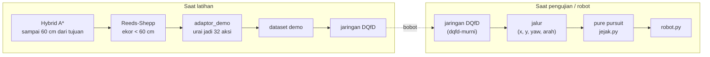
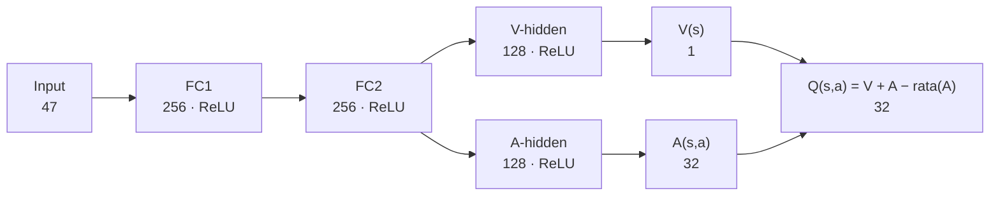

	Struktur **DQfD versi 2 ("full DQfD")** di branch `ver-1-1`, 2026-10-20. Lanjutan dari [[Deep Reinforcement Learning]], yang menjelaskan versi 1 (14 primitif + aksi SAMBUNG).

> [!note] Inti perubahan
> **Hybrid A\* dan Reeds-Shepp hanya menjadi demonstrator saat latihan.** Saat pengujian dan di robot, seluruh jalur dari awal sampai tujuan dipilih jaringan DQfD. Tidak ada pemanggilan Reeds-Shepp maupun Hybrid A\* (diverifikasi: 0 panggilan selama `dqfd-murni` merencanakan).
>
> Versi 1 menutup jalur dengan aksi SAMBUNG yang memanggil Reeds-Shepp. Di versi 2, ekor Reeds-Shepp milik demonstrator **diurai menjadi primitif**, dan jaringan menirunya langkah demi langkah.

---

## 1. Posisi di dalam sistem



- DQfD **hanya** menggantikan perencana jalur. Pelacak (pure pursuit), wasit, dan `robot.py` tidak berubah.
- Satu model per robot. Profil kemudi ID 01 dan ID 02 sekarang sama (lihat bagian 2), tetapi bobotnya tetap dilatih terpisah dari demo masing-masing.

## 2. Profil kemudi yang dipakai

Dari uji busur 2026-10-20 (lihat `konfig.py`, tabel `ROBOT`):

| | ID 01 | ID 02 |
|---|---|---|
| `max_steer_deg` | 55,0° | 55,0° |
| Kemudi rencana (× `PLAN_STEER_RATIO` 0,75) | 41,25° | 41,25° |
| R rencana | 25,7 cm | 25,7 cm |
| Kompensasi kemudi (`robot.py`) | sisi kanan (`kemudi_kanan`) | tidak ada |

Kompensasi kemudi hanya bekerja saat perintah dikirim ke servo. Perencana dan DQfD tetap memakai sudut ideal yang simetris.

## 3. Demonstrator: Hybrid A\* + Reeds-Shepp

Parameter operasional dari `konfig.PARAM_RENCANA`:

- **Reeds-Shepp hanya dicoba bila titik acuan robot < `analytic_dist` = 60 cm dari tujuan.** Percobaan berkala setiap ekspansi ke-4 (`analytic_every`) dimatikan.
- Akibatnya porsi Reeds-Shepp di jalur turun dari 93% ke 52%. Ganti arah maju-mundur per jalur naik dari 0,83 ke 1,70 (peta lapang). Ini dipilih dengan sadar.
- Dengan aturan ini, Hybrid A\* **selalu** mengambil Reeds-Shepp begitu tembakannya bebas di dalam 60 cm (79/79 kesempatan terukur).

### 3.1 Penguraian jalur demo menjadi aksi (`adaptor_demo.py`)

```
jalur = [awal] + (4 pose per primitif) x N + (pose ekor Reeds-Shepp)
```

| Bagian | Diurai menjadi | Ketepatan |
|---|---|---|
| Primitif Hybrid A\* | 1 kelompok 4 pose = 1 aksi primitif penuh | **Persis**: jalur dan biaya identik dengan g-cost A\* (selisih 0) |
| Ekor Reeds-Shepp | Per segmen: primitif penuh (kemudi penuh/lurus) + primitif pendek untuk sisa panjang | **Hampiran**: sisa dibulatkan ke ⅛ langkah, ditulis biner (½ + ¼ + ⅛) |

Busur Reeds-Shepp memakai kelengkungan yang **sama persis** dengan primitif kemudi penuh (radius = 1/κ_max). Yang berbeda hanya panjangnya.

Hasil uji penerimaan (`python -m drl.adaptor_demo --uji`, 30 rute per robot per peta):

| | Kalibrasi | Rumah | Rumah2 |
|---|---|---|---|
| Lulus ID 01 / ID 02 | 30/30, 29/30 | 28/30, 25/28 | 30/30, 30/30 |
| Ekor RS ditolak (menyentuh margin setelah diurai) | 0 / 1 | 2 / 3 | 0 / 0 |
| Simpang ekor dari RS asli, rata / maks | 0,7 / 1,7 cm | 0,6 / 1,3 cm | 0,7 / 1,8 cm |
| Biaya urai vs A\* + RS, rata | −0,9 / −1,3% | −0,6 / −0,1% | −1,8 / −2,6% |

Pada 210 ekor RS yang diukur sebelum implementasi, pecahan ½ + ¼ + ⅛ membuat **semua** ekor mendarat di toleransi tujuan (galat maks 1,9 cm / 2,3°). Dengan ½ saja hanya 128/210.

## 4. MDP (`lingkungan.py`)

Satu episode = satu perencanaan, dari pose awal sampai **tiba** di toleransi tujuan (3,2 cm, 12°). Tidak ada dinamika (jeda kemudi, ramp gas, kamera); itu urusan pelacak.

### 4.1 Aksi: 32

| Aksi | Gerak | Panjang | Kemudi |
|---|---|---|---|
| 0–6 | maju | 7,3 cm (4 sub-titik) | −41,3 / −30,3 / −16,3 / 0 / +16,3 / +30,3 / +41,3° |
| 7–13 | mundur | 7,3 cm | sama |
| 14–31 | **pendek**, maju/mundur | 3,65 cm (2 sub-titik), 1,83 cm, 0,91 cm | −41,3° / 0 / +41,3° |

Urutan aksi pendek: `14 + pecahan × 6 + kemudi × 2 + arah`, dengan pecahan (½, ¼, ⅛), kemudi (kanan penuh, lurus, kiri penuh), arah (maju, mundur). Urutan ini bagian dari kontrak model (`VERSI_AKSI = 2`).

### 4.2 Mask (aksi terlarang, Q = −10⁹)

1. Badan menyentuh zona di salah satu sub-titik (aturan Hybrid A\*, termasuk kelonggaran "lepas diri" bila awalnya menempel).
2. **Primitif penuh** yang mendarat di sel yang sudah dikunjungi **dengan arah gerak yang sama**. Sel = `_key` Hybrid A\* (4,9 cm, 10°). Arah ikut dihitung karena manuver maju-mundur Reeds-Shepp memang melewati sel yang sama dua kali.
3. **Primitif pendek** yang mendarat di **sel halus** yang sudah dikunjungi dengan arah yang sama. Sel halus = ⅛ sel A\* (0,6 cm, 1,25°). Ukuran ini lebih kecil dari gerak terpendek (0,91 cm > 0,6 × √2), jadi satu gerak pendek selalu pindah sel, sedangkan bolak-balik ke tempat yang sama tertutup.
4. Primitif pendek setelah **24** dipakai dalam satu episode (`MAKS_PENDEK`). Ekor RS terpanjang yang terukur 6 segmen × ≤ 3 = 18.

### 4.3 Reward dan akhir episode

Reward = −biaya langkah, dengan rumus ekspansi Hybrid A\* untuk panjang aksi itu (`p` = panjang):

```
biaya = p · (1 atau reverse_cost 2,0)
      + steer_cost 0,3 · p · |κ|/κmax
      + steer_change_cost 6,0 · |κ − κ_sebelum|/κmax
      + switch_cost 32,4 · [ganti arah]
      + clearance_penalty(margin_min, p)
```

| Akhir | Syarat | Catatan |
|---|---|---|
| Tiba | pose dalam 3,2 cm dan 12° dari tujuan | sukses |
| Buntu | semua aksi ter-mask | reward −5000 cm tambahan |
| Terpotong | 300 langkah (`MAKS_LANGKAH`) | bukan keadaan terminal untuk DQN |

## 5. Input jaringan: 47 angka

Kerangka robot (x maju, y samping). Jarak dibagi 300 cm kecuali disebut lain.

| Indeks | Jml | Isi | Skala |
|---|---|---|---|
| 0–1 | 2 | Posisi tujuan relatif: maju, samping | ÷ 300 cm |
| 2 | 1 | Jarak lurus ke tujuan | ÷ 300 cm |
| 3–4 | 2 | Selisih arah hadap tujuan (cos, sin) | 1, 0 bila arah bebas |
| 5 | 1 | Penanda arah tujuan bebas | 0/1 |
| 6–7 | 2 | Jalur lurus pendekatan 32,4 cm muat dari depan / dari belakang | 0/1 |
| 8 | 1 | Arah gerak terakhir | +1 / −1 / 0 |
| 9 | 1 | Kelengkungan kemudi terakhir | κ/κmax |
| 10–41 | 32 | **Sinar**: jarak tepi badan ke zona, setiap 11,25°, berpangkal di pusat badan | 0 = menempel, 1 = ≥ 100 cm |
| 42 | 1 | **Heuristik Dijkstra**: biaya tempuh ke tujuan memutari rintangan | ÷ 300 cm |
| 43–44 | 2 | Arah turun heuristik (cos, sin) | kerangka robot |
| 45 | 1 | Margin keselamatan yang dipakai | 8 cm = 1,0 |
| 46 | 1 | Jarak bebas badan sekarang | ÷ 20 cm, dipotong −1…1 |

Tidak ada input dari Reeds-Shepp. Heuristik Dijkstra (42–44) **dipertahankan** (keputusan 2026-10-20): itu peta jarak yang dihitung sekali per tujuan, bukan perencana jalur. Tanpa itu jaringan hanya melihat sejauh sinarnya (100 cm).

## 6. Susunan neuron: Dueling DQN

**47 input → FC1 256 → FC2 256 → cabang V 128 / A 128 → 32 output. 148.129 parameter per robot.**



| Lapis | Bentuk bobot | Parameter |
|---|---|---|
| FC1 | 47 → 256 | 12.288 |
| FC2 | 256 → 256 | 65.792 |
| V-hidden | 256 → 128 | 32.896 |
| V(s) | 128 → 1 | 129 |
| A-hidden | 256 → 128 | 32.896 |
| A(s,a) | 128 → 32 | 4.128 |
| **Total** | | **148.129** (versi 1 dengan 15 output: 145.936) |

- **V(s)**: perkiraan total biaya sisa ke tujuan.
- **A(s,a)**: kelebihan/kekurangan tiap aksi dibanding rata-rata.
- **Q** = −(biaya sisa) / 100 (`SKALA_REWARD`). Jadi −Q × 100 adalah perkiraan biaya jalur (cm berbobot) bila aksi itu diambil.

## 7. Algoritma belajar (`dqfd.py`, `latih.py`)

### 7.1 Loss

```
J = J_DQ + λn · J_n + λe · J_E + L2
```

| Komponen | Isi | Nilai |
|---|---|---|
| J_DQ | TD 1 langkah, Double DQN (argmax jaringan online, nilai jaringan target) | γ = 0,995 |
| J_n | TD n langkah | n = 10, λn = 1,0 (fase A), 0,5 (fase B) |
| J_E | Large-margin, **hanya sampel demo**: max_a[Q(s,a) + l(a_E,a)] − Q(s,a_E) | margin l = 0,8, λe = 1,0 |
| L2 | weight decay Adam | 1e-5 |

Semua max/argmax hanya atas aksi sah (mask).

Buffer: prioritized replay proporsional (α = 0,4). Data demo di depan dan **permanen**, dengan bonus prioritas ε_demo = 1,0. Data agen melingkar di belakangnya (300.000 transisi).

### 7.2 Fase pelatihan

| | Fase A: pra-latih | Fase B: latihan sendiri |
|---|---|---|
| Data | Hanya demo (episode bukan uji) | Demo + hasil rollout jaringan sendiri |
| Panjang | 20.000 langkah gradien | 150.000 langkah lingkungan, 0,5 langkah gradien per langkah lingkungan (75.000) |
| Learning rate | 1e-4 | 5e-5 |
| Eksplorasi | – | ε 0,1 → 0,01 di antara aksi sah, 16 rollout paralel |
| Skenario | – | 70% dari episode demo latih, 30% acak baru; 50% dari peta tersulit (`--porsi-sulit`) |

Lain-lain: batch 256, sinkron jaringan target setiap 2.000 langkah, evaluasi setiap 5.000 langkah, GPU via `--perangkat cuda` (NVIDIA GeForce RTX 5050 Laptop, CUDA 12.8).

**Peta tersulit** dipilih otomatis: jenis peta asli dengan waktu Hybrid A\* rata-rata terbesar di dataset.

### 7.3 Validasi dan pemilihan model

- Set validasi: setiap episode latih ke-10 disisihkan (bukan set uji). 40 rute per jenis peta, 60 untuk peta tersulit.
- Dinilai dengan perencana **mundur** (anggaran 600).
- **Skor** = % tiba − 10 × (p90 rasio biaya DQfD/A\* − 1). Checkpoint dengan skor terbaik disimpan sebagai `model_dqn/id0N.pt`.

Metrik untuk keputusan **satu vs dua model** (bagian 10):

| Metrik | Arti |
|---|---|
| `gagal_jauh` | % rute yang tidak pernah masuk radius 60 cm: masalah **navigasi** |
| `gagal_dekat` | % rute yang masuk 60 cm tetapi tidak mendarat: masalah **presisi** |
| `balik<60cm` | Rata-rata titik balik maju-mundur di dalam 60 cm pada rute yang tiba, dibanding demo di rute yang sama |

## 8. Dataset demo (`skenario.py`)

| | Nilai |
|---|---|
| Episode sukses per robot | 5.000 |
| Peta | Semua di `Camera/peta_constraint/` dibagi rata + sintetis 30%: Kalibrasi, Rumah, Rumah2 masing-masing 23,3% (1.167), sintetis 30% (1.500) |
| Satu tugas | Satu peta, 20 skenario. Setiap tugas ke-10 masuk set uji (peta sintetis di set uji tidak pernah dilihat saat latihan) |
| Variasi | margin cadangan 6 cm 20%, badan robot lain sebagai rintangan 30%, arah tujuan bebas 30%, jarak dekat 15–60 cm 15% (sisanya 40–300 cm) |
| Kegagalan A\* | Disimpan sebagai set negatif: DQfD harus ikut buntu dengan cepat |
| Ekor RS yang ditolak | Dihitung terpisah (`ekor_rs_ditolak`), bukan galat |

Uji kecil (200 demo ID 01): primitif pendek mengisi **19%** aksi demo, dan seluruh episode bisa diputar ulang persis dari metadata (`--periksa`).

## 9. Saat pengujian (`perencana_dqfd.py`)

| Mode `--perencana` | Isi |
|---|---|
| `dqfd-murni` | **Hanya jaringan.** Gagal = tidak berangkat. Dipakai untuk pengujian (keputusan 2026-10-20) |
| `dqfd` | Jaringan, dengan Hybrid A\* + Reeds-Shepp sebagai cadangan dan gerbang mutu 1,3 |
| `astar` | Hybrid A\* + Reeds-Shepp, tanpa DQfD |

Metode pencarian berpandu jaringan:

- **Mundur**: greedy menurut Q; saat buntu kembali dan coba aksi terbaik berikutnya (anggaran 600).
- **Terbaik-dulu** (bawaan): f = g + c(a) + 2,0 × h, h = max(0, −Q × 100 − c(a)), anggaran 1.200. Langkah yang langsung tiba diberi h = 0.

> [!warning] Belum diputuskan
> Metode bawaan dipilih dengan model versi 1. Model uji kecil versi 2 memberi hasil yang berubah-ubah antara mundur dan terbaik-dulu. **Pilih ulang setelah pelatihan penuh**, pada set validasi, seperti putaran 2.

### Kompatibilitas model

- Checkpoint mencatat `max_steer_deg`, `r_plan_cm`, `versi_aksi`, dan `n_aksi`.
- Model dengan profil kemudi lain atau ruang aksi lain **ditolak** dengan pesan yang menyuruh latih ulang.
- Model dan data versi 1 diarsipkan di `model_dqn/arsip_v1_sambung/` dan `drl/data/arsip_v1_sambung/`.

## 10. Keputusan terbuka

**Satu model vs dua model** (model jauh + model dekat < 60 cm). Keputusan 2026-10-20: **mulai dengan satu model.**

- Alasan: kualitas pendaratan bergantung pada cara robot *datang* ke batas 60 cm. Satu model memperhitungkan biaya seluruh sisa jalur, sedangkan dua model memotong rantai itu tepat di titik yang paling penting.
- Tanda perlu model dekat: `gagal_dekat` tinggi dibanding `gagal_jauh`, atau `balik<60cm` jauh di atas demo.
- Model dekat bisa dilatih dari bagian < 60 cm dataset yang sama, tanpa membangkitkan demo ulang.

**Bobot per peta.** Ketiga peta asli sekarang dibagi rata. Dataset versi 1 memberi porsi lebih ke peta sulit (Rumah 30%, Rumah2 25%, Kalibrasi 15%). Opsi `--bobot` belum dibuat.

## 11. Perintah

Dari folder `Forklift Robot Program`:

```bash
python -m drl.adaptor_demo --uji                  # demonstrator lulus di semua peta?
python -m drl.skenario --id 1,2 --n 5000          # bangkitkan demo
python -m drl.skenario --id 1,2 --periksa         # integritas dataset
python -m drl.latih --id 1,2 --perangkat cuda     # latih; --tampil untuk dasbor
python -m drl.evaluasi --id 1,2                   # nilai di set uji
python navigasi.py --simulasi --id 1 --perencana dqfd-murni
```

Opsi peta untuk `drl.skenario`: `--peta Kalibrasi,Rumah` (hanya peta tertentu), `--porsi-sintetis 0.2`.
