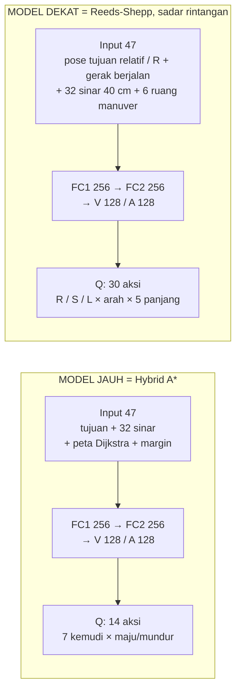
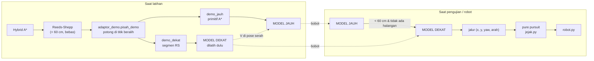

Struktur **full DQfD, dua model per robot** (versi aksi 5), branch `ver-1-3`, 2026-10-21. Konsep dasar DQfD dan sejarahnya ada di [[Deep Reinforcement Learning]]. Perbandingan performa dan waktu dengan Hybrid A\* + RS (versi 4): [[Perbandingan Hybrid A-star RS vs DQfD]].

> [!note] Inti
> - **Hybrid A\* dan Reeds-Shepp hanya menjadi demonstrator saat latihan.** Saat pengujian dan di robot, seluruh jalur dipilih dua jaringan DQfD, tanpa pemanggilan Reeds-Shepp maupun Hybrid A\* (diverifikasi: 0 panggilan selama `dqfd-murni` merencanakan).
> - **Model jauh meniru masukan & keluaran Hybrid A\*.**
> - **Model dekat meniru keluaran Reeds-Shepp, dan sadar rintangan** (ver-1-3): masukannya masukan Reeds-Shepp **+ 32 sinar + 6 ruang manuver** = 47 angka.
> - **Model jauh berhenti di dalam 60 cm bila tidak ada halangan.** Bila masih ada halangan, model jauh **berjalan lanjut** sampai tidak ada halangan, lalu model dekat melanjutkan.

```
awal ──[MODEL JAUH = Hybrid A*]──> berhenti: < 60 cm DAN tidak ada halangan ──[MODEL DEKAT = Reeds-Shepp]──> tujuan
                                   (masih ada halangan -> model jauh lanjut)
```

> [!important] Perubahan ver-1-3: model dekat sadar rintangan (versi aksi 5)
> **Masukan model dekat 9 → 47**: 9 angka Reeds-Shepp (tetap) + **32 sinar** jarak bebas dari tepi badan, jangkau 40 cm (indeks 9–40) + **6 ruang manuver**, yaitu berapa langkah penuh tiap segmen R/S/L × maju/mundur bisa dijalankan tanpa tabrakan (indeks 41–46). Keluaran tetap 30 segmen RS, demonstrator tetap Reeds-Shepp.
>
> **Kenapa.** Di versi 4 (9 masukan), model dekat buta rintangan. Hasil [[Perbandingan Hybrid A-star RS vs DQfD]]:
> - hampir semua kegagalan DQfD adalah gagal dekat, terutama di Rumah;
> - dari pose serah model jauh, hanya 36–39% percobaan pendaratan berhasil;
> - pendaratan yang gagal memakan 70–80% waktu model dekat.
>
> Mask memang mencegah tabrakan, tapi urutan aksi menurut Q tidak tahu mana manuver yang muat. Akibatnya pencarian banyak mundur dan sering buntu.
>
> **Status.** Model dan data versi 4 diarsipkan di `model_dqn/arsip_v4_dekat_buta/` dan `drl/data/arsip_v4_dekat_buta/`. Dataset versi 5 sudah dibangkitkan (identik dengan versi 4 kecuali 38 kolom masukan baru model dekat), dan data DAgger versi 4 dikonversi ke 47 kolom. **Model jauh versi 4 dipakai lagi** (masukan dan keluarannya tidak berubah), jadi yang perlu dilatih hanya model dekat (bagian 14). Hasil evaluasi di 10.4 dan 12.1 adalah hasil **versi 4**.

### 0.1 Hasil pertama: dilatih dari nol, LEBIH BURUK dari versi 4

Model dekat v5 dilatih dari nol (data sama dengan v4 + 38 kolom baru, model jauh = v4), 2026-10-21/22. Set uji, metode gabungan:

| | ID 01 v4 → v5 | ID 02 v4 → v5 |
|---|---|---|
| Tiba | 96,9 → **96,0%** (26 → 33 gagal) | 97,8 → **96,4%** (18 → 29 gagal) |
| Gagal dekat | 3,0 → 3,9% | 2,1 → 3,5% |
| Rumah | 90,7 → 90,2% | 93,0 → 91,5% |
| Rute diperbaiki / dirusak | 11 / 18 | 10 / 21 |
| Waktu median / p90 | 233 / 2.324 → 405 / 2.999 ms | 191 / 2.204 → 351 / 2.931 ms |
| Tiba ≤ 2 s | 88,5 → 84,8% | 89,0 → 86,5% |

Kelemahannya sudah terlihat di **validasi model dekat sendiri**, tanpa model jauh. Set validasinya sama persis untuk v4 dan v5:

| Validasi model dekat (model terbaik) | ID 01 v4 → v5 | ID 02 v4 → v5 |
|---|---|---|
| Setuju dengan demonstrator | 71,1 → 68,9% | 72,1 → 69,9% |
| Tiba | **62,2 → 45,0%** | 47,2 → 49,4% |
| Biaya p90 vs demo | **1,90 → 7,6×** | 1,95 → 5,1× |
| Ganti arah | 2,6 → 5,5 | 1,4 → 5,4 |

**Dugaan penyebab.** Demonstratornya (Reeds-Shepp) tidak memakai informasi rintangan. Bagi bagian meniru (J_E), 38 masukan baru tidak menjelaskan pilihan demonstrator, jadi jaringan mempelajari pola semu darinya. Ruang masukannya membesar (9 → 47) dengan data dan langkah yang sama. Manfaat informasi rintangan hanya bisa datang lewat Q-learning (fase B), dan sinyal itu terlalu lemah untuk menutup kerugiannya. Model dan evaluasinya diarsipkan di `model_dqn/arsip_v5_dekat_dari_nol/`.

### 0.2 Langkah berikutnya: mulai dari bobot v4 (`--awal`)

Model dekat v5 diinisialisasi dari model dekat v4. Bobot FC1 untuk 9 masukan lama disalin, dan bobot 38 masukan rintangan dimulai dari **nol** (`latih.bobot_awal`).
- Di langkah 0, jaringannya menghitung Q **persis** seperti v4. Diuji: selisih Q 0, argmax sama 100% untuk 20.000 keadaan per robot. Validasi langkah 0 identik dengan v4 (ID 01: tiba 62,2%, biaya p90 1,90, skor 53,3).
- Masukan rintangan baru dipakai sejauh menurunkan loss.
- Evaluasi langkah 0 ikut dalam pemilihan model terbaik, jadi hasilnya tidak bisa lebih buruk dari v4 **di set validasi**.

### 0.3 Hasil: mulai dari bobot v4, LEBIH BAIK dari versi 4 (2026-10-22)

`python -m drl.latih --id 1,2 --model dekat --awal model_dqn/arsip_v4_dekat_buta`, pengaturan latih bawaan, sekitar 30 menit per robot.

**Validasi model dekat** (set sama dengan 0.1):

| Model terbaik | ID 01: v4 / dari nol / **dari v4** | ID 02: v4 / dari nol / **dari v4** |
|---|---|---|
| Langkah | 90.000 / 85.000 / **30.000** | 90.000 / 90.000 / **90.000** |
| Tiba | 62,2 / 45,0 / **71,1%** | 47,2 / 49,4 / **68,9%** |
| Setuju dengan demonstrator | 71,1 / 68,9 / **73,4%** | 72,1 / 69,9 / **74,5%** |
| Biaya p90 vs demo | 1,90 / 7,60 / 1,94× | 1,95 / 5,08 / 2,19× |
| Ganti arah | 2,64 / 5,52 / 2,44 | 1,36 / 5,39 / 2,66 |
| Waktu 8 rute tersulit | 12,1 / 32,0 / 27,3 ms | 26,1 / 54,2 / 33,5 ms |

Kenaikannya stabil: setelah langkah 5.000, semua evaluasi di atas v4 (ID 01: 64–71%, ID 02: 54–69%). Jaringan memakai masukan rintangan secukupnya: norma bobot FC1 masukan baru 0,53 (ID 01) dan 1,13 (ID 02), masukan lama 13–14.

**Set uji** (`drl.evaluasi`, metode gabungan, **model jauh v4 yang sama**):

| | ID 01 v4 → **v5 (`--awal`)** | ID 02 v4 → **v5 (`--awal`)** | Hybrid A\* + RS (ID 01 / 02) |
|---|---|---|---|
| **Tiba** | 96,9 → **99,0%** (26 → 8 gagal) | 97,8 → **98,4%** (18 → 13 gagal) | 99,8 / 100% |
| Gagal jauh / gagal dekat | 0,1 / 3,0 → 0,1 / **0,8%** | 0,1 / 2,1 → 0,1 / **1,5%** | – |
| **Rumah** | 90,7 → **97,7%** | 93,0 → **94,5%** | 100% |
| Kalibrasi / Rumah2 / sintetis | 100 / 99,5 / 98,0 → 100 / 100 / 98,8% | 100 / 98,9 / 99,2 → 100 / 99,4 / 99,6% | |
| Rute penuh / rute dekat saja | 94,2 / 99,1 → 98,2 / 99,8% | 96,1 / 99,1 → 96,6 / 99,8% | |
| Rute diperbaiki / dirusak | 20 / 2 | 8 / 3 | |
| Biaya vs A\* + RS, median / p90 | 1,04 / 1,71 → **1,02 / 1,45×** | 1,04 / 1,58 → **1,02 / 1,50×** | 1 |
| Ganti arah rata-rata | 3,78 → 3,00 | 3,15 → 3,03 | 1,35 / 1,38 |
| **Waktu median** | 233 → **49 ms** | 191 → **136 ms** | 3,4 / 4,6 ms |
| Waktu p90 | 2.324 → 785 ms | 2.204 → 1.250 ms | 63 / 45 ms |
| **Tiba ≤ 2 s** (batas robot) | 88,5 → **95,0%** | 89,0 → **93,3%** | 99,8 / 100% |
| Tiba ≤ 0,5 s | 66,9 → 83,7% | 68,4 → 76,6% | 99,0 / 98,6% |
| Percobaan serah rata-rata | 2,00 → 1,37 | 1,95 → 1,54 | |
| Galat akhir rata (maks) | 0,69 cm / 0,90° (1,00 cm / 2,00°) | 0,69 cm / 0,80° (1,00 cm / 2,00°) | 0 |
| Jalur tidak sah | 0 | 0 | |
| Negatif: ikut buntu, jalur ditemukan (sah) | 96,7%, 5 (5) | 94,7%, 8 (8) | |

**Kesimpulan.**
- Informasi rintangan **membantu**, asalkan model dekat dimulai dari model yang sudah bisa meniru (v4). Dilatih dari nol, ia justru merugikan (0.1).
- Lebih cepat walaupun observasinya lebih mahal: pendaratan pertama lebih sering langsung berhasil (percobaan serah 2,0 → 1,4–1,5), dan setiap pendaratan gagal yang terhindar menghemat sekitar 0,6 s.
- ID 01 naik besar (Rumah 90,7 → 97,7%). ID 02 naik lebih kecil.

Sisa kegagalan:
- ID 01, 8 rute: Rumah 5 (4 rute penuh, 1 rute dekat), sintetis 3 (1 gagal jauh).
- ID 02, 13 rute: Rumah 11 (9 rute penuh gagal dekat, 1 gagal jauh, 1 rute dekat), Rumah2 1, sintetis 1.

Hampir semuanya rute penuh, artinya pendaratan dari pose serah **model jauh v4**. Model jauh v4 dilatih bersama model dekat v4, jadi ia belum belajar titik serah yang cocok untuk model dekat baru. Langkah berikutnya: latih ulang model jauh seperti ver-1-2 (bagian 14).

---

## 1. Model jauh vs model dekat

### 1.1 Peran

| | **MODEL JAUH** (`id0N_jauh.pt`) | **MODEL DEKAT** (`id0N_dekat.pt`) |
|---|---|---|
| Meniru | **Hybrid A\*** | **Reeds-Shepp** |
| Bekerja | posisi awal → titik serah | titik serah → tujuan |
| Tugas | navigasi memutari rintangan | pendaratan presisi |
| Melihat rintangan? | **ya** (32 sinar 100 cm + peta Dijkstra) | **ya** (32 sinar 40 cm + 6 ruang manuver). Versi 4: tidak, sama dengan RS |
| Selesai sukses bila | di dalam 60 cm **dan** tidak ada halangan (bagian 3) | tiba ≤ **1,0 cm & 2°** |
| Masukan | **47** angka | **47** angka (9 RS + 32 sinar + 6 ruang manuver) |
| Keluaran | **14** aksi | **30** aksi |
| Parameter | 145.807 | 147.871 (versi 4: 138.143) |
| Data latih | `demo_jauh_id0N.npz` | `demo_dekat_id0N.npz` + `demo_dekat_tambahan_id0N.npz` + `demo_dekat_dagger_id0N.npz` |
| Urutan latih | kedua (imbalan akhir = pendaratan sungguhan model dekat) | pertama |

### 1.2 Masukan (INPUT)

| Isi | Model JAUH (47), seperti masukan Hybrid A\* | Model DEKAT (47), masukan Reeds-Shepp + rintangan |
|---|---|---|
| Posisi tujuan relatif (maju, samping) | indeks 0–1, ÷ 300 cm | indeks 0–1, **÷ R** (radius belok 25,7 cm, seperti `reeds_shepp_paths`) |
| Jarak lurus ke tujuan | indeks 2, ÷ 300 cm | – (sudah tersirat di 0–1) |
| Selisih arah hadap tujuan (cos, sin) | indeks 3–4 | indeks 2–3 |
| Penanda arah tujuan bebas | indeks 5 | indeks 4 |
| Pendekatan lurus 32,4 cm muat depan / belakang | indeks 6–7 | indeks 5–6 (target tembakan RS, `_approach_dirs`) |
| Arah gerak & kelengkungan berjalan | indeks 8–9 | indeks 7–8 (biaya RS bergantung padanya, `_rs_cost`) |
| **32 sinar jarak ke rintangan** | **indeks 10–41**, jangkau 100 cm | **indeks 9–40**, jangkau **40 cm** |
| **Ruang manuver** (segmen R/S/L × maju/mundur yang muat) | – | **indeks 41–46** |
| **Peta Dijkstra** (biaya memutari rintangan + arah turunnya) | **indeks 42–44** | tidak ada (jalur sudah bebas sampai tujuan saat serah) |
| Margin keselamatan, jarak bebas badan | indeks 45–46 | tidak ada (tersirat di sinar & ruang manuver) |

### 1.3 Keluaran (OUTPUT)

| | Model JAUH (14), seperti keluaran Hybrid A\* | Model DEKAT (30), seperti keluaran Reeds-Shepp |
|---|---|---|
| Bentuk | **primitif**: 7 tingkat kemudi × maju/mundur | **segmen RS**: 3 jenis × maju/mundur × 5 panjang |
| Kemudi | −41,3 / −30,3 / −16,3 / 0 / +16,3 / +30,3 / +41,3° | **R** (kanan penuh −41,3°) / **S** (lurus) / **L** (kiri penuh +41,3°) |
| Panjang | 7,3 cm | 7,3 / 3,65 / 1,83 / 0,91 / 0,46 cm (1, ½, ¼, ⅛, 1/16 langkah) |
| Indeks | 0–6 maju, 7–13 mundur | `panjang × 6 + kemudi × 2 + arah` (kemudi R, S, L; arah maju, mundur) |



## 2. Posisi di dalam sistem



- DQfD **hanya** menggantikan perencana jalur. Pelacak (pure pursuit), wasit, dan `robot.py` tidak berubah.
- ID 01 dan ID 02 memakai susunan yang sama, dengan bobot terpisah yang dilatih dari demo masing-masing.

## 3. Aturan berhenti model jauh

Model jauh berhenti, lalu model dekat mengambil alih, bila **kedua** syarat terpenuhi:

1. **Titik acuan di dalam 60 cm** dari tujuan (`analytic_dist`). Ini batas **terjauh**, sama dengan jarak demonstrator mulai mencoba Reeds-Shepp.
2. **Tidak ada halangan untuk mendarat.** Diperiksa dua tahap:

| Tahap                  | Membuat dataset (demonstrator)                                                                                        | Latihan sendiri model jauh (fase B)                                                                                               | Saat pengujian (robot)                                                     |
| ---------------------- | --------------------------------------------------------------------------------------------------------------------- | --------------------------------------------------------------------------------------------------------------------------------- | -------------------------------------------------------------------------- |
| Saringan cepat         | Peta Dijkstra tidak memaksa memutar (biaya Dijkstra = jarak oktil grid), atau sudah < 25 cm (`RADIUS_SERAH_PAKSA_CM`) | sama                                                                                                                              | sama                                                                       |
| Jalur pendaratan bebas | **Tembakan Reeds-Shepp dari pose itu bebas tabrakan**, syarat yang sama persis dengan saat Hybrid A\* beralih ke RS   | **Model dekat mencoba mendarat** (sama dengan pengujian, `buat_cek_pendaratan`), maks 12 percobaan per episode lalu episode gagal | **Model dekat mencoba mendarat dari pose itu** dan berhasil tanpa tabrakan |

Bila masih ada halangan, **model jauh berjalan lanjut** dan memperkecil jarak, lalu dicek lagi di pose berikutnya. Saat pengujian, paling banyak **12** percobaan pendaratan per rute (`MAKS_SERAH`, semula 6; lihat bagian 12.1), masing-masing ≤ 0,6 s (`BATAS_DEKAT_S`).

Akibatnya:
- Di dataset, model jauh berhenti **tepat** di titik demonstrator beralih ke Reeds-Shepp, jadi demo jauh = primitif Hybrid A\* dan demo dekat = **100% segmen Reeds-Shepp**.
- Di latihan sendiri model jauh, aturan berhentinya sudah sama dengan pengujian (langkah 4, bagian 10.4).
- Saat pengujian, tidak ada Reeds-Shepp sama sekali. Yang memutuskan "tidak ada halangan" adalah model dekat sendiri.

Demonstrator memakai parameter `konfig.PARAM_RENCANA`: Reeds-Shepp hanya dicoba < 60 cm dari tujuan (percobaan berkala `analytic_every` dimatikan), dan Hybrid A\* selalu mengambil RS begitu tembakannya bebas (79/79 terukur).

## 4. Demo: pemotongan dan uji penerimaan

```
jalur demo = [awal] + (4 pose per primitif A*) x N + (pose ekor Reeds-Shepp)
aksi jauh  = primitif A*, diurai PERSIS (1 kelompok 4 pose = 1 primitif)
aksi dekat = ekor RS -> per segmen: aksi panjang penuh + aksi pendek untuk sisanya
             (dibulatkan ke 1/16 langkah, ditulis biner ½ + ¼ + ⅛ + 1/16)
```

Busur Reeds-Shepp memakai kelengkungan yang **sama persis** dengan kemudi penuh (radius = 1/κ_max). Pada 200 ekor RS, pecahan sampai 1/16 membuat semuanya mendarat ≤ 1,0 cm & 1,2°.

Demo yang tidak bisa dipakai dibuang dengan kode alasan (`adaptor_demo.TOLAK`):

| Kode | Arti |
|---|---|
| `belum_bebas` | RS demonstrator mulai saat peta Dijkstra masih menunjukkan halangan (RS memutari rintangan) |
| `tanpa_rs` | Hybrid A\* tiba tanpa ekor RS, sehingga tidak ada bagian model dekat |
| `jauh_margin` | Bagian A\* menyentuh margin (peta dengan robot lain sebagai rintangan) |
| `dekat_margin` | Ekor RS hasil urai menyimpang sekitar 1 cm dan menyentuh margin |
| `dekat_presisi` | Ekor RS hasil urai tidak mendarat ≤ 1 cm & 2° |

Uji penerimaan (`python -m drl.adaptor_demo --uji`, 30 rute per robot per peta):

| | Kalibrasi | Rumah | Rumah2 |
|---|---|---|---|
| Lulus ID 01 / ID 02 | 28/30, 29/30 | 24/30, 25/28 | 30/30, 30/30 |
| Ditolak ID 01 | dekat_presisi 2 | belum_bebas 2, dekat_margin 4 | – |
| Ditolak ID 02 | dekat_margin 1 | dekat_margin 2, tanpa_rs 1 | – |
| Selisih bagian jauh dari A\* | 0 | 0 | 0 |
| Galat akhir dekat, rata (maks) | 0,6 cm / 0,5° (0,97 cm / 1,04°) | 0,4 cm / 0,4° (0,92 cm / 1,43°) | 0,6 cm / 0,4° (0,93 cm / 1,01°) |
| Simpang dari A\* + RS, maks | 0,96 cm | 0,86 cm | 0,89 cm |
| Biaya vs A\* + RS | −0,9 s.d. −0,4% | +0,2 s.d. +0,3% | −0,8 s.d. −0,7% |

## 5. MDP (`lingkungan.py`)

Satu episode = satu perencanaan satu model. Tidak ada dinamika (jeda kemudi, ramp gas, kamera); itu urusan pelacak.

| | Model JAUH | Model DEKAT |
|---|---|---|
| Mulai dari | pose awal, diam | pose serah, dengan arah & kelengkungan berjalan (`d0`, `k0`) |
| Selesai sukses | berhenti (bagian 3) | tiba ≤ 1,0 cm & 2° (arah bebas: posisi saja) |
| Reset ditolak bila | sudah boleh berhenti di pose awal ("sudah di radius dekat") | sudah di tujuan |
| Imbalan akhir | − **nilai serah**: biaya mendarat menurut model dekat | – |

**Mask** (aksi terlarang, Q = −10⁹):
1. Badan menyentuh zona di salah satu sub-titik (aturan Hybrid A\*, termasuk kelonggaran "lepas diri" bila awalnya menempel).
2. Aksi panjang **penuh** yang mendarat di sel yang sudah dikunjungi **dengan arah yang sama** (sel `_key` Hybrid A\*: 4,9 cm, 10°). Arah ikut dihitung karena manuver maju-mundur RS memang melewati sel yang sama dua kali.
3. Aksi **pendek** (hanya model dekat) yang mendarat di **sel halus** yang sudah dikunjungi dengan arah sama: 1/16 sel A\* (0,3 cm, 0,625°), lebih kecil dari gerak terpendek (0,46 cm > 0,3 × √2).
4. Aksi pendek setelah 32 dipakai dalam satu episode (`MAKS_PENDEK`).

**Reward** = −biaya langkah, dengan rumus ekspansi Hybrid A\* untuk panjang aksi itu (`p` = panjang):

```
biaya = p · (1 atau reverse_cost 2,0)
      + steer_cost 0,3 · p · |κ|/κmax
      + steer_change_cost 6,0 · |κ − κ_sebelum|/κmax
      + switch_cost 32,4 · [ganti arah]
      + clearance_penalty(margin_min, p)
```

| Akhir | Syarat | Catatan |
|---|---|---|
| Berhenti (jauh) | bagian 3 | sukses; reward − nilai serah |
| Tiba (dekat) | ≤ 1 cm & 2° | sukses |
| Buntu | semua aksi ter-mask | reward −5000 cm tambahan |
| Terpotong | 300 langkah | bukan keadaan terminal untuk DQN |

**Nilai serah** (bawaan sejak langkah 4, bagian 10.4) = biaya jalur pendaratan **sungguhan** model dekat dari pose serah, atau biaya buntu bila gagal. Cara lama (`--nilai-akhir v`): −max_a Q_dekat(pose serah) × 100, dipotong ≥ 0. Di versi 4 model dekat buta rintangan, jadi V-nya berperan seperti biaya Reeds-Shepp tanpa rintangan dan terlalu optimis di tempat sempit. Di versi 5, V model dekat ikut melihat rintangan. Dengan nilai ini model jauh belajar tiba di batas 60 cm dengan arah yang enak didaratkan.

## 6. Masukan model jauh: 47 angka

Kerangka robot (x maju, y samping).

| Indeks | Jml | Isi | Skala |
|---|---|---|---|
| 0–1 | 2 | Posisi tujuan relatif: maju, samping | ÷ 300 cm |
| 2 | 1 | Jarak lurus ke tujuan | ÷ 300 cm |
| 3–4 | 2 | Selisih arah hadap tujuan (cos, sin) | (1, 0) bila arah bebas |
| 5 | 1 | Penanda arah tujuan bebas | 0/1 |
| 6–7 | 2 | Pendekatan lurus 32,4 cm muat dari depan / dari belakang | 0/1 |
| 8 | 1 | Arah gerak terakhir | +1 / −1 / 0 |
| 9 | 1 | Kelengkungan kemudi terakhir | κ/κmax |
| 10–41 | 32 | **Sinar**: jarak tepi badan ke zona, setiap 11,25°, dari pusat badan | 0 = menempel, 1 = ≥ 100 cm |
| 42 | 1 | **Heuristik Dijkstra**: biaya tempuh ke tujuan memutari rintangan | ÷ 300 cm |
| 43–44 | 2 | Arah turun heuristik (cos, sin) | kerangka robot |
| 45 | 1 | Margin keselamatan yang dipakai | 8 cm = 1,0 |
| 46 | 1 | Jarak bebas badan sekarang | ÷ 20 cm, dipotong −1…1 |

Sinar dan peta Dijkstra adalah padanan **peta rintangan** yang dibaca Hybrid A\*. Peta Dijkstra yang sama juga dipakai saringan berhenti (bagian 3).

## 7. Masukan model dekat: 47 angka

Kerangka robot (x maju, y samping). Indeks 0–8 persis besaran yang dipakai Hybrid A\* untuk menyusun dan menilai tembakan Reeds-Shepp: `reeds_shepp_paths((x, y, yaw), target, radius)`, target dari `_approach_dirs`, dan `_rs_cost(segmen, d, k)`. Indeks 9–46 menggantikan **pemeriksaan tabrakan** yang pada Hybrid A\* dikerjakan terpisah dari rumus RS.

| Indeks | Jml | Isi | Skala |
|---|---|---|---|
| 0–1 | 2 | Posisi tujuan relatif: maju, samping | ÷ R = 25,7 cm (radius belok rencana, 1/κ_max) |
| 2–3 | 2 | Selisih arah hadap tujuan (cos, sin) | (1, 0) bila arah bebas |
| 4 | 1 | Penanda arah tujuan bebas | 0/1 |
| 5–6 | 2 | Pendekatan lurus 32,4 cm muat dari depan / dari belakang | 0/1 |
| 7 | 1 | Arah gerak yang sedang berjalan | +1 / −1 / 0 |
| 8 | 1 | Kelengkungan yang sedang berjalan | κ/κmax |
| **9–40** | **32** | **Sinar**: jarak bebas dari **tepi badan** ke zona, setiap 11,25°, dari pusat badan | 0 = menempel, 1 = ≥ **40 cm** |
| **41–46** | **6** | **Ruang manuver**: bagian dari 4 langkah penuh (29,2 cm) yang bisa dijalankan tanpa tabrakan, untuk **R+, R−, S+, S−, L+, L−** (urutan sama dengan aksi 0–5) | 0 = langsung menabrak, 1 = 4 langkah bebas |

**Sinar** sama dengan sinar model jauh, tetapi jangkaunya 40 cm, bukan 100 cm. Di dalam 60 cm yang penting adalah ruang di sekitar badan; dengan 100 cm, di ruang sempit seperti Rumah semua sinar mendekati 0. Cara hitungnya berbeda: semua sinar disampel tiap 0,5 cm dari tepi badan dalam satu operasi larik, bukan sphere tracing. Selisih terhadap sphere tracing rata-rata 0,04 cm (maks 1,9 cm, 60 pose).

**Ruang manuver** memeriksa sub-titik perencana (4 per langkah, sama dengan `_ekspansi` dan `pose_margin` Hybrid A\*), semua sekaligus. Hasilnya **identik** dengan `pose_margin` per titik (0 beda di 399 pose), dan langkah pertamanya konsisten dengan mask aksi sungguhan (2.394 dari 2.394 cek). Ini **petunjuk** untuk jaringan, bukan pemeriksaan keselamatan; tabrakan tetap dicegah mask. Ruang manuver menjawab pertanyaan yang dijawab Hybrid A\* dengan mencoba kandidat RS satu per satu (`_best_free_rs`): *segmen mana yang muat, dan seberapa jauh?*

**Ongkos.** Observasi model dekat median **79 µs** per panggilan (versi 4: 2,5 µs; sinar model jauh 400–485 µs). Satu langkah model dekat sebelumnya sekitar 250 µs (cek tabrakan 30 aksi sekitar 145 µs + forward sekitar 100 µs), jadi per langkah sekitar 30% lebih mahal. Diharapkan tertutup kalau pendaratan gagal berkurang, karena itulah 70–80% waktunya.

## 8. Keluaran

### 8.1 Model jauh: 14 primitif Hybrid A\*

| Aksi | Gerak | Panjang | Kemudi |
|---|---|---|---|
| 0–6 | maju | 7,3 cm (4 sub-titik) | −41,3 / −30,3 / −16,3 / 0 / +16,3 / +30,3 / +41,3° |
| 7–13 | mundur | 7,3 cm | sama |

### 8.2 Model dekat: 30 segmen Reeds-Shepp

Indeks = `panjang × 6 + kemudi × 2 + arah`:

| Panjang | R+ | R− | S+ | S− | L+ | L− |
|---|---|---|---|---|---|---|
| 1 langkah (7,3 cm) | 0 | 1 | 2 | 3 | 4 | 5 |
| ½ (3,65 cm) | 6 | 7 | 8 | 9 | 10 | 11 |
| ¼ (1,83 cm) | 12 | 13 | 14 | 15 | 16 | 17 |
| ⅛ (0,91 cm) | 18 | 19 | 20 | 21 | 22 | 23 |
| 1/16 (0,46 cm) | 24 | 25 | 26 | 27 | 28 | 29 |

R = kanan penuh (κ = −κ_max), S = lurus, L = kiri penuh (κ = +κ_max), mengikuti penamaan segmen Reeds-Shepp; "+" maju, "−" mundur. Uji kecil (150 demo ID 01): R+ 18,1%, R− 12,3%, S+ 23,0%, S− 14,9%, L+ 20,2%, L− 11,4%; aksi pendek 39,9%.

## 9. Susunan neuron: Dueling DQN

Lapis tersembunyi sama untuk kedua model. Yang membuatnya meniru Hybrid A\* atau Reeds-Shepp adalah **masukan dan keluarannya**.

| Lapis | Model JAUH | Parameter | Model DEKAT | Parameter |
|---|---|---|---|---|
| FC1 · ReLU | 47 → 256 | 12.288 | **47** → 256 | **12.288** (versi 4: 9 → 256, 2.560) |
| FC2 · ReLU | 256 → 256 | 65.792 | 256 → 256 | 65.792 |
| V-hidden · ReLU | 256 → 128 | 32.896 | 256 → 128 | 32.896 |
| V(s) | 128 → 1 | 129 | 128 → 1 | 129 |
| A-hidden · ReLU | 256 → 128 | 32.896 | 256 → 128 | 32.896 |
| A(s,a) | 128 → 14 | 1.806 | 128 → 30 | 3.870 |
| **Total** | | **145.807** | | **147.871** (versi 4: 138.143) |

- **Q(s,a) = V(s) + A(s,a) − rata-rata(A)** = −(biaya sisa) / 100 (`SKALA_REWARD`).
- V model jauh termasuk biaya mendarat dari pose serah. V model dekat adalah biaya mendarat itu sendiri.

### Diagram neuron

Cara membaca: lingkaran = neuron, ⋮ = neuron yang tidak digambar (FC1/FC2 berisi 256, V/A-hidden 128), garis abu-abu = bobot yang dilatih. Garis hijau dari A ke Q dan garis putus-putus dari V ke Q **tidak punya bobot**: itu rumus Q = V + A − rata(A).

**Model jauh** (meniru Hybrid A\*): 47 masukan dikelompokkan per indeks, 14 keluaran primitif.

![[Gambar/DQfD neuron model jauh.svg]]

**Model dekat** (meniru Reeds-Shepp, sadar rintangan): 47 masukan dikelompokkan per indeks (jingga = masukan rintangan baru ver-1-3), 30 keluaran segmen R/S/L dikelompokkan per panjang.

![[Gambar/DQfD neuron model dekat.svg]]

## 10. Algoritma belajar (`dqfd.py`, `latih.py`)

### 10.1 Loss

```
J = J_DQ + λn · J_n + λe · J_E + L2
```

| Komponen | Isi | Nilai |
|---|---|---|
| J_DQ | TD 1 langkah, Double DQN (argmax jaringan online, nilai jaringan target) | γ = 0,995 |
| J_n | TD n langkah | n = 10, λn = 1,0 (fase A), 0,5 (fase B) |
| J_E | Large-margin, **hanya sampel demo**: max_a[Q(s,a) + l(a_E,a)] − Q(s,a_E) | margin l = 0,8, λe = 1,0 |
| L2 | weight decay Adam | 1e-5 |

Semua max/argmax hanya atas aksi sah (mask). Buffer: prioritized replay proporsional (α = 0,4). Data demo di depan dan permanen, dengan bonus prioritas ε_demo = 1,0. Data agen melingkar di belakangnya (300.000 transisi).

### 10.2 Urutan dan fase

1. **Model dekat dilatih dulu**, dari `demo_dekat` + `demo_dekat_tambahan` + `demo_dekat_dagger` bila ada (digabung otomatis).
2. **Model jauh** sesudahnya. Dataset menyimpan reward **tanpa** imbalan di pose serah; imbalan itu dipasang saat latih dari model dekat (`--nilai-akhir`, bagian 10.4).

| | Fase A: pra-latih | Fase B: latihan sendiri |
|---|---|---|
| Data | Hanya demo (episode bukan uji) | Demo + hasil rollout jaringan sendiri |
| Panjang | 20.000 langkah gradien | 150.000 langkah lingkungan, 0,5 langkah gradien per langkah lingkungan |
| Learning rate | 1e-4 | 5e-5 |
| Eksplorasi | – | ε 0,1 → 0,01 di antara aksi sah, 16 rollout paralel |
| Skenario | – | 70% dari demo latih, 30% acak baru (dekat: start 15–60 cm dari tujuan); 50% dari peta tersulit |

Lain-lain:
- batch 256, sinkron jaringan target setiap 2.000 langkah, evaluasi setiap 5.000 langkah;
- GPU `--perangkat cuda` (NVIDIA GeForce RTX 5050 Laptop, CUDA 12.8);
- peta tersulit = jenis peta asli dengan waktu Hybrid A\* rata-rata terbesar (Rumah).

### 10.3 Validasi dan pemilihan model

- Set validasi: setiap episode latih ke-10 (bukan set uji). 40 rute per jenis peta, 60 untuk peta tersulit. Perencana **mundur**.
- **Skor** = % tiba − 10 × (p90 rasio biaya − 1). Model terbaik disimpan sebagai `id0N_<jenis>.pt`, yang terakhir sebagai `id0N_<jenis>_akhir.pt`.

| Model | Yang dinilai | Metrik di baris evaluasi |
|---|---|---|
| Dekat | pendaratan dari pose awal episode dekat | tiba, rasio biaya vs demo, **galat akhir cm / deg**, `balik` (titik balik) vs demo |
| Jauh | **rute gabungan** jauh + dekat | `TIBA gabungan`, `gagal jauh/dekat`, rasio vs demo A\* + RS, `balik`, galat akhir |

- `gagal_jauh`: tidak pernah mencapai pose yang lolos saringan berhenti, artinya masalah **navigasi**.
- `gagal_dekat`: ada pose seperti itu, tetapi semua gagal didaratkan, artinya masalah **presisi**.

### 10.4 Langkah 3 dan 4: menyamakan latihan dengan pengujian (hasil versi 4)

Hasil 12.1 menunjukkan sisa kegagalan adalah **gagal dekat**: model jauh menyerahkan di pose yang tidak bisa didaratkan model dekat. Dua sebabnya, dan perbaikannya:

| | Langkah 3: DAgger (`drl/dagger.py`) | Langkah 4: nilai akhir dari pendaratan sungguhan (`latih.py`) |
|---|---|---|
| Masalah | Model dekat hanya pernah melihat pose serah **demonstrator**. Saat dipakai, ia mulai dari pose serah **model jauh**: arah datang, jarak, dan kemudi berjalan yang lain | Model jauh dulu belajar dari V model dekat (terlalu optimis, 12.1) dan berhenti di pose tembakan RS bebas, bukan di pose yang bisa didaratkan model dekat |
| Cara | Rute acak (sebaran = dataset, seed 7) dijalankan dengan `rencanakan_dua` dan **dua model terlatih**. Setiap pose tempat model jauh mencoba serah dicatat (`catat=`). Dari tiap pose, demonstrator membuat demo: tembakan RS terbaik yang bebas (`planner._analytic`), diurai menjadi segmen model dekat, dan diputar ulang dengan `d0` / `k0` pose itu | **Demo jauh**: tiap episode diputar ulang, lalu model dekat mendarat dari pose akhirnya. Berhasil = biaya jalur pendaratannya; gagal = biaya buntu. **Fase B**: lingkungan jauh berhenti hanya di pose tempat model dekat **benar-benar mendarat**, dan imbalannya adalah biaya pendaratan itu. Setelah 12 percobaan gagal, episode berakhir gagal (`serah habis`, + biaya buntu) |
| Keluaran | `demo_dekat_dagger_id0N.npz` (+ `ep_dekat_berhasil`), `ringkasan_dagger_id0N.json`. Semua episode bukan-uji | Opsi `--nilai-akhir pendaratan` (bawaan) atau `v` (cara lama). Pencarian pendaratan sama dengan pengujian: `--metode-pendaratan gabungan --batas-pendaratan 0.6` |

Uji kecil (2026-10-21, model ID 01 yang sekarang):

| Uji | Hasil |
|---|---|
| DAgger, 40 rute | 38 tiba, 2 gagal dekat. **109 pose serah dicoba, 71 gagal didaratkan.** 59 demo RS (27 di antaranya dari pose yang gagal); tembakan RS terhalang di 45 pose, menyentuh margin 3, tidak presisi 2. Semua 59 episode lolos putar ulang (`_periksa_satu`) |
| Pendaratan dari pose akhir 200 demo jauh | mundur 0,3 s: **121/200 (60%)**, 11 s. Gabungan 0,6 s (= pengujian): **147/200 (73,5%)**, 54 s. Mundur 1,0 s: 121/200, jadi yang membatasi mundur adalah anggarannya, bukan waktunya |
| Biaya pendaratan (yang berhasil) | median 210 sel, sedangkan V model dekat memperkirakan 167: **V memang terlalu optimis** |

Artinya model dekat yang sekarang gagal mendarat dari sekitar seperempat pose serah **demonstrator**, padahal pose itu ada di data latihnya. Kelemahan presisi ini tidak semua bisa ditutup DAgger. Urutan latih ulangnya **dagger → dekat → jauh**, karena nilai akhir model jauh bergantung pada model dekat yang baru.

Waktu latih jauh terukur (ID 01): sekitar **3 jam 45 menit**, sebelumnya sekitar 40 menit. Rinciannya: 17 menit pendaratan 3.100 demo + evaluasi awal, 17 menit fase A, 3 jam 11 menit fase B (8 → 19 menit per 5.000 langkah gradien). Yang mahal adalah pendaratan yang gagal, karena selalu menghabiskan jatah penuh 0,6 s. ID 02 serupa (11:58 → 15:31).

DAgger 3.000 skenario ID 01: 6.760 pose serah dicoba, 4.108 gagal didaratkan model dekat lama, menghasilkan 4.123 demo RS (1.855 dari pose yang gagal), 70.605 transisi, 5,7 menit.

**Hasil latih ulang** (2026-10-21, set uji, metode gabungan). Model ID 01: jauh langkah 60.000, dekat langkah 90.000. Model ID 02: jauh langkah 95.000, dekat langkah 90.000.

| | ID 01 sebelum → **sesudah** | ID 02 sebelum → **sesudah** |
|---|---|---|
| Tiba | 96,5% → **96,9%** (29 → 26 rute gagal) | 96,5% → **97,8%** (28 → 18 rute gagal) |
| Gagal jauh / gagal dekat | 0,2 / 3,3% → 0,1 / 3,0% | 0,2 / 3,2% → 0,1 / 2,1% |
| Rumah | 91,2% → 90,7% | 90,5% → **93,0%** |
| Kalibrasi / Rumah2 / sintetis | 100 / 99,5 / 96,4% → 100 / 99,5 / **98,0%** | 100 / 98,9 / 97,3% → 100 / 98,9 / **99,2%** |
| Rute dekat saja / rute penuh | 98,9 / 93,7% → 99,1 / 94,2% | 99,3 / 93,0% → 99,1 / **96,1%** |
| Biaya vs A\* + RS (median / p90) | 1,02 / 1,60× → 1,04 / 1,71× | 1,02 / 1,59× → 1,04 / 1,58× |
| Ganti arah rata-rata | 3,26 → 3,78 | 3,38 → 3,15 |
| Waktu median / p90 | 154 / 2.826 → 233 / 2.324 ms | 266 / 2.366 → 191 / 2.204 ms |
| Percobaan serah rata-rata | 2,10 → 2,00 | 2,10 → 1,95 |
| Galat akhir rata (maks) | 0,67 cm / 0,83° (1,00 cm / 1,98°) | 0,68 cm / 0,79° (1,00 cm / 1,99°) |
| Negatif: ikut buntu, jalur ditemukan (sah) | 97% → 98,7%, 2 (2) | 93% → 94,7%, 8 (8) |

Sisa kegagalan, hampir semuanya **gagal dekat**:
- ID 01, 26 rute: Rumah 20 (17 rute penuh, 3 rute dekat), sintetis 5, Rumah2 1.
- ID 02, 18 rute: Rumah 14 (satu di antaranya gagal jauh), sintetis 2, Rumah2 2.

Kesimpulan: ID 02 membaik jelas, ID 01 hanya sedikit, dan Rumah ID 01 tidak membaik. Perbedaan yang mencolok: model jauh ID 01 yang terpilih berasal dari langkah 60.000, sedangkan ID 02 dari langkah 95.000.

## 11. Dataset (`skenario.py`)

| Berkas (`drl/data/`) | Isi |
|---|---|
| `demo_jauh_id0N.npz` | Episode model jauh (primitif A\*), plus `ep_obs_serah` (47 angka) / `ep_mask_serah` (30) model dekat di pose serah |
| `demo_dekat_id0N.npz` | Episode model dekat (segmen RS) dari potongan demo utama; `ep_awal` = pose serah, `ep_d0` / `ep_k0` |
| `demo_dekat_tambahan_id0N.npz` | `--hanya-dekat`: skenario yang start-nya 15–60 cm dari tujuan |
| `demo_dekat_dagger_id0N.npz` | `python -m drl.dagger`: demo RS dari pose serah yang dicapai model jauh terlatih (bagian 10.4). Versi 5 sekarang: data DAgger versi 4 (pose serah model jauh v4 + model dekat v4), observasinya dihitung ulang ke 47 kolom |
| `negatif_id0N.npz` | Skenario yang gagal di Hybrid A\*: DQfD harus ikut buntu |
| `ringkasan_id0N.json` | Jumlah per peta, demo ditolak per kode, histogram aksi, komposisi |

| | Nilai |
|---|---|
| Demo A\* per robot | 5.000 (`--n`) |
| Peta | Semua di `Camera/peta_constraint/` dibagi rata + sintetis 30%: Kalibrasi, Rumah, Rumah2 masing-masing 23,3%, sintetis 30% |
| Satu tugas | Satu peta, 20 skenario. Setiap tugas ke-10 masuk set uji |
| Variasi | margin cadangan 6 cm 20%, badan robot lain sebagai rintangan 30%, arah tujuan bebas 30%, jarak dekat 15–60 cm 15% (sisanya 40–300 cm) |

Uji kecil (150 demo ID 01): 112 episode jauh dan 142 episode dekat, dan semuanya bisa diputar ulang persis dari metadata (`--periksa`).

## 12. Saat pengujian (`perencana_dqfd.py`)

`rencanakan_dua()`:
1. Model jauh mencari jalur.
2. Di setiap pose yang lolos saringan (di dalam 60 cm, peta Dijkstra bebas), **model dekat mencoba mendarat**. Kalau berhasil tanpa tabrakan, model jauh berhenti di situ.
3. Kalau gagal, model jauh **berjalan lanjut** dari pose itu dan memperkecil jarak (maksimal 12 percobaan pendaratan, masing-masing ≤ 0,6 s).
4. Start yang sudah memenuhi syarat langsung ke model dekat.
5. Jalur akhir = jalur jauh + jalur dekat, dengan format yang sama dengan Hybrid A\*.

Metode pencarian (dipakai untuk kedua model):
- **Mundur**: greedy menurut Q; saat buntu kembali dan coba aksi terbaik berikutnya (anggaran 600).
- **Terbaik-dulu**: f = g + c(a) + 2,0 × h, h = max(0, −Q × 100 − c(a)), anggaran 1.200. Untuk model dekat, langkah yang langsung tiba diberi h = 0.
- **Gabungan** (bawaan): terbaik-dulu dengan 75% batas waktu, lalu mundur bila gagal.

| Mode `--perencana` | Isi |
|---|---|
| `dqfd-murni` | **Hanya dua jaringan.** Gagal = tidak berangkat. Dipakai untuk pengujian |
| `dqfd` | Dua jaringan, dengan Hybrid A\* + Reeds-Shepp sebagai cadangan dan gerbang mutu 1,3 |
| `astar` | Hybrid A\* + Reeds-Shepp, tanpa DQfD |

Di layar `navigasi.py`, bagian model jauh berwarna hijau/oranye, bagian model dekat biru muda/ungu, dan titik pergantiannya ditandai **"serah"**.

### 12.1 Jumlah percobaan pendaratan (`MAKS_SERAH`, hasil versi 4)

Evaluasi pertama (model ID 01: jauh langkah 55.000, dekat langkah 95.000) tiba 91,1%. Kegagalannya hampir semua **gagal dekat** (8,7%), terkumpul di Rumah. Uji pada rute yang sama, tanpa latih ulang:

| Pengaturan | 30 rute yang gagal | 80 rute acak | Waktu median (acak) |
|---|---|---|---|
| Maks 6, pose serah pertama dulu (semula) | 0/30 | 73/80 | 205 ms |
| **Maks 12, pose serah pertama dulu** (dipakai) | **20/30** | **76/80** | 151 ms |
| Anggaran ×3 + 2 s per pendaratan, maks 12 | 22/30 | – | – |
| ≤ 12 kandidat diurutkan biaya jauh + V model dekat, coba maks 6 | 10/30 | 73/80 | 263 ms |
| ≤ 6 kandidat diurutkan biaya jauh + V model dekat, coba maks 6 | 0/30 | 73/80 | 150 ms |

- Yang menentukan adalah **banyaknya pose serah yang dicoba**, bukan anggaran per pencarian.
- **Urutan berdasarkan V model dekat tidak membantu.** Model dekat versi 4 buta rintangan, jadi V-nya terlalu optimis di tempat sempit dan tidak bisa membedakan pose serah yang mudah dari yang sulit.
- Rute normal tidak melambat, karena biasanya berhasil di percobaan pertama atau kedua (rata-rata 2,2).

**Evaluasi penuh dengan `MAKS_SERAH` = 12** (2026-10-21, set uji, metode gabungan, model yang sama):

| | ID 01 (828 rute) | ID 02 (808 rute) |
|---|---|---|
| Tiba, sebelum → sesudah | 91,1% → **96,5%** | 92,9% → **96,5%** |
| Gagal jauh / gagal dekat | 0,2 / 3,3% (semula 0,2 / 8,7%) | 0,2 / 3,2% (semula 0,2 / 6,8%) |
| Tiba di Rumah | 78,6% → 91,2% | 83,6% → 90,5% |
| Tiba Kalibrasi / Rumah2 / sintetis | 100 / 99,5 / 96,4% | 100 / 98,9 / 97,3% |
| Tiba rute dekat saja / rute penuh | 98,9 / 93,7% | 99,3 / 93,0% |
| Biaya vs A\* + RS (median / p90) | 1,02 / 1,60× | 1,02 / 1,59× |
| Ganti arah (DQfD / A\*) | 3,26 / 1,35 | 3,38 / 1,38 |
| Galat akhir rata (maks) | 0,68 cm / 0,81° (1,00 cm / 2,00°) | 0,69 cm / 0,80° (1,00 cm / 2,00°) |
| Waktu median / p90 (A\*) | 154 / 2.826 ms (3 / 57 ms) | 266 / 2.366 ms (3 / 40 ms) |
| Percobaan serah rata-rata | 2,10 | 2,10 |
| Negatif: buntu, jalur ditemukan (sah) | 97%, 5 (5) | 93%, 10 (10) |

Sisa kegagalan (29 dan 28 rute) sebagian besar **rute penuh di Rumah** (16 per robot) dan di peta sintetis (7 per robot). Jalur yang tiba semuanya sah menurut pemeriksaan independen.

**Kompatibilitas model.** Checkpoint mencatat `max_steer_deg`, `r_plan_cm`, `versi_aksi`, `jenis`, `n_aksi`, dan `n_obs`. Versi diperiksa **per jenis model** (`lingkungan.VERSI_MODEL`): model jauh cocok dari versi 4, model dekat dari versi 5. Jadi model jauh versi 4 tetap dipakai, sedangkan model dekat versi 4 dan model sebelum dua-model ditolak dengan pesan yang menyuruh latih ulang (diuji). Profil kemudi lain juga ditolak. Model dan data versi sebelumnya diarsipkan di `model_dqn/arsip_*` dan `drl/data/arsip_*`; versi 4 di `arsip_v4_dekat_buta`.

## 13. Keputusan terbuka

> [!warning] Disetel setelah pelatihan penuh
> - **Metode pencarian** (mundur / terbaik-dulu / gabungan): pilih dari `drl.evaluasi` di set uji.
> - **`BATAS_DEKAT_S`** (0,6 s). `MAKS_SERAH` sudah ditetapkan 12 (bagian 12.1).
> - **Model jauh ID 01 langkah 95.000** (`id01_jauh_akhir.pt`) belum dievaluasi. Model ID 02 yang terbaik justru di langkah 95.000.
> - **Model dekat sadar rintangan** (versi 5) sudah dibuat, tapi belum dilatih dan dievaluasi. Ukuran keberhasilannya: gagal dekat di Rumah, keberhasilan per percobaan pendaratan dari pose serah model jauh (versi 4: 36–39%), dan waktu model dekat ([[Perbandingan Hybrid A-star RS vs DQfD]]).
> - **Jangkau sinar model dekat** (40 cm) dan **panjang ruang manuver** (4 langkah): bisa disetel setelah hasil pertama.
> - **Biaya bila pendaratan gagal** di demo jauh: sekarang biaya buntu (5.000 cm). Bila model jauh jadi ragu berhenti, pertimbangkan nilai yang lebih kecil.
> - **`RADIUS_SERAH_PAKSA_CM`** (25 cm): tetap, atau `None` supaya saringan Dijkstra berlaku mutlak.

- **Bobot per peta**: ketiga peta asli dibagi rata. Opsi `--bobot` belum dibuat.
- **Nama model**: "jauh/dekat" bisa diganti menjadi `hybrid` / `rs`.

## 14. Perintah

Dari folder `Forklift Robot Program`:

**Versi 5, yang sudah dijalankan:**

```powershell
python -m drl.skenario --id 1,2 --n 5000                   # demo jauh + dekat + negatif (selesai)
python -m drl.skenario --id 1,2 --n 5000 --hanya-dekat     # demo dekat tambahan (selesai)
python -m drl.skenario --id 1,2 --periksa                  # lulus
# data DAgger v4 -> 47 kolom (selesai, lulus periksa)
python -m drl.hitung_ulang_obs --id 1 --masuk drl/data/arsip_v4_dekat_buta/demo_dekat_dagger_id01.npz --keluar drl/data/demo_dekat_dagger_id01.npz
python -m drl.hitung_ulang_obs --id 2 --masuk drl/data/arsip_v4_dekat_buta/demo_dekat_dagger_id02.npz --keluar drl/data/demo_dekat_dagger_id02.npz
```

**Sudah dijalankan, hasil lebih buruk (bagian 0.1):**

```powershell
python -m drl.latih --id 1,2 --model dekat --perangkat cuda   # dari nol, diarsipkan: arsip_v5_dekat_dari_nol
python -m drl.evaluasi --id 1,2
```

**Sudah dijalankan, hasil lebih baik dari v4 (bagian 0.3):**

```powershell
python -m drl.latih --id 1,2 --model dekat --awal model_dqn/arsip_v4_dekat_buta --perangkat cuda
python -m drl.evaluasi --id 1,2
```

**Berikutnya:**

```powershell
python -m drl.latih --id 1,2 --model jauh --perangkat cuda   # seperti ver-1-2, nilai akhir = pendaratan model dekat baru
python -m drl.evaluasi --id 1,2
python navigasi.py --simulasi --id 1 --perencana dqfd-murni
```

Evaluasi ini mengganti **hanya model dekat**, jadi selisihnya terhadap hasil versi 4 adalah efek masukan rintangan. Bila sisa kegagalannya ternyata di pose serah yang buruk, langkah lanjutannya:

```powershell
python -m drl.dagger --id 1,2 --n 3000                     # putaran DAgger kedua, dengan model dekat v5
python -m drl.latih --id 1,2 --model dekat --perangkat cuda
python -m drl.latih --id 1,2 --model jauh --perangkat cuda  # nilai akhir = pendaratan model dekat v5
python -m drl.evaluasi --id 1,2
```

`drl.hitung_ulang_obs` menghitung ulang observasi sebuah dataset dengan lingkungan sekarang lewat putar ulang. Alat ini menolak dataset yang aksi, reward, atau mask-nya berubah. Diuji: konversi demo versi 4 identik bit demi bit dengan demo versi 5 yang dibangkitkan ulang (kecuali `ep_waktu_astar`, waktu jam).

Uji kecil versi 5 (2026-10-21, folder sementara, bukan data asli):
- `adaptor_demo --uji` (15 rute per robot per peta): **semua lulus**. Bagian jauh identik dengan A\*, galat akhir dekat ≤ 0,96 cm / 1,43°.
- `skenario` 120 + 60 demo ID 01: semua episode lolos `--periksa`.
- `latih` dekat → jauh singkat: berjalan sampai selesai, dengan 47 masukan untuk kedua model.

Opsi peta untuk `drl.skenario`: `--peta Kalibrasi,Rumah` (hanya peta tertentu), `--porsi-sintetis 0.2`.
